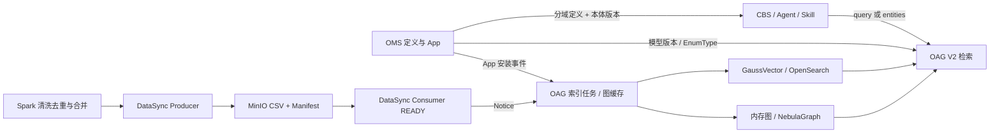
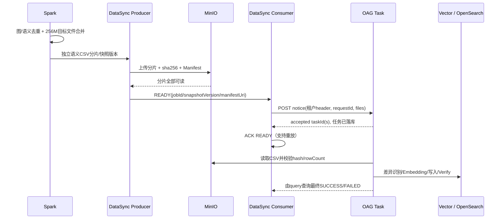
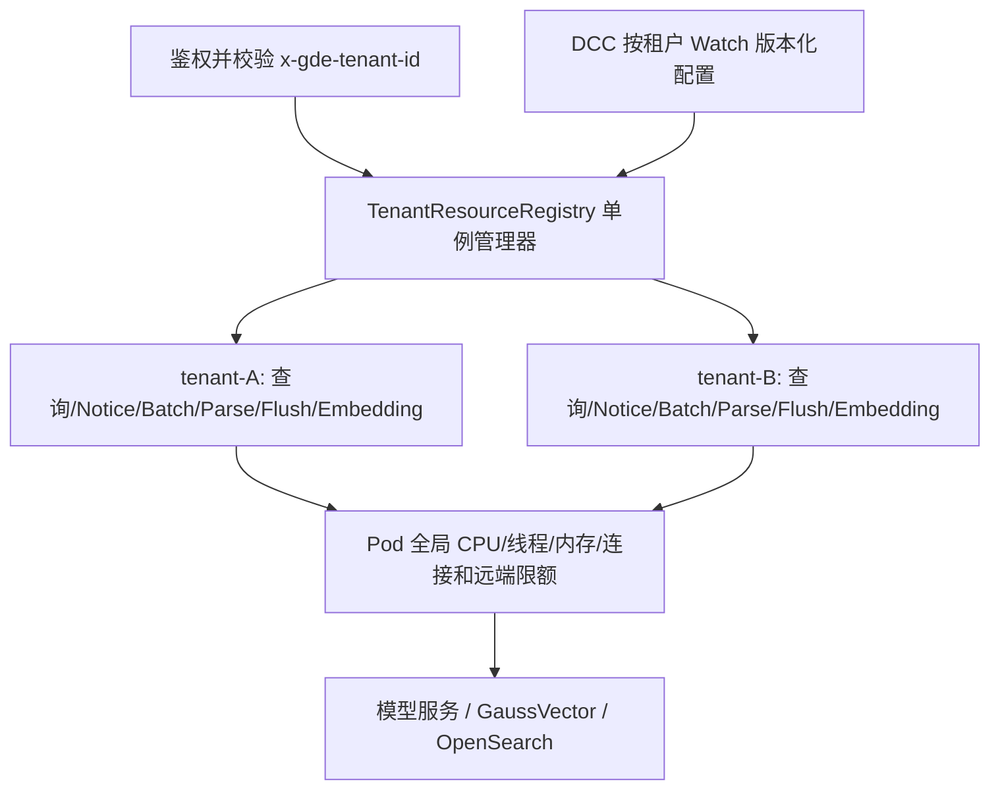

# Agentic Operation Center 27.3.0 功能设计说明书（IRxxx 软件Q4需求）

> 版本：V1.5（2026-11-03）  
> 范围：OMS、OAG、DFx、语义索引构建与检索、DataSync/Spark 联调、本体安全及 Skill 接口  
> 设计目标：面向 CBS 软件上车场景，统一本体模型访问与子图检索能力，实现索引自动化构建、增量同步、水平扩展、租户资源隔离和性能规格化管理。

---

## 1. 设计目标、场景与需求基线

### 1.1 业务背景与目标

CBS 面向运营商问账、集团客户问账，以及经营、销售、运营、运维人员的问计、问因和辅助决策。例如预付费账户数量、优惠余额、套餐月活 TOP3、账单风险等。业务 IRB 目标为**准确率 90%、业务端到端 5 分钟**；OAG 单接口按照独立检索性能规格验收。当前 CBS 本体参考规模为 **144 个 ObjectType、2896 个 Property、370 个 Relationship、11 个业务域**，模型仍在迭代。


本期 Q4 的重点是让 OMS/OAG 具备**安全交付、接口统一、自动索引、多实例扩展、配置治理、可恢复的数据同步与可量化的检索性能**。

**验收标准**：CBS 问账、问计、问因用例覆盖预付费账户、优惠余额、套餐月活及账单风险等场景；业务准确率 90% 和端到端 5 分钟由 CBS 业务验收，OMS/OAG 独立记录各自接口指标。

### 1.2 最新目标与交付边界

| 目标 | 最新要求 | 主责 |
|---|---|---|
| OMS 安全 / DFx | 模型加密参数拆分，详细方案跟随《本体模型文件支持加密》；OMS 分域/定义接口及 Agent/OMS 双级缓存 | OMS/GDE |
| 公共 DFx | OMS/OAG 场景包分层与恢复指导书遵循 GDE 统一要求 | OMS/OAG/GDE |
| OAG 统一 | V2 query/entities 双模式、Skill V1 → V2，枚举不建索引、Property 全量返回枚举 | OAG/Skill |
| App 自动化 | **先修复手动创建索引偶现问题**，再自动触发建索引及图缓存刷新 | OMS/OAG |
| 全量增量 | 1000 万行首次全量、10 万行增量；DataSync 异步生产通知、Spark 合并小文件及前置去重 | Spark/DataSync/OAG |
| 租户资源 | **线程池、队列与并发配额按租户划分，线程池资源参数按租户 DCC 监听**；系统级参数不进入 DCC | OAG/配置底座 |
| 子图查询 | **原始 10 QPS/3s 目标保留**；10-26 附件定义 2U4G/10 QPS/平均 ≤5s、极端拒绝 <20%，3U4G 建议压测；两口径需联合评审 | OAG/性能测试 |
| 检索预研与安全 | 仅 OpenSearch 倒排检索及 ID-only 安全索引要共同评审 | OMS/OAG/安全 |

**实施范围**：按 Q4-01～Q4-20 组织模块交付。OMS/OAG 与 GDE 公共能力及模型加密专项集成；V2 接口、DCC Watch、LVQ 按功能设计实施，实例 Delete 复用现有 CSV 操作能力并完成接口联调验收。

**验收标准**：Q4-01～Q4-20 均有对应的功能模块、建设内容和责任边界；接口统一、自动索引、多实例、数据同步、配置治理、安全能力分别具备对应验收入口。

### 1.3 术语、责任边界与主链路

| 术语/责任 | 本文明确的边界 |
|---|---|
| OMS | 本体定义、EnumType、分域分组、模型版本、App 安装状态与元数据权限的权威来源 |
| OAG | 定义索引和 Instance 值索引、V2 子图检索、内存图、异步任务生命周期、索引发布与租户资源隔离 |
| CBS/业务 Agent | 缓存分域本体定义，提供 query 或提前抽取的 entities，并结合 OAG 返回子图和业务知识完成业务推理 |
| Spark | 计算侧生成图与语义索引数据、合并小文件、两类数据按完整业务键去重 |
| DataSync Producer/Consumer | 负责 MinIO 不可变文件、Manifest 和 READY 消息的生产及通知，调用 OAG Notice 触发异步索引任务 |
| GaussVector / OpenSearch / NebulaGraph | 实例 Vector、词法倒排、图数据/内存图回源的不同存储依赖；故障与版本发布分别管理 |
| DCC | 租户线程池与配额等候选运行参数的动态配置来源，真实 SDK/命名空间需与平台底座核实 |
| 稳定业务键 | 实例值逻辑键 `(tenantId, ontologyId, objectTypeId, propertyId, normalized(value))`；若按租户/本体物理隔离，可在单表内使用后三项，**原值归一化规则必须冻结** |



**数据一致性**：Notice 请求由持久化 Task 记录受理状态；索引完成后发布成功状态。OMS/OAG 在同租户、同本体下读取当前生效模型及索引版本，按鉴权结果隔离敏感数据。

**验收标准**：OMS/OAG/CBS/Spark/DataSync/DCC 的数据与操作责任能够逐跳定位；使用同租户同本体执行查询、索引通知和数据加载时，业务键、任务标识与权限范围一致。

### 1.4 最新需求范围与需求清单（2026-10-31）

本期建设范围包含 OMS、OAG、DFx、性能与安全共 20 项需求，按 Q4-01～Q4-20 建立设计和验收对应关系。

| 需求编号 | 模块与能力 | 需求描述 | 详细设计 |
|---|---|---|---|
| Q4-01 | OMS / 本体加密 | 参数拆分；详细方案跟随《本体模型文件支持加密》 | §2.1、§6 |
| Q4-02 | DFx / OMS 分域 | 分域/本体定义接口规范，Agent 缓存+OMS 内部缓存避免实时全量查询 | §2.2 |
| Q4-03 | DFx / OMS 多实例 | 水平扩展及负载分担 | §2.3 |
| Q4-04 | DFx / OMS 恢复 | 公共故障恢复指导书，跟随 GDE 统一要求 | §2.5 |
| Q4-05 | DFx / OMS 配置 | 场景包参数分层，跟随 GDE 统一要求 | §2.4、§7 |
| Q4-06 | OAG / 统一接口 | 服务/软件场景统一；默认不建枚举检索索引，子图属性全量返回枚举 | §3.1 |
| Q4-07 | 接口统一 / Skill | V1 切换 V2，V1 标记 deprecated | §3.2 |
| Q4-08 | DFx / 自动索引 | **先修复手动建索引偶现问题**，再由 OMS App 安装触发 OAG 建索引并刷新图 | §3.3 |
| Q4-09 | DFx / 多实例 | OAG 多实例、内存图同步刷新及接口负载分担 | §3.4 |
| Q4-10 | DFx / 配置分层 | 组网参数场景包、系统参数配置中心、任务参数 API；租户线程池/DCC Watch | §3.5、§7 |
| Q4-11 | DFx / 恢复 | 公共故障恢复指导书，跟随 GDE 统一要求 | §3.5 |
| Q4-12 | 性能 / 数据导入 | **单表 1000 万行全量（100 万用户）、10 万行增量**；DataSync Producer/Consumer 异步通知（爱华）、Spark 目标 256M 小文件合并（振鲁）及图/语义去重、Embedding/向量库资源与入库规格 | §4.1、§4.7 |
| Q4-13 | 性能 / 子图查询 | **原始需求：单实例 10 QPS、3 s，并支持水平扩展**；10-26 测试附件：2U4G 10 QPS、平均 ≤5 s、拒绝 <20%——两种口径并列，验收优先级待冻结 | §5.1、§8 |
| Q4-14 | 性能 / 定义索引 | 数据库全量比对、差异 Embedding | §4.2 |
| Q4-15 | 性能 / LVQ | LVQ 建表前置、COPY 后免 rebuild 的目标及 DCC COPY 大小调优 | §4.5 |
| Q4-16 | 性能 / 删除 | 复用现有 CSV `op=DELETE` 能力，完成语义索引 Delete 接口联调 | §4.6 |
| Q4-17 | 性能 / 增量 | Incremental 在向量库比对，缺失/变化才向量化插入 | §4.3 |
| Q4-18 | 性能/准确率 / 预研 | 实例值只进 OpenSearch 不进向量库，OMS 配语义字段；关键词单路路由及覆盖范围评估 | §5.3 |
| Q4-19 | 安全 / 索引字段 | 向量/OpenSearch 去名称描述、ID 反查内存图/NebulaGraph，详情跟随加密专项 | §6.1 |
| Q4-20 | 安全 / 明文屏蔽 | 后台日志及前端子图明文脱敏，通过加密堆栈参数控制，详情跟随加密专项 | §6.2 |

**实施顺序**：首先修复手动建索引偶现问题，再完成 Spark→DataSync→MinIO→OAG 全量/增量入库，落地按租户 DCC 的线程池与队列隔离。子图检索按 **10 QPS/3s 业务目标**和 **2U4G、10 QPS、平均 5s 测试规格**分别验收；Q4-18 关键词单路检索与 Q4-19 安全索引规范联合设计。

**验收标准**：20 项原始需求编号连续且唯一，每项均指向具体设计章节；1000 万全量、10 万增量、10 QPS/3s、附件 5s、GDE 参数和安全专项要求均可追溯。

### 1.5 需求到设计与验收追踪

| 设计专题 | 需求项 | 主要交付 | 验收用例组 |
|---|---|---|---|
| OMS 安全、分域及可用性 | Q4-01～05 | 模型加密、查询/缓存规范、OMS 集群、场景包参数与恢复手册 | OMS-Q4-01～05 |
| OAG V2 与 App 自动交付 | Q4-06～09 | 统一 V2、Skill 迁移、自动建索引和多实例图刷新 | OAG-Q4-06～09 |
| 配置及高可用 | Q4-10～11 | 分层参数、DCC 演进、多实例恢复手册 | DFx-Q4-10～11 |
| 索引与检索性能 | Q4-12～17 | FULL/INCREMENTAL/DELETE、数据库差异同步、LVQ 预研、压测与资源模型 | IDX-Q4-12～17 |
| 倒排-only 与安全 | Q4-18～20 | 属性检索模式预研、索引明文治理、日志/界面保护 | SEC-Q4-18～20 |

**验收标准**：20 项需求与设计章节、§8.1 验收用例完成一一对应；业务与平台联合评审按编号定位设计、测试证据和责任模块。


---

## 2. OMS 功能设计：本体加密、分域访问与高可用（Q4-01～05）


### 2.1 本体模型加密与参数拆分（Q4-01）

OMS 完成本体加密相关参数拆分，实现组网级参数、系统级参数和接口级参数的分层配置。模型安装、升级、回滚及多实例加载过程传递统一加密参数，并完成模型权限、密钥依赖和配置校验。加密算法、密钥格式与堆栈开关遵循《本体模型文件支持加密》的统一设计。OMS、OAG 完成加密模型的索引构建、查询及权限联调。

**验收标准**：加密参数在场景包、系统配置及任务入口按级别生效；加密本体完成首次安装、升级、回滚和多实例加载，OMS 定义查询与 OAG 子图检索按授权规则获得一致模型。

### 2.2 分域查询与定义接口、Agent/OMS 双级缓存（Q4-02）

OMS 基于现有内存图提供本体分域查询和定义查询能力。业务 Agent 在会话开始或分域切换时加载相关本体定义，并缓存对象、属性和关系信息；后续轮次优先读取 Agent 缓存。OMS 使用内存图完成服务端查询与缓存，实现业务 Agent 与 OMS 两级查询加速。

| 功能 | 接口 | 处理说明 |
|---|---|---|
| 分域列表查询 | `GET /api/v1/ontologies/{ontologyId}/list` | 根据租户、本体 ID 和权限返回可见分组 |
| 分域成员查询 | `POST /api/v1/ontologies/{ontologyId}/group/members` | 根据分组 ID 获取 ObjectType、Property 和 Relation 成员定义 |
| 本体定义查询 | OMS 既有本体定义查询接口 | 批量获取对象、属性及关系定义，复用服务端内存图 |

**缓存策略**：Agent 缓存按 `(tenantId, ontologyId, groupId, 会话/授权范围)` 管理，模型发生变更时更新对应缓存；OMS 内存图统一提供当前有效本体定义。对话流内复用已加载分域，减少 OMS 远程调用与网络消耗。缓存命中率、加载耗时、OMS 请求量及堆内存按会话和租户统计。

**性能规格与资源评估**：OMS 单实例按 **1U2G** 部署配置开展分域接口服务级压测，测试场景为 **10 个在线会话、10 路并发，单次分域/定义查询 3 秒内完成**。基于业务真实分域模型，同时设置 Agent 缓存命中与首次加载两组负载，记录 1U2G 条件下的成功 QPS、平均/P95/最大时延、CPU/内存、图缓存占用和 GC。预期能力为在 Agent 复用缓存的常态下支撑 10 会话并发访问；**最终单实例可承载并发数按 1U2G 压测结果确认**，并据此配置服务限流和容量扩展阈值。

**验收标准**：采用 1U2G OMS 单实例，10 在线会话、10 路并发，单次分域/定义请求 3 秒内完成；冷缓存、Agent 缓存命中和模型变更后刷新分别有请求耗时、命中率、CPU、内存和 GC 测试记录。

### 2.3 OMS 多实例水平扩展（Q4-03）

待确认：DSP mesh istogateway 增加配置？

OMS 使用 LB/网关统一接入，基于健康实例与连接负载将分域和定义查询请求**均匀路由至多个 OMS 实例**。每个实例加载本体内存图并提供独立查询能力，支持 1→2→3 实例水平扩容、负载分担和故障实例自动摘流。

OMS 多实例内存图刷新、模型加密加载和变更通知按《本体模型文件支持加密》统一机制实施。新实例完成内存图加载与健康检查后加入服务池；实例退出后由网关将请求分配至其他健康节点。验证 1U2G 单实例基准、双实例并发能力、负载均衡比例、实例故障接管及扩容后的查询耗时。

**验收标准**：完成 OMS 1/2/3 实例负载测试，网关对健康实例分担流量；滚动升级、实例退出和新实例接入后，分域查询成功率、内存图一致性与服务可用性符合测试方案。

### 2.4 OMS 场景包参数分层与交付参数治理（Q4-05）

OMS、OAG 的场景包参数统一执行 GDE 参数分级规范，通过**业务定制范围、交付填写范围、内置参数范围**三级分类控制安装表单规模。场景包中声明模型加密、内存图、实例副本、资源配额及服务依赖等安装参数，系统级运行参数进入配置中心，单次任务参数由 API 传递。

**场景包参数规范**：

| 规则 | 设计与实现要求 |
|---|---|
| GDE 版本管理 | GDE 版本信息由部署版本清单与发布制品管理，`values.yaml` 只保存安装运行配置 |
| Solution 参数选取 | 每个参数具有业务定制标识和 Solution 纳管标识；业务需要定制的参数进入 Solution。依赖场景包声明的只读或内置参数根据安装协议继续保留在 Solution |
| 交付填写分类 | `invisible=true` 对应传统 `customized`，由业务定制及后台自动填充；`invisible=false` 或省略对应传统 `productize`，在交付表单中呈现 |
| 只读参数 | `readonly=true` 默认配置 `invisible=true`，由交付模板或系统生成有效值 |
| **国际化** | Solution 中所有参数提供中、英文展示名称、描述、单位、取值范围及错误提示；按交付语言呈现 |
| CBS 交付开放项 | **副本数、CPU/内存等资源配置**按 CBS 交付要求向交付人员开放填写，采用 `invisible=false` 并提供边界校验 |
| 参数分级 | 组网参数由场景包声明，系统参数由配置中心管理，租户资源参数由 DCC 按租户监听，任务参数由接口传递 |

**参数分类示例**（字段表达参数语义，具体 Solution Schema 名称与 GDE 安装规范对齐）：

```yaml
parameters:
  - name: replicaCount
    inSolution: true
    invisible: false
    readonly: false
    default: 2
    i18n:
      zh: {name: "服务副本数", description: "部署的 OMS/OAG 服务实例数量"}
      en: {name: "Service replicas", description: "Number of OMS/OAG instances"}
  - name: cpuLimit
    inSolution: true
    invisible: false
    readonly: false
    i18n:
      zh: {name: "CPU资源上限", description: "单实例CPU资源配置"}
      en: {name: "CPU limit", description: "CPU resources per instance"}
  - name: modelKeyReference
    inSolution: true
    invisible: true
    readonly: true
    i18n:
      zh: {name: "模型密钥引用", description: "系统自动注入的密钥引用"}
      en: {name: "Model key reference", description: "System-provided key reference"}
```

**实现流程**：梳理现有 `values.yaml` 与 Solution 参数清单 → 标记业务定制/交付填写/内置参数 → 设置 `invisible`、`readonly` 和国际化信息 → 校验 CBS 副本与资源参数的开放范围 → 执行首次安装、升级、回滚及多语言场景包回归。安装页面统计交付可见参数数量，形成交付配置清单和默认值清单。

**验收标准**：检查 values.yaml 中的 GDE 版本信息由发布清单管理；所有 Solution 参数具备业务定制与交付填写分类，readonly 参数默认 invisible=true、交付填写参数按 invisible=false 呈现；CBS 副本、CPU/内存可填写，中英文提示完整，首次安装/升级/回滚均验证配置有效。

### 2.5 OMS 故障快速恢复（Q4-04）

OMS 按 GDE 公共故障恢复规范补充本体模型加载失败、分域查询超时、缓存异常、加密参数异常、实例退出及 App 安装失败等场景的操作指导。每个场景包含故障现象、诊断指标、恢复步骤、恢复后的业务校验和演练记录。RTO、RPO 与恢复入口执行 GDE 统一标准。

**验收标准**：本体加载、缓存、加密配置、分域查询、实例故障及安装失败均有 Runbook；逐场景完成故障注入、操作恢复、健康检查、业务回归和 GDE RTO/RPO 记录。


## 3. OAG 统一接口、自动交付与高可用（Q4-06～11）


### 3.1 服务/软件场景统一 V2 本体子图接口（Q4-06）

OAG 提供统一的本体语义子图检索接口，支持自然语言问题和业务已抽取实体两种输入。服务场景使用 `query`，软件场景使用 `entities` 并关闭重复的对象/属性链接处理。子图返回对象、属性、关系、Function 与 Action 的模型信息，并按属性类型装配枚举和实例值。

**接口**：`POST /v2/onto-retrieval/subgraph/semantic-search`，`Content-Type: application/json`。

| 参数 | 类型与默认值 | 功能说明 |
|---|---|---|
| `ontologyId` | String，必填，1～256 字符 | 指定当前检索本体 |
| `query` | String，可选，1～1024 字符 | 输入自然语言业务问题 |
| `entities` | String，可选，1～102400 字符 | 输入 JSON String 形式的结构化实体，优先执行此模式 |
| `adaptiveRetrieval` | int，默认 1 | 软件实体检索时设置 0 |
| `seedRetrievalMode` | `vector/keyword/hybrid`，默认 `vector` | 设置种子检索通道；Skill 使用 `hybrid` |
| `similarityThreshold` | 默认 0.6 | 向量检索相似度阈值 |
| `topk` | 默认 3 | 设置每阶段候选数量 |
| `graphExpansionStrategy` / `hopLimit` | 默认 minimal / 3 | 设置子图构建策略及跳数 |
| `includeFunctions` / `includeActions` | 默认 0 / 0 | 控制模型附加信息返回 |

**软件场景组合**：`entities` 非空，`adaptiveRetrieval=0`，配置 `enableObjectLinking=false`、`enablePropertyLinking=false`、`enablePropertyValueLinking=true`、`includeAllProperties=true`。`extractedEntities` 至少包含一个 `objectType`；每个 `propertyValues` 项携带实例 `value`，`property` 支持空串或省略，用于按对象下全部可检索实例字段进行链接。对象种子经裁剪后连接成最小连通子图，属性通过 `has_property` 边补齐。

**请求示例**：

```json
{
  "ontologyId": "dtmi.ontology.example.1",
  "query": "How many prepaid accounts are there?",
  "entities": "{\"entities\":{\"extractedEntities\":[{\"objectType\":\"Account\"}],\"propertyValues\":[{\"objectType\":\"Account\",\"propertyValues\":[{\"property\":\"paymentType\",\"value\":\"prepaid\"}]}]}}",
  "adaptiveRetrieval": 0,
  "seedRetrievalMode": "hybrid",
  "similarityThreshold": 0.7,
  "topk": 2,
  "graphExpansionStrategy": "minimal",
  "includeFunctions": 0,
  "includeActions": 0
}
```

**响应**：`resultCode/resultMessage/result`；`result` 下返回 `seedNodes/nodes/edges/functions/actions/propertyValuesLinks`。`seedNodes` 存储 ObjectType 种子；Property 节点顶层根据属性类别返回 `propertyEnumValues`（OMS EnumType 全量枚举）和 `propertyInstanceValues`（实例属性命中值），`properties` 存储 name、dataType、enumDataType 等属性元数据。`propertyValuesLinks` 保存值链接候选、规范值及分数。兼容期同时支持 query 模式的 `nodes[].type` 和 entities 模式的 `nodes[].label/properties` 两种结构，统一接口 DTO 逐步收敛。枚举值采用 OMS 权威定义并随属性全量返回，实例值检索访问 `t_oag_instance_{ontologyId}`。

**验收标准**：V2 query-only、entities-only、双输入各自返回符合 DTO 的有效子图；实体值检索访问 Instance 索引，Property 装配全量 Enum；topk、adaptiveRetrieval=0、空属性字段及非法参数具备稳定结果与错误码。

### 3.2 Skill 和脚本从 V1 迁移到 V2（Q4-07）

**Skill 改造范围**：`ontology-platform-unified-skill/SKILL.md` 与 `ontology-platform-unified-skill/scripts/semantic_subgraph_search.py` 统一调用 `/v2/onto-retrieval/subgraph/semantic-search`；Body 使用 `ontologyId` 与 `topk`，支持 query-only、entities-only 及双输入模式，加入请求参数校验、HTTP 错误检查、业务响应校验和稳定错误返回。

**Skill 调用**：

```bash
python scripts/semantic_subgraph_search.py --query "<问题/业务主题>"
python scripts/semantic_subgraph_search.py --ontology-id "<本体ID>" --entities-file ./entities.json --adaptive-retrieval 0
python scripts/semantic_subgraph_search.py --query-json @request-v2.json
```

自然语言调用通过环境变量 `ONTOLOGY_ID` 指定本体，同时配置 `SERVICE_NAMESPACE`、`TENANT_ID`。`--entities-file`、`--entities` 支持结构化实体输入并序列化为 HTTP JSON String；完整 Body 保留用户显式 0 值。脚本对 HTTP、业务响应和网络错误进行分类处理，失败时返回稳定错误结构及非零退出码，保留 `message_type=message_ontololgy_subgraph` 兼容包装。

**V1 兼容与退役**：V1 端点进入 deprecated 管理，Skill 与调用方逐步切换 V2。运行期记录 V1 流量和调用来源，完成业务回归与灰度回退验证后依据正式退役审批实施下线。

**验收标准**：Skill 默认请求 V2；query、entities、JSON 文件和混合输入可运行，零值参数按输入保留；HTTP 异常、业务失败和超时返回非零退出码及诊断信息，V1 调用监控与兼容回退可用。

### 3.3 App 安装自动创建索引、刷新内存图（Q4-08）

**第一阶段：修复手动创建索引异常。**

故障复现步骤：

1. 完成环境与本体 App 初始安装，确认 OMS 本体定义可查询。
2. 在管理页面手动执行创建本体索引，等待任务状态显示创建成功。
3. 调用 V2 本体子图检索接口，使用可命中的对象或业务问题进行查询。
4. 检查返回的 `result.nodes/result.edges` 是否为空，并核对索引表记录数、内存图节点数及检索日志。
5. 在相同安装环境重复执行上述流程，定位“索引任务成功、子图检索返回空结果”的偶发场景。

修复索引创建成功状态与实际检索可用状态的联动，建立索引数据、内存图加载和检索返回的统一校验。验证检索可用后完成手动建索引验收。

**第二阶段（后续规划）：App 安装自动化。** OMS 在本体 App 安装或更新完成后调用 OAG 创建索引接口；OAG 依次执行创建索引任务、构建定义索引、刷新内存图和检索验证，任务成功后对外提供新模型检索能力。重复安装按租户、本体和任务标识幂等处理，失败任务按可恢复阶段重试；安装、建索引及子图检索完成状态在 OMS/OAG 管理界面可查询。

**验收标准**：按初始安装→手动建索引→子图检索复现路径验证修复，Task SUCCESS 对应可命中子图；自动化阶段 OMS App 安装触发 OAG 索引创建、图刷新和结果校验，重复安装幂等、失败可重试。

### 3.4 OAG 多实例水平扩展、内存图刷新与负载分担（Q4-09）

待确认：DSP mesh istogateway，阮潇潇

OAG 经 LB/网关将检索请求均匀路由至健康实例，支持多实例水平扩容和租户流量分担。每个实例在本地内存中**仅维护当前最新本体图版本**，服务启动或模型发生更新时从 OMS/图存储加载最新定义并整体刷新内存图。模型变更完成后通知各 OAG 实例同步刷新；遗漏通知的实例通过定期版本检查恢复一致。

本体图缓存采用按租户和本体隔离的内存管理方式，刷新后清理旧图占用，保障每个实例的内存预算。索引后台任务由持久化任务状态与租约机制协调执行，故障实例的任务根据 Checkpoint 恢复。

多实例验收覆盖 1/2/3 Pod 负载分担、网关路由均匀度、最新内存图刷新、一台 Pod 退出、Pod 重启后的图加载、租户隔离和检索结果一致性。按单实例与双实例的吞吐及下游依赖利用率评估横向扩容收益。

**验收标准**：1/2/3 Pod 在网关负载分担下获得一致的最新内存图；模型更新、Pod 重启及通知重放后各实例图数据和检索结果一致，旧图缓存完成释放并记录内存占用。

### 3.5 OAG 参数分层与公共故障恢复（Q4-10～11）

分层规则见 §7.1；OAG 按租户配置独立线程池、队列与并发上限，运行期通过 DCC Listener/Watch 实施参数热更新，容器资源由全局上限统一控制。故障恢复按 GDE 规范接入。

故障快速恢复**跟随 GDE 公共需求**，OAG 专项增加：Embedding 服务 503、Instance Task 卡住、MinIO READY/NOTICE 丢失、租户队列饥饿/配置 Watch 错误、图缓存版本 不一致等场景。提交证据包括监控/日志、恢复动作与演练结果；RTO/RPO 仍按 GDE 统一要求执行。

**验收标准**：场景包、系统级、DCC 租户级和任务级配置各自按规定来源生效；Embedding 503、Notice 丢失、租户队列异常及图缓存异常完成恢复演练与告警验证。


---

## 4. 实例索引构建、差异同步与性能（Q4-12、Q4-14～17）

索引构建端到端流程：
[索引数据入库流程](https://clouddragon.huawei.com/cloudmodeling/myspace/diagram?diagramId=cd0f1a95f5c1401fbb74e2b62f488570)


### 4.1 Spark/DataSync 全量与增量数据入库、1000 万行验收（Q4-12）

**原始规格**：单表首次全量 **1000 万行 / 100 万用户**，增量 **10 万行**。源需求的三项措施及责任不合并：

1. **DataSync 生产者—消费者异步（爱华）**：Producer 接收 Spark 生成的语义索引 CSV 并写入 MinIO 不可变文件，全部写入完成后发布 READY；Consumer 获取 READY 后调用 `index-data/notice`，OAG 按文件地址读取 CSV 并异步完成构建。该机制使 CSV 上传与 OAG 索引构建并行解耦。
2. **Spark 合并小文件（振鲁）**：计算侧按对象粒度合并图数据/语义索引小文件，**目标单文件 256M**。
3. **Spark 图/语义去重前移**：图按完整顶点/边复合键及事件版本去重；语义按 `(tenantId, ontologyId, objectTypeId, propertyId, normalized(value))` 去重。新的语义索引文件由 Spark 单独生成，DataSync 直接上传 MinIO；**后端仍保留唯一索引与幂等**，避免跨批、回放和乱序导致 COPY 主键冲突。



**验收标准**：Spark 完成图/语义去重和目标文件合并，DataSync READY/Notice 可靠投递；按 Manifest 核对源文件、Task 状态和目标数据，异常重试后成功记录一致。

#### 4.1.1 全量与增量同步性能测试结果

入库测试采用 **OAG 3U4G、8/16 并发**及两类服务器，统计各阶段的处理速率与总耗时。

| 测试模型 | 服务器类型 | OAG规格 | 数据量 | 测试场景 | OAG接口同步（条/s） | Embedding读数据（条/s） | 向量入库（条/s） | 总耗时（s） |
|---|---|---|---|---|---:|---:|---:|---:|
| 单文件全量 | 920C 物理机 | 3U4G | 10万 | 8并发 | 345.01 | 526.73 | 814.71 | 289.85 |
| 单文件全量 | HV6 虚拟机 | 3U4G | 18万 | 8并发 | 340.74 | 463.32 | 706.09 | 528.26 |
| 多文件10并发全量 | 920C 物理机 | 3U4G | 200万 | 8并发 | 262.81 | 215.18 | 316.83 | 7610.10 |
| 多文件10并发增量 | 920C 物理机 | 3U4G | 20万 | 8并发 | 403.80 | 859.52 | 770.90 | 505.20 |
| 多文件10并发全量 | 920C 物理机 | 3U4G | 20万 | 16并发 | 387.32 | 1550.39 | 556.49 | 526.70 |
| 多文件10并发增量 | 920C 物理机 | 3U4G | 20万 | 16并发 | 451.32 | 1252.11 | 826.45 | 452.00 |

**验收标准**：六组测试样本的环境、并发数、数据量、各阶段 rows/s 和总耗时完整保留；复测按相同输入与资源条件报告阶段瓶颈和结果差异。

#### 4.1.2 100 万用户/1000 万行验证与容量评估

**服务级测试数据**：以业务测试构造的 **94 万条实例值数据**为基线，按业务对象、属性、值长度及数据分布扩展至 **100 万用户、单表 1000 万行实例值索引数据**。生成数据保持原有属性分布与合法对象归属，增量样本单独构建 10 万行；记录原始条数、扩充条数和去重后条数。

**测试场景**：

| 场景 | 数据规模 | 验证内容 |
|---|---|---|
| 首次全量同步 | 单表 1000 万条 | 端到端：Spark/MinIO/Notice/Embedding/向量库完整流水线，统计总耗时和资源消耗，服务级：通过压测脚本调用notice和query接口 |
| 增量同步 | 10 万条 | 端到端：Spark/MinIO/Notice/Embedding/向量库完整流水线，统计总耗时和资源消耗，服务级：通过压测脚本调用notice和query接口 |
| 多实例同步 | OAG 1/2/3 实例，Embedding 1/2/3 副本 | 验证批处理并发、模型副本扩容、GaussVector 写入能力及水平扩容效率 |
| 异常恢复 | 文件重传、任务重试、Pod 退出、模型超时、数据库连接异常 | 验证任务幂等、续处理与完整性校验 |

**性能容量计算**：选用已测 **20 万条、多文件 10 并发、16 线程、增量同步**场景的 OAG 接口同步速率 `R_base=451.32 条/s` 作为容量估算基线。

| 计算参数 | 数值与用途 |
|---|---|
| 基准吞吐 | `451.32 条/s`，来自既有增量场景实测 |
| 首次全量规模 | `10,000,000` 条，预计 **6.15 小时** |
| 增量规模 | `100,000` 条，预计 **3.69 分钟** |
| 实测条件 | 920C、OAG 3U4G、多文件 10 并发、16 线程 |
| 复测重点 | 全量与增量分别采集真实端到端 TPS、Embedding TPS、COPY TPS、OpenSearch Bulk TPS、CPU/内存和磁盘 IO |

以上耗时作为单实例容量规划基准。首次全量与已有增量测试的执行路径和数据新增率分别评测，并在同一软硬件条件下记录**实测耗时与预测耗时的偏差**；多实例按实际吞吐与瓶颈测算扩展效率。

**验收标准**：完成 94 万条业务数据扩充至单表 1000 万条的可复现样本、10 万条独立增量样本及源/目标行数对账；生成全量、增量实际 TPS 和资源报告，核对增量 Embedding 仅处理新增键，记录容量估算偏差与扩容收益。

### 4.2 本体定义索引：全量比对与差异 Embedding（Q4-14）

**功能目标**：针对 OMS 的 ObjectType、Property、Relationship 等本体定义建立差异化语义索引更新能力，按定义唯一 ID 和标准化语义文本进行全量对比，复用未变化定义的 Embedding，提升本体模型索引重建效率。Instance Value 的独立临时表差异方案见 §4.3。

**处理流程**：

1. **读取模型定义**：获取租户、本体 ID、完整模型版本和全部定义记录，统一规范用于检索的名称、描述、同义词及语言信息，计算定义语义文本摘要。
2. **识别差异**：以本体定义的稳定 ID 与类型定位现有索引，对比本体模型版本、Embedding 模型版本、向量维度及语义文本摘要，分别形成新增、语义变化、元数据变化、复用和删除集合。
3. **增量向量化**：新增与语义变化记录执行 Embedding；语义摘要一致且模型参数相同的记录复用原向量；仅元数据变化的记录同步更新相应词法信息和模型属性。
4. **批量入库与清理**：按定义索引表实际唯一约束批量插入或更新。OMS 完整模型快照加载和对账成功后，依据权威定义集合清理已删除的定义索引，并记录索引总量、新增量、复用量及本次向量化数量。
5. **模型生效**：定义索引构建成功后与 OMS 当前本体定义、OAG 内存图进行版本一致性核查；多实例按照 §3.4 完成当前模型图刷新，查询入口使用已校验的定义与索引数据。

**实现约束**：定义索引使用自身的 Definition ID、Definition Type 和语义摘要进行比较，数据库字段与唯一键按现有 Mapper/DDL 确认；§4.3.1 的 GaussDB 差异 SQL 使用 Instance 业务组合键，适用于实例值差异验证。

**验收标准**：分别构造首次全量构建、相同模型再次构建、定义文本变化、仅元数据变化、定义删除和 Embedding 模型版本变化场景。相同语义文本及模型版本复用已有向量，新增与语义变化记录完成 Embedding，定义索引数量与 OMS 当前完整模型一致；任务统计、索引结果和多实例内存图版本可核对。

### 4.3 Instance 值增量：每批独立 TEMP B、数据库差异、Embedding 与幂等写入（Q4-17）

**增量索引方案**：每批默认 **4000 条**，每个批次创建独立 TEMP B，执行数据库差异识别、对新增组合键计算 Embedding，并将新数据幂等写入正式表 A。批次独立到达、独立处理，存量向量按组合键直接复用。

**验收标准**：每批默认 4000 条创建独立 TEMP B，稳定组合键差异识别后仅新增记录进入 Embedding；正式表 A 唯一键保证跨批次及重复 Notice 的幂等结果，任务保留可恢复 Checkpoint。

#### 4.3.1 GaussDB 实例新增数据差异查询

**数据库差异识别**：使用 `test` 作为待写入实例值表、`t_oag_instance_...` 作为正式实例索引表，通过 `NOT EXISTS` 查询新增组合键。目标版本执行 TEMP/ON COMMIT DROP、UPSERT 与 LVQ 方言兼容验证。

```sql
SELECT
    test."value",
    test.object_type_id,
    test.property_id
FROM test
WHERE NOT EXISTS (
    SELECT 1
    FROM "t_oag_instance_dtmi.ontology.65313863.1"
    WHERE "t_oag_instance_dtmi.ontology.65313863.1"."value" = test."value"
      AND "t_oag_instance_dtmi.ontology.65313863.1".object_type_id = test.object_type_id
      AND "t_oag_instance_dtmi.ontology.65313863.1".property_id = test.property_id
);
```

源验证结果：

```text
value         | object_type_id                         | property_id
温控器A        | oag_instance_dtmi.ontology.65313863.1 | P1001
3号车间-东区   | oag_instance_dtmi.ontology.65313863.1 | P1002
(2 rows)
```

**正式索引表 A 结构（用于组合键与向量列设计）**：

```sql
create table if not exists "${tableName}"
(
    vector floatvector(${vectorDim}) not null,
    value VARCHAR(4096),
    synonyms text,
    property_id VARCHAR(512) not null,
    property_name VARCHAR(512),
    object_type_id VARCHAR(256) not null,
    object_type_name VARCHAR(512),
    CONSTRAINT "uk_instance_${tableName}"
      PRIMARY KEY (object_type_id, property_id, value)
);
```

动态表名 `${tableName}` 由服务端根据租户/本体白名单生成并按 SQL 标识符规则引用。临时表 B 单独定义三个业务键字段，正式表 A 使用带向量列的完整结构，确保批量差异识别与向量写入职责分离。

**验收标准**：GaussDB NOT EXISTS 对比查询返回新增完整业务键，验证原有两条差异样例；在目标数据库版本执行 TEMP/ON COMMIT DROP 和冲突写入语法测试。

#### 4.3.2 独立临时表命名、防冲突与生命周期

| 项目 | 规范与原因 |
|---|---|
| 推荐表名 | `tmp_oag_emb_b_<batch_uuid32>`，示例 `tmp_oag_emb_b_a81f62c0d93e4b728f614c039ae725bd` |
| 生成规则 | 每批/每次重试由**服务端**生成独立 UUID v4、去连字符、转 32 位小写 hex；不使用毫秒时间戳/线程号/外部批次号直接拼表名 |
| 长度/过滤 | 共 **46 个 ASCII 字节**（固定前缀14+UUID32），≤PostgreSQL 常见 63 字节限制；正则 `^tmp_oag_emb_b_[0-9a-f]{32}$`，SQL identifier 按白名单校验后引用 |
| 两层隔离 | UUID 唯一表名 + `pg_temp` 会话级隔离；各 JDBC 连接持有独立 TEMP 表，同一连接按事务自动释放 |
| DDL/事务 | `CREATE TEMP TABLE ... ON COMMIT DROP`；创建、插入及差异查询均在**同一 JDBC Connection** 的短事务中完成 |
| 数据类型 | B 只有 `value, object_type_id, property_id` 三列，按正式 A 类型（如 VARCHAR(4096)/VARCHAR(256)/VARCHAR(512)）定义，均 NOT NULL，不存 vector；默认一批约 4000 行，不建 B 索引 |
| 并发 | 每批 B 独立、不同批次可交错到达；唯一键仍由 A 的非延迟唯一约束保障。临时表不会承担跨批次互斥 |

**标识符示意（Java）**：

```java
private static final Pattern TEMP_NAME =
    Pattern.compile("^tmp_oag_emb_b_[0-9a-f]{32}$");

static String newTempTableName() {
    String name = "tmp_oag_emb_b_" +
        UUID.randomUUID().toString().replace("-", "");
    if (!TEMP_NAME.matcher(name).matches()) {
        throw new IllegalStateException("invalid temp name");
    }
    return name;
}

static String tempRef(String name) {
    if (!TEMP_NAME.matcher(name).matches()) {
        throw new IllegalArgumentException("unsafe temp identifier");
    }
    return "pg_temp.\"" + name + "\"";
}
```

**验收标准**：并行批次生成的 UUID32 TEMP 表名唯一、符合长度与白名单格式，JDBC 同一连接内完成表生命周期；事务 COMMIT/ROLLBACK 后 TEMP 释放，并发连接间数据相互隔离。

#### 4.3.3 一批新增数据的 SQL 与事务时序

**阶段 I：短事务（创建 B、装载、找新键）**，B 的创建和查询绑定同一连接。在 PostgreSQL 兼容版本可采用：

```sql
BEGIN;
CREATE TEMP TABLE "tmp_oag_emb_b_a81f62c0d93e4b728f614c039ae725bd" (
    "value" VARCHAR(4096) NOT NULL,
    object_type_id VARCHAR(256) NOT NULL,
    property_id VARCHAR(512) NOT NULL
) ON COMMIT DROP;

-- 同一 JDBC 事务中的 PreparedStatement 批量 INSERT，参数严格绑定
INSERT INTO pg_temp."tmp_oag_emb_b_a81f62c0d93e4b728f614c039ae725bd"
    ("value", object_type_id, property_id) VALUES (?, ?, ?);

-- A 为经白名单解析、加 schema 引用的本体实例正式表
SELECT b."value", b.object_type_id, b.property_id
FROM (
    SELECT DISTINCT "value", object_type_id, property_id
    FROM pg_temp."tmp_oag_emb_b_a81f62c0d93e4b728f614c039ae725bd"
) b
WHERE NOT EXISTS (
    SELECT 1 FROM public."t_oag_instance_dtmi.ontology.65313863.1" a
    WHERE a."value" = b."value"
      AND a.object_type_id = b.object_type_id
      AND a.property_id = b.property_id
);
COMMIT;
```

**事务边界**：`SELECT` ResultSet 全量读取到 Java List 后 COMMIT，`ON COMMIT DROP` 自动释放 B。Spring TransactionTemplate 与 JdbcTemplate 使用同一 DataSource；远程 Embedding 在事务外执行。目标 GaussVector 版本通过 TEMP、ON COMMIT DROP 与 ON CONFLICT 方言验证后启用适配 Mapper。

**阶段 II：Java 增量 Embedding**：仅对 DISTINCT 新增键计算向量，每批默认 4000 条，以模型请求 size32 进一步切片；例如新增 200 条时产生约 7 次模型调用。校验输出数量、维度和有限浮点数，模型失败转可恢复任务重试。跨批次键可用 SingleFlight/锁减少重复计算，数据库唯一键保证最终存量数据一致。

**阶段 III：独立短事务，将有效向量批量写入 A**（PG 兼容语义示意）：

```sql
INSERT INTO public."t_oag_instance_dtmi.ontology.65313863.1"
    ("value", object_type_id, property_id, vector)
VALUES (?, ?, ?, ?)
ON CONFLICT (object_type_id, property_id, "value")
DO NOTHING;
```


| 事务段 | TEMP 存活 | 失败恢复 |
|---|---|---|
| I：CREATE B / JDBC BATCH / anti-join | 在短事务中 | ROLLBACK 后本事务创建表消失；重放同一原始批次 |
| II：Java Embedding | B 在上一步提交后自动释放 | 独立于数据库事务执行；失败时根据持久化 Task/源文件重新处理 |
| III：向量写入 A / OpenSearch 补写 | 不依赖 B | A 主键冲突幂等跳过；OpenSearch 失败按 Task checkpoint 重试 |
| 全部完成 | 无 TEMP | 标记可观测成功，跨批次无需等待全量结束 |

**并发去重控制**：两个 Pod 同时识别相同新增键时，A 唯一索引执行最终防重；根据重复模型调用比例选配跨实例 SingleFlight/分布式租约（续租与 fencing），取得许可后再次检查 A。持续监控高频 TEMP 建表产生的系统目录和 Autovacuum 开销。

**验收标准**：同一物理连接完成 B 装载与差异查询，提交后才进入 Java Embedding；重复键跳过向量化，新增向量维度正确并幂等插入 A，三阶段故障可恢复。

#### 4.3.4 FULL_REPLACE、INCREMENTAL 与 CLEAR 的处理边界

- **首次 FULL_REPLACE**：首次安装按完整快照执行 Embedding、COPY、LVQ 索引构建及全部文件校验，完成后将索引任务置为 SUCCESS 并开放实例检索。
- **后续 FULL_REPLACE**：业务侧依次调用现有 `CLEAR` 任务接口、查询并确认清理完成，再提交完整 `FULL_REPLACE` 文件进行全量导入；OAG 复用首次全量的入库流程。业务按照清理、导入和校验的执行时间安排索引维护窗口，索引可用状态由对应 Task 结果反馈。
- **INCREMENTAL**：每批通过 TEMP B 比对新增业务键并向量化插入；CSV `op=DELETE` 沿用既有逐行删除逻辑，按业务键从相关实例索引中删除。逐批处理与 §4.6 的 Delete 联调使用同一 `INCREMENTAL` 模式。
- **CLEAR**：清理当前租户、本体对应的完整 Instance 索引，通过索引管理任务及授权范围执行。CLEAR 与运行中的 INCREMENTAL 按任务顺序/版本水位协调，清理完成后再接收后续 FULL 导入。

**验收标准**：首次全量完成所有文件校验并开放索引；后续全量按 **CLEAR 成功→FULL_REPLACE 导入→全量校验** 顺序执行，任务状态、清理行数和最终入库行数可核对；INCREMENTAL 新增与 CSV DELETE 按独立业务组合键生效，重复消息、乱序通知及异常恢复遵循 Task 幂等规则。

#### 4.3.5 配置、负载边界与验收

默认**单业务批 4000**（需从 DCC 注册映射到现有 `batchInstance.maxBatchSize` 并解决 1000/4000 代码默认差异），示例差异子批 JDBC 500、Embedding 请求 size32、插入 200、并发批 8 均为**压测起点非正式默认**。`copy-batch-size` 需与逻辑 Batch 区分并以 §4.5 为准。按租户限制连接池与查询线程，创建/建表频率、diff rows、Embedding HTTP in-flight、冲突跳过、写入总行数都可按 Task 查看。

测试：覆盖 0/10/100% 新键、批内与跨批去重、双 Pod 并发、事务回滚、任务恢复、Property ID 校验、正式表旧向量复用、OpenSearch 部分失败补写及 FULL 快照隔离。

**验收标准**：0%/10%/100% 新键、多 Pod 重叠、跨批复用、数据库失败与模型失败全部通过；按租户输出 Batch、COPY、Embedding 配额和耗时，记录系统目录占用及恢复成功率。

### 4.4 Embedding 并发与批量入库资源控制（Q4-12、14、17）

**数据处理流程**：`Notice → Task → CSV Parse → Batch De-dup → Diff → Embedding → GaussVector COPY/Upsert → OpenSearch Bulk → Verify/Publish`。改造涉及 `IndexTaskService`、`InstanceIndexServiceImpl`、`InstanceVectorServiceImpl`、`InstanceVectorBaseMapper.xml` 和 `ElasticSearchRestRepository`。

- **租户线程资源**：Notice、Parse、Instance Batch、Flush、Embedding 的 Worker 与队列按 tenant 独立配置，DCC 监听租户级参数，各 Pod 使用 CPU、线程、HTTP 连接、GaussVector 连接池与内存全局预算。
- **实际并发**：`parseFile.threadPoolSize=20`、`batchInstance.threadPoolSize=8/20`、`parallelFlush.Size=8/20`、`notice.threadPoolSize=20` 按真实执行阶段核准默认值；`ConfiguredEmbeddingModel.embedAll` 通过模型 HTTP in-flight 信号量实施最终并发控制。
- **失败与上下文**：每个任务设置 tenantId/traceId/模型版本并在完成后清理 ThreadLocal；校验模型输出数量、维度及 NaN/Inf，失败任务写入稳定错误码与 Checkpoint 并重试。OpenSearch Bulk 对失败文档补写，两库校验一致后完成任务。
- **DCC 调优**：分别管理 `batchInstance.maxBatchSize`（逻辑批次）、Embedding 请求大小、`parallelFlush.Size`（写入并发）和 `copy-batch-size`（COPY 分片）。在线缩容先控制新任务准入，随后排空旧连接并切换配额。

**验收标准**：对租户线程池、HTTP in-flight、COPY 批量、数据库连接及队列实施资源上限；模型输出数量与维度校验、503 重试、OpenSearch Bulk 部分失败恢复均有 Task 日志和最终双库对账结果。

### 4.5 LVQ 建表预建与 COPY 入库优化（Q4-15）

**设计流程**：实例数据建表时创建 LVQ 索引，COPY 完成并校验后直接发布；`InstanceVectorBaseMapper.xml` 的建表分支集成空表建索引过程，成功路径跳过 COPY 后的 `rebuildindex`，并通过配置支持数据库兼容回退。COPY 分片大小由租户 DCC 管理。

**LVQ 建表 SQL**：在向量表创建后、COPY 之前创建 LVQ 索引，距离算子和并行度按 GaussVector 版本及资源规格确定。

```sql
-- 建表及校验后、第一批 COPY 之前执行；需要先确认目标 GaussVector 语法
CREATE INDEX tablename_idx_lvq ON tablename
USING gsdiskann (vector COSINE)
WITH (
  enable_pq = true,
  lvq_nclus = 128,
  subgraph_count = 1,
  quantization_type = 'lvq',
  num_parallels = 5,
  enable_vector_copy = false,
  build_with_quantized_vector = true
);
```

**处理流程**：

1. 建表服务通过“预建 LVQ”配置创建与 `floatvector(${vectorDim})` 匹配的物理表及唯一约束，随后执行对应数据库版本支持的 LVQ DDL。索引存在性及可用性验证成功后启动 COPY；DDL 失败时 Task 记录明确错误码并进入可恢复失败状态。
2. 按租户 DCC `copy-batch-size` 配置 COPY 分片，以 1000/4000 为测试起点调优；COPY 分片、JDBC 写入和 Embedding 请求分别使用独立批次参数。基于 batch Checkpoint 支持失败重试，同一本体版本的建索引 Task 按持久化状态协调执行。
3. `COPY` 全批完成后校验行数、唯一约束、LVQ 索引状态、Recall 与查询样本，Task 状态转为 VERIFYING→SUCCESS。默认使用预建 LVQ 流程；目标数据库空表建索引能力验证异常时，按配置切换原后建索引流程并记录版本和耗时。
4. `SET maintenance_work_mem='4GB'` 作为 GaussVector 数据库会话级建索引参数评估，结合数据库内存与并行 DDL 数量配置资源上限。

**A/B 回归**：A 组执行建表→COPY→建/重建 LVQ；B 组执行建表→LVQ→COPY→索引校验。使用相同模型、1000 万行、数据库版本与副本数比较总耗时、rows/s、IO/CPU、写放大、Recall@K、P95、任务重试和恢复结果。**依据端到端吞吐收益、召回准确率及数据库版本兼容性选择正式方案**；DCC 变更同步提供租户配置快照、生效记录和回退验证。

**验收标准**：空表预建 LVQ 后完成 COPY，校验索引可查询、行数一致和 Recall@K；与后建 LVQ 的 A/B 数据一致，报告端到端总耗时、IO、P95 与数据库方言兼容结果，COPY Batch DCC 变更可回退。

### 4.6 实例语义索引 Delete 操作联调（Q4-16）

**功能定位**：实例索引已有 CSV 逐行 `op=DELETE` 能力，本期完成 DataSync 与 OAG 的删除接口联调，复用现有 Notice、Task Query、失败重试及 GaussVector/OpenSearch 删除处理逻辑。`FULL_REPLACE`、`INCREMENTAL` 和 `CLEAR` 的任务模式及全量处理流程由 §4.3.4 统一规定。

**接口与输入**：调用 `POST /v1/onto-retrieval/{ontologyId}/index-data/notice`，使用现有 `IndexFileImportRequest` 的 `requestId`、`dataType=INSTANCE_VALUE`、`importMode=INCREMENTAL`、`files` 等字段。DataSync 在 CSV 中为待删除记录设置 **`op=DELETE`**，由 `property_id`、`object_type_id`、`value` 确定稳定业务组合键，`property_name` 和 `object_type_name` 用于模型归属校验，`synonyms` 按现有 CSV 规范提供。请求通过 `x-gde-tenant-id` 传递授权租户，索引任务接口按 §7.3 执行。

**联调流程**：

1. **删除数据准备**：Spark/DataSync 根据业务删除事件生成 `INSTANCE_VALUE` CSV，校验对象、属性、实例值和 `op=DELETE`，上传 MinIO 后通过 Notice 通知 OAG。
2. **任务受理与校验**：OAG 根据 `requestId`、租户、本体和文件标识创建幂等任务，校验 CSV 记录及业务组合键，沿用当前实例值索引操作分发逻辑处理 DELETE。
3. **删除入库与状态回传**：OAG 按组合键执行 GaussVector 和 OpenSearch 删除，汇总处理条数、成功/失败数量和错误码；DataSync 通过 Task Query 查询最终结果。
4. **失败重试与数据对账**：按既有 Task Retry/Checkpoint 流程恢复失败文件或记录，以同一业务键比对两类索引的删除结果，并通过事件水位与幂等机制校验重复/乱序通知。

**CSV 删除测试数据**：

```csv
property_id,property_name,object_type_id,object_type_name,value,synonyms,op
P1001,paymentType,O1001,Account,Prepaid,,DELETE
P1002,accountId,O1001,Account,100000000000006990,,DELETE
```

**验收标准**：完成 DataSync→MinIO→Notice→OAG→GaussVector/OpenSearch 的 Delete 联调；对单条、批量、重复、乱序及跨租户删除事件进行验证，目标业务键在向量库与倒排库保持一致。Notice 幂等受理、Task Query 状态反馈、失败 Retry/Checkpoint 恢复、错误码与处理条数均有可重复的测试记录。联调复用现有 CSV `op` 和索引任务协议。

### 4.7 全链路联调、故障回滚与容量报告（Q4-12、14～17）

联调执行顺序：① 10 万样本验证 Producer READY/Consumer ACK/Task 受理；② 200 万已有数据环境复测；③ 1000 万首次 FULL；④ 10 万 INCREMENTAL 且 0/10/100% 新值；⑤ 基于 CSV `op=DELETE` 完成接口联调，并按 CLEAR→FULL_REPLACE 顺序验证后续全量；⑥ 1/2/3 Pod 和 1/2/3 Embedding 副本。测试固定模型与数据、`DCC configVersion`、CPU/Pod/DB 版本和索引策略，每轮调整一组变量。

故障测试覆盖上传失败、Manifest 缺分片、Checksum 异常、Notice 重放、TEMP 回滚、模型 503/限流、JDBC 断开、COPY 唯一键冲突、OpenSearch Bulk 部分失败、LVQ DDL 兼容、Task Cancel、Pod 重启及任务并发。每类异常提供稳定错误码、Checkpoint 和恢复流程；INCREMENTAL 故障期间保持已生效数据可查询，后续全量按维护窗口完成 CLEAR、FULL_REPLACE 和结果校验。

**容量报表字段**：`tenantId（脱敏）/ontologyId/modelVersion/jobId/sourceRowCount/afterSparkDistinct/inputFiles/manifestBytes/taskCount/aExisting/aNew/embeddedRows/vectorInserted/lexicalInserted/deletedRows/lvqBuilt/totalWallTime/activePods/embeddingReplicas/actualEmbeddingTPS/gaussIOPS/opensearchBulkTPS/minioReadMBps`。首次全量按完整 Manifest 校验入库结果；后续全量记录 CLEAR Task 成功时间、FULL_REPLACE Task 成功时间和数据恢复可用时间。

**验收标准**：完整执行 10 万、200 万、1000 万及多实例联调，报告源数据数、去重数、嵌入数、向量与倒排写入数、删除数、失败/恢复数和各阶段时长；增量故障保留已发布索引的查询能力，后续全量通过 CLEAR→FULL_REPLACE 的 Task 状态及数据行数对账确认恢复结果。


## 5. 查询性能、OAG 横扩与分级索引预研（Q4-13、Q4-18）


### 5.1 子图检索性能规格与水平扩容（Q4-13）

**查询性能规格**：业务需求单实例 **10 QPS / 3 秒**，软件场景基准为 **2U4G、10 QPS、平均耗时 ≤5 秒、极端场景限流拒绝率 <20%**，建议使用 **3U4G** 开展对照压测。先验证基准平均 ≤5s，再按业务 3s 目标评估优化效果，统计口径由性能评审统一定义。

**指标范围**：OAG 子图检索统计实体链接、实体裁剪和子图构建三个阶段，按单接口入口至响应完成计算时延。CBS 问题切词、OQL/Cypher 执行、业务数据访问和 Agent 端到端时间由业务侧分别统计；OMS 分域接口按 §2.2 的 10 并发/3 秒独立测量。

| 约束 | 10-26 附件参数 | 测试说明 |
|---|---|---|
| 本体规模 | ObjectType ≤150 / Property ≤3000 / Edge ≤400 | CBS 原参考 144/2896/370，超上限需新基线 |
| 单 Pod 资源 | 2U4G，图缓存预算 1GB、≤10 本体 | 2U4G 作为基准，3U4G 独立测试并记录资源差异 |
| CPU 单核 | SHA-256 256B ≥280万 ops/s、≥700MB/s | 同 VM/物理机/架构记录 |
| 输入规模 | extractedEntities <20；propertyValues 1-4:40%、4-8:50%、8-12:<10% | 对 4/8 分桶边界与数据比例完成签认 |
| 请求 | 10 请求/秒，连续 1000 请求，CXO 黄金测试集 L1 | 记录真实发送时间与完成响应时间 |
| 语义参数 | hybrid、similarityThreshold=0.7、V2 `topk≤3`、`hopLimit≤3`、minimal | includeFunctions=0、includeActions=0 |
| 自适应 | adaptiveRetrieval=1 | 小本体 ≤300 节点全量；软件生产通常 entities+adaptive=0，**两模式分别评估** |
| 缓存 / 预热 | 关闭 `subgraph-retrieval-cache-switch`，重启后预热 ≥3min，前 3 次测试结果剔除 | 查询高峰与实例向量化入库错峰 |
| 指标 | 10 QPS、平均 ≤5s、极端拒绝率 <20% | 同步报告成功 QPS、超时、错误、P50/P95/P99 |
| 基准硬件 | 920C 物理机、HV6/E9000 等局点 | 按硬件架构分别测试和报告 |

**OAG 与 Embedding 联动扩容**：

**扩容能力评估**：OAG 1→2 Pod 的吞吐目标为 10→20 QPS，Embedding 模型服务以 **120 条/s** 的单副本观察值作为压测起点，2 副本理论为 240 条/s。扩容结果由网关负载均衡、模型真实请求速率、GaussVector/OpenSearch 容量及网络性能共同决定；按模型副本数输出实测吞吐与服务降级指标。

| 测试矩阵 | OAG Pod | Embedding 副本 | 入口目标 | 要回答的问题 |
|---|---:|---:|---|---|
| 基线 | 1 | 1 | 10 QPS | 2U4G/3U4G 两套单实例基线 |
| 仅 OAG 扩容 | 2 | 1 | 20 QPS（目标） | 下游模型是否先饱和，是否真正翻倍 |
| 联动扩容 | 2 | 2 | 20 QPS（目标） | 模型吞吐、数据库/检索引擎是否成为瓶颈 |
| 可扩展性 | 3 | 3 | 30 QPS（探索） | 同租户全局限流、租户公平与效率曲线 |
| 故障降级 | 2 | 2→1 | 10/20 QPS 梯度 | 模型副本丢失、OAG 重路由与 503/429 比例 |

每组分别执行**入口固定总 QPS**和**每 Pod 固定 QPS**测试，统计 `QPS_success/QPS_offered`、Pod 负载方差、模型 in-flight、数据库与检索服务时延、网关重试和响应耗时。通过对比模型扩容、OAG 资源扩容和租户队列设置，量化原始 3s 目标的优化空间；硬件档位、时延统计分母及目标归属由性能评审统一确认。

**验收标准**：2U4G 单实例按 10 QPS、1000 连续请求复现平均 ≤5 秒与约束工作负载拒绝率 <20%；单独记录原始 3 秒优化目标的实测差距，3U4G、2/3 Pod 与 Embedding 多副本按相同数据报告扩展效率。

### 5.2 按租户的查询准入、信号量与过载保护（Q4-10、13）

`semantic-search.max-pool-size=30`、`semantic-search.queue-capacity=50`、`semantic-search.timeout-seconds=300` 为资源参数候选值；查询并发许可、工作线程与实际 QPS 分别计量。根据 tenantId 分配租户队列、许可与 Pod 全局配额。

准入步骤：`authTenant → resource lookup → tryAcquire(tenant semaphore) → 有界入队/按规则拒绝 → 执行 OAG → finally 释放许可`。查询入口按租户记录排队、执行、拒绝和超时；采用异步排队与短等待保护 HTTP 工作线程，按标准错误码区分限流与 Istio 上游 503。在线缩容保留运行中的请求并排空旧队列。

压测覆盖稳定 10QPS、超量突发、2/3 Pod 同租户并发、Embedding 模型延迟和 DCC 断连；保存租户配置快照、拒绝分母及入口重试次数，并按实际负载定义目标拒绝比例。

**验收标准**：认证租户拥有独立查询许可与队列，全局资源限制生效；10 QPS 稳态、突发限流、两个租户并行、DCC Watch 异常及 Pod 扩容场景均输出成功 QPS、排队时长、拒绝率和隔离结果。

### 5.3 OMS Property `retrieval` 索引模式扩展设计（Q4-18，预研）

**检索模式配置**：在现有 `retrieval.enabled` 基础上增加可选 `indexMode`，取值为 `KEYWORD_ONLY`、`VECTOR_ONLY` 和 `HYBRID`。当 `enabled=true` 且 indexMode 省略时使用 HYBRID；`enabled=false` 时跳过实例语义索引构建。

**OMS Property 检索属性定义**：在现有 `id/name/display/description/status/extensions/dataType/refSynonymTypeName/createdAt` 等字段基础上，扩展 `retrieval.indexMode`。

```json
{
  "id": "dtmi.65313863.property-type.38396236-3130393330653430.1",
  "name": "accountId",
  "dataType": "long",
  "retrieval": {
    "enabled": true,
    "indexMode": "KEYWORD_ONLY"
  }
}
```

完整字段表：

| 字段 | 类型 | 默认 / 取值 | 规则 |
|---|---|---|---|
| `retrieval.enabled` | boolean | 沿用模型既有值，如 `false` | **false=不构建实例语义索引，也不参与值召回**；属性仍可在 OMS 建模/Binding/子图属性补全出现 |
| `retrieval.indexMode` | string（可省略） | `HYBRID`（当 enabled=true 且字段缺失时） | `KEYWORD_ONLY` / `VECTOR_ONLY` / `HYBRID`；建议仅 enabled=true 时生效 |
| `retrieval` 整体缺失 | 继承既有模型规范 | 不在本文另行改变 enabled 的缺省 | 防止新字段引入对旧模型的隐式索引启用 |

**`retrieval` 字段结构定义**：

```json
{
  "type": "object",
  "properties": {
    "enabled": {"type": "boolean"},
    "indexMode": {
      "type": "string",
      "enum": ["KEYWORD_ONLY", "VECTOR_ONLY", "HYBRID"],
      "default": "HYBRID"
    }
  },
  "required": ["enabled"],
  "additionalProperties": true
}
```

`default` 是 JSON Schema 的缺省注释约定，OMS/OAG 运行时执行默认值填充。整个 `retrieval` 缺失时采用 OMS 原有 enabled 缺省规则。

**四种有效运行状态**：

| enabled / indexMode | OpenSearch | GaussVector | Embedding | 查询通道 |
|---|---|---|---|---|
| `false` / 任意（建议不填） | 不建 | 不建 | 不调用 | 无 |
| `true` / 字段省略或 `HYBRID` | 建 | 建 | 调用 | Keyword + Vector，RRF 或既有融合 |
| `true` / `KEYWORD_ONLY` | **建** | 不建 | 不调用 | **仅 Keyword** |
| `true` / `VECTOR_ONLY` | 不建 | **建** | 调用 | **仅 Vector** |


**查询路由与融合**：Instance Value Linking 按 `objectType+propertyId` 加载 indexMode，并与 seedRetrievalMode 交集。hybrid+KEYWORD_ONLY 执行 Keyword，hybrid+VECTOR_ONLY 执行 Vector；单通道以实际结果计分，双通道用 RRF 融合。similarityThreshold 作用于 Vector。vector+KEYWORD_ONLY 返回空候选和模式诊断。property 省略/空串时遍历本 ObjectType 中 enabled=true 的语义字段。

**Instance 索引存储范围**：`HYBRID` 和 `KEYWORD_ONLY` 的有效属性值写入 OpenSearch；`HYBRID` 和 `VECTOR_ONLY` 写入 GaussVector；`enabled=false` 时保留 OMS 属性定义及子图属性补齐能力。**EnumType/values[] 统一由 OMS 本体定义装配并全量返回**，检索索引仅用于实例值召回。

**索引安全与召回协同**：Q4-19 按 ID 管理名称和描述，Q4-18 的 Keyword-only 模式采用经安全评审授权的词法字段，结合精确检索和业务召回要求确定字段保留范围。

**预研验收**：验证四状态的实际索引内容与 Embedding 调用次数；全文/向量单通道路由、hybrid 的 RRF 与 topK；本体版本更新、检索模式切换与删除、跨租户隔离、无 property 过滤时的对象内字段路由；使用纯数字 AccountId、英文/中文短文本、同义词测试 Recall@K/Precision@K、磁盘量、入库/查询耗时。正式 DTO 字段名和值取值、模式变化是全量重建还是增量、禁用后索引删除授权等由 OMS/OAG/安全联评后冻结。

**验收标准**：retrieval.enabled 和 indexMode 的停用、关键词、向量、混合状态分别生成对应索引；单/双检索通道路由及 RRF 满足配置，AccountId 数值、中文/英文、同义词黄金集有 Recall@K、Precision@K、资源与兼容性报告。


---

## 6. 数据安全与明文治理（Q4-19～20）


### 6.1 向量与 OpenSearch 去名称描述、按 ID 回查（Q4-19）

**本体索引字段治理**：向量与全文索引以稳定 ID、归属和必要元数据存储，名称、描述经 OMS 内存图或 NebulaGraph 按 ID 回查，严格实施租户授权。保留字段范围、加密格式及密钥轮换执行《本体模型文件支持加密》。

**关键词检索安全策略**：在 ID-only 模式下支持基于授权 ID 的精确检索；需要 BM25 与模糊匹配的属性按安全策略保留受控词法字段，并对两种配置分别测试 Recall@K、字段泄露风险、回查耗时与兼容性。

**验收标准**：向量与 OpenSearch 字段清单按加密专项审核，ID 回查的对象、属性和租户权限正确；ID-only 精确检索和授权词法字段两种策略分别完成安全、Recall 和性能测试。

### 6.2 后台日志与前端子图明文脱敏（Q4-20）

**明文管控策略**：后台日志与前端子图展示均由**加密堆栈参数**控制；常态生产日志输出业务标识、节点/边数量与诊断错误码等最小必要信息，授权调试场景在安全审批后开启受控明文日志并记录审计。前端根据角色和环境执行子图字段脱敏，参数默认值及授权策略按《本体模型文件支持加密》统一确认。

后台根据加密堆栈参数控制日志字段明文，授权调试场景开启审计；常态日志记录 traceId、模型版本、节点/边数、Task ID 和错误码。前端和服务端按角色执行子图字段脱敏，统一覆盖响应、导出、异常栈和 APM。安全配置进入系统级部署参数，由 OMS/OAG 完成联调与回归。

**验收标准**：授权调试与常态环境按加密堆栈配置呈现相应日志字段；前端子图、服务端响应、导出及异常记录按角色脱敏，记录审计证据与跨租户权限回归结果。


---

## 7. 参数分层、DCC 租户监听与资源池隔离（Q4-05、Q4-10）


### 7.1 参数统计口径与分级原则

**参数清单**：新增 `@Value` 声明 115 处、83 个唯一 Key，其中已分类的 72 项包含 38 个租户 DCC 配置候选和 34 个系统级参数；剩余 11 项完成源码归属核查并补齐配置清单。

| 分级 | 配置来源与示例 | 配置原则 |
|---|---|---|
| 场景包/部署组网 | `onto_encrypt`、`oag.cache.type`、图数据库依赖 | 由场景包和 GDE 组网参数管理 |
| **租户级 DCC** | §7.2 的线程池、资源准入、检索/排序、功能开关、索引任务参数 | **按租户隔离资源/队列，按租户 Watch/推送更新，具备资源上限、审计和安全回退** |
| 系统级配置 | MinIO、Nebula、OpenSearch、数据库、证书、namespace、Pod/日志/探针 | 系统配置中心、Secret、部署底座统一管理 |
| 请求/任务级 | V2 query/entities、topk、hopLimit、jobId、snapshotVersion、COPY 任务模式 | 原 API 参数不自动提升为 DCC；请求可覆盖项受安全/资源限额约束 |

**参数优先级**：配置读取顺序为 `认证租户 → inputMode(query/entities) → DCC tenant/mode override → DCC 基线 → 版本兼容预置`；Body 明确参数执行接口合法值及默认值，DCC 管理资源/功能级覆盖，Pod 与集群硬上限提供最终保护。Watch 异常时持续使用最近一次有效配置。

**验收标准**：83 个 Key 的统计与 72 个已分类明细及其余 11 个待核对项对账；场景包/系统配置/租户 DCC/任务级的归属表与生效顺序清晰，非法配置按最近有效快照恢复。

### 7.2 DCC 参数清单与分类

DCC 分为四类配置候选，初始值采用服务现有有效配置；对 8/20、1000/4000、1/6 等不同默认值核查代码执行入口，统一租户作用域、参数值域与热更新策略。

**A. 线程池/批处理/模型缓存（10 项，全部明确资源归属）**

| 参数 Key | 附件默认值 | 资源属性与 DCC 生效要求 |
|---|---|---|
| `embedding-thread-core-pool-size` | `8` | 按租户分配 Embedding 执行池 core 线程与全局配额 |
| `embedding-thread-max-pool-size` | `32` | 模型内部租户执行池 max，必须 `core ≤ max` 且受全局预算 |
| `embedding-model-cache-size` | `10` | 按租户管理模型对象缓存容量和内存占用 |
| `embedding-thread-pool-size` | `1` | 控制 Embedding 外层批任务并发，内层 HTTP 并发由独立许可控制 |
| `batchInstance.threadPoolSize` | `8 / 20` | Instance 批次执行资源，租户独立队列/配额，默认冲突待收敛 |
| `batchInstance.maxBatchSize` | `1000 / 4000` | 批处理大小，按 tenant 配置，影响下一批次而非中途重切 |
| `batchInstance.retry` | `3` | 任务失败重试次数，租户级重试节流防止雪崩 |
| `parallelFlush.Size` | `8 / 20` | 向量库并行 Flush 额度；真实 Key 的大小写必须保持并核实实际读取 |
| `parseFile.threadPoolSize` | `20` | CSV 解析资源；按租户限制文件并行处理数和排队 |
| `notice.threadPoolSize` | `20` | Notice/任务消费资源；防止大租户挤占小租户的通知 |

**B. 查询准入、排序/检索与 RRF（16 项）**

| 参数 Key | 附件默认值 | 建议作用域 |
|---|---|---|
| `semantic-search.max-pool-size` | `30` | 租户级查询并发许可（旧 Q4 25，仅历史草案） |
| `semantic-search.queue-capacity` | `50` | 租户级等待队列长度 |
| `semantic-search.timeout-seconds` | `300` | 租户级许可等待超时；300 s 风险需复评 |
| `rrf.k` | `10` | 租户+query/entities 模式的融合平滑参数 |
| `rrf.channel-weights.ontology-object-vector` | `0.5` | 对象 vector 通道权重，核实与 dense 是否为别名 |
| `rrf.channel-weights.ontology-object-lexical` | `0.5` | 对象关键词权重 |
| `rrf.channel-weights.ontology-object-dense` | `0.5` | 对象 dense 权重，注意同义 Key 重复 |
| `rrf.channel-weights.instance-vector` | `0.5` | 实例 vector 通道权重，核实与 dense 是否为别名 |
| `rrf.channel-weights.instance-lexical` | `0.5` | 实例关键词权重 |
| `rrf.channel-weights.instance-dense` | `0.5` | 实例 dense 权重，检查双重加权 |
| `ontology-object-similarity-threshold` | `-1` | 租户/模式覆盖；`-1` 哨兵含义待定义 |
| `instance-similarity-threshold` | `-1` | -1 作为阈值继承标识，由运行时规则解析为有效阈值 |
| `instance-topk` | `-1` | 实例候选 TopK，实际最大值需约束 |
| `rrf-topk` | `-1` | -1 作为继承标识，实际输出按接口 TopK 和全局上限配置 |
| `adjacency-cache-max-size` | `1000` | 租户级图邻接缓存额度，亦受总堆内存约束 |
| `rule-config-path` | 无 | 使用可信 Rule 版本 ID 或系统级白名单路径，并执行安全校验 |

**C. 检索开关 / 子图过滤（7 项）**

| 参数 Key | 附件默认值 | 作用 |
|---|---|---|
| `subgraph.undirected-filter` | `false` | 附件源码默认 false；既有软件 V2 预置 true，需按版本+模式冻结 |
| `enable-object-linking` | `false` | 软件 entities 关闭已对齐对象的二次链接 |
| `enable-property-linking` | `false` | entities 模式复用已对齐属性，query 模式按属性链接策略处理 |
| `enable-property-value-linking` | `true` | 实例值链接访问 Instance 索引，枚举由 OMS 定义全量装配 |
| `include-all-properties` | `true` | Property 属性补全，枚举全量另遵循 Schema |
| `include-keys` | `false` | 控制 Key 属性输出并保持模型归属完整 |
| `subgraph-retrieval-cache-switch` | `true` | 查询缓存开关；**性能压测必须覆盖为 false** |

**D. 索引任务与任务保留（5 项）**

| 参数 Key | 附件默认值 | 作用 |
|---|---|---|
| `index-build.max-retry` | `3` | 租户索引任务失败重试；结合全局重试洪峰控制 |
| `index-task.max-concurrent-tasks` | `10` | 租户后台任务并发许可，另有全局上限 |
| `index-task.queue-length` | `200` | 租户后台排队上限与公平性 |
| `index-task.queue-timeout-hours` | `1 / 6` | 不同源码默认冲突；按任务类别核实实际 timeout |
| `index-task.file-ttl-hours` | `168` | 源文件有效期覆盖任务恢复窗口 |

**系统级排除**：附件第 5/6/7 类标注无需进入 DCC：MinIO scheme/证书/实例名/bucket、GaussVector/OpenSearch 实例名、Nebula IP/port/space、Elasticsearch URI/证书、JDBC 连接、`support_new_tenants`/tenantId 初始化、namespace/镜像模板、`POD_NAME/NODE_NAME/HOST_IP/LOG_LEVEL_CONFIGMAP_PATH` 和探针端口。`server.ssl.trust-store-password` 等敏感信息须由密钥机制管理，**不复制真实密码到 DCC**。上述配置虽涉及环境/租户身份，也不因字段含 tenant 就自动成为租户 DCC 开关。

**配置管理范围**：10 + 16 + 7 + 5 = **38 个租户 DCC 配置候选**，新增 `copy-batch-size` 作为独立的待注册参数；34 个系统级参数由配置中心或 Secret 管理，其余 11 个 Key 按代码实际使用场景归类。

**验收标准**：38 个租户候选与 34 个系统参数逐项确认归属，copy-batch-size 独立登记；各 Key 在租户和输入模式下的默认值、校验范围、修改生效时点与审计信息可检查。

### 7.3 按租户独立资源池、`x-gde-tenant-id` 与索引管理四接口（Q4-10）

**租户识别**：索引任务 Notice、Query、Retry、Cancel 四类接口统一通过 `x-gde-tenant-id` Header 获取已授权租户，并选择对应的资源池；客户端通过 `headers.add("x-gde-tenant-id", tenantId)` 传递租户标识。索引任务管理沿用 V1 API 路径，V2 用于本体子图语义检索。

**验收标准**：Notice、Query、Retry、Cancel 全部使用经过授权的 x-gde-tenant-id，按租户定位任务和资源池；跨租户 taskId、重复 requestId、Pod 故障及 Watch 变更均通过接口与数据隔离测试。

#### 7.3.1 入口、请求头与认证约束

| API | 方法及路径 | Header 与功能说明 |
|---|---|---|
| 文件导入通知 | `POST /v1/onto-retrieval/{ontologyId}/index-data/notice` | `x-gde-tenant-id` 必填，用于模型归属、任务幂等及租户资源池 |
| 批量查询 | `POST /v1/onto-retrieval/{ontologyId}/index-tasks/query` | Header 必填；仅返回本租户、本 ontology 的任务 |
| 批量重试 | `POST /v1/onto-retrieval/{ontologyId}/index-tasks/retry` | Header 必填；只允许操作本租户失败且具备恢复条件的任务 |
| 批量取消 | `POST /v1/onto-retrieval/{ontologyId}/index-tasks/cancel` | Header 必填；只允许操作本租户非终态任务 |

网关真实转发路径参考既有 `OntologyIndexTaskRest` 类级映射：`/onto-retrieval-api/v1/onto-retrieval` + 方法级 `/{ontologyId}/...`；上表为 API 相对路径，不另重复加 v1。`x-gde-tenant-id` 在参考 API 中要求 String、长度不超过 256；增加空白/格式校验、鉴权/授权与审计。`Content-Type: application/json`、`Accept: application/json` 为通用头，追踪沿用服务平台 Trace/Header 规范。

**Java 客户端**：

```java
HttpHeaders headers = new HttpHeaders();
headers.setContentType(MediaType.APPLICATION_JSON);
headers.setAccept(List.of(MediaType.APPLICATION_JSON));
headers.add("x-gde-tenant-id", tenantId); // 从可信会话或鉴权上下文获取
headers.add("X-Request-Id", requestId);
```

**Controller 适配示意**（方法名沿用既有风格；原有 DTO 与任务逻辑保留）：

```java
@RequestMapping("/onto-retrieval-api/v1/onto-retrieval")
public class OntologyIndexTaskRest {
    @PostMapping("/{ontologyId}/index-data/notice")
    public NewBaseRespone<List<AsyncTaskAcceptedResponse>> noticeIndexData(
        @RequestHeader("x-gde-tenant-id") String tenantId,
        @PathVariable("ontologyId") String ontologyId,
        @Valid @RequestBody IndexFileImportRequest request) {
        authorization.checkTenantOntology(tenantId, ontologyId);
        return indexTaskService.createTaskAndExecute(tenantId, ontologyId, request);
    }
}
```

Controller 通过统一鉴权服务校验 tenantId/ontologyId，索引任务创建、查询、重试及取消均按租户条件查询数据库。缺失 Header、租户无权限和跨租户 taskId 返回统一错误码，保护其他租户任务详情。

**验收标准**：四接口的 x-gde-tenant-id Header、JSON Body、租户鉴权、缺失或无权限错误码已完成联调；接口请求返回本租户任务状态，其他租户数据保持隔离。

#### 7.3.2 Query/Retry/Cancel 请求与恢复语义

三接口复用 `BatchTaskIdsRequest` 批量请求：

```json
{"taskIds": ["idx-task-001", "idx-task-002"]}
```

`taskIds` 为非空、去重的 String 数组，最大项数由 `maxTaskIdsPerRequest` 运行限制（参考建议从 100 起步，非已确定默认）；网关、控制器、存储查询均校验 tenant+ontology。

| 方法 | 返回/状态 | 校验与恢复动作 |
|---|---|---|
| `/index-tasks/query` | HTTP 200，建议 DTO `ontologyId/requestedCount/foundCount/tasks[]/notFoundTaskIds[]` | 每 Task 返回 status、stage、total/success/failed/skipped、retryCount、errorCodes、fileList、errFileList、fileRetentionUntil、start/endTime 等；不属于当前租户的 Task 不泄露 |
| `/index-tasks/retry` | HTTP 202，逐任务 accepted/reasonCode | 对失败、重试次数在限额内、文件 TTL 有效且 Checkpoint 可恢复的任务重试，优先处理 errFileList |
| `/index-tasks/cancel` | HTTP 202，逐任务 accepted/reasonCode | 对运行中的任务设置 CANCEL_REQUESTED，Worker 安全退出后置 CANCELLED；重复调用返回幂等结果 |

批量操作返回 operation、requestedCount、acceptedCount、rejectedCount、results[]，单项包含 taskId、accepted、status、stage、reasonCode、message。客户端依据稳定错误码执行恢复，包括 TASK_NOT_FOUND、TASK_STATE_CONFLICT、RETRY_LIMIT_EXCEEDED、SOURCE_FILE_EXPIRED、SOURCE_FILE_MISSING 和 SOURCE_UNRECOVERABLE。

**验收标准**：Query 按 taskIds 返回真实状态与失败原因，Retry 仅恢复符合条件的失败任务，Cancel 在安全检查点结束运行任务；批量部分成功、任务缺失、重复调用与文件过期返回稳定状态。

#### 7.3.3 TenantResourceRegistry 与独立执行资源



**租户资源注册器**：单例 `TenantResourceRegistry` 按 `(tenantId,operationType,configVersion)` 懒创建独立 ExecutorBundle，维护有界队列、Worker 与配额，并支持空闲回收。数据库/模型共享物理连接池通过租户令牌分配容量；ThreadLocal 在执行完毕后清理。集群级额度通过集中配额或网关配额管理。

**接口级验收**：Notice/Query/Retry/Cancel 缺 Header、无权限、Body 伪造 tenant、跨本体 taskIds、两租户同 requestId、Task 部分成功、Cancel/Retry 竞态、DCC Watch 变更/Pod 重启、新租户首访和队列饥饿均应有可重复测试。

**验收标准**：TenantResourceRegistry 为每个活跃租户建立独立 ExecutorBundle；A 租户队列满载时 B 租户仍可正常操作，新租户创建/空闲回收后线程与连接占用符合 Pod 总预算。

### 7.4 DCC 按租户监听、线程池热更新与资源安全迁移

**DCC 配置监听**：采用“注册→租户订阅→加载完整配置→参数校验→热更新资源池→故障回退”的流程。`@Value` 用于初始化静态基线，运行期由配置底座 Listener/Watch 提供租户级配置变更事件。

1. **配置注册与归属**：对 38 个租户 DCC 候选登记 tenantId、operationType、min/max/default 及校验器；新增 copy-batch-size 单独登记。34 个系统级参数进入系统配置中心，其他 11 个 Key 根据源码归属补齐。
2. **懒初始化/租户首次访问**：以可信鉴权 tenantId 初始化该租户完整、**带版本号**的 `TenantConfigSnapshot`，先对同租户 DCC 注册/版本/授权做全量读取，再发布资源包。每 Pod 以单例 Registry 维护多个租户资源包，定期对闲置租户进行 drain/回收；不永久按每租户 max=32 提前分配线程。
3. **监听事件**：按 tenantId+scope 订阅 DCC，通过版本拉取完整配置快照；事件提交受控配置队列后执行线程池调整。
4. **整套校验**：校验 core≤max、队列/批次/超时合法区间、权限白名单及租户/Pod 资源总预算；非法配置保持上次有效值并告警，多个默认值按生效点核准。
5. **安全原子切换**：构建新 TenantConfigSnapshot 与 ExecutorBundle，校验完成后 CAS 切换新任务入口。在途任务继续持有原 configVersion。线程池扩容先 max 后 core，缩容先 core 后 max；队列容量变化使用新队列、旧队列 drain/shutdown。
6. **连接与缓存**：HTTP/模型连接与数据库许可随租户配置热调整，共享连接池按租户配额管理；资源重建时等在途连接归还后关闭旧版本。
7. **异常保护与对账**：DCC 异常采用上次有效配置与系统总预算；Pod 定期按 tenant+configVersion 对账，缩容时保留在途 Embedding/COPY，任务通过 Checkpoint/MinIO 恢复。集群级租户总配额由集中额度或网关管理。
8. **监控与审计**：DCC 审计 + OAG 自身 metrics 记录租户（脱敏）、参数键/旧新版本、生效结果、Pool active/core/max、队列深度、任务拒绝/超时、Embedding in-flight、连接占用、Watch 延迟/重连与配置回滚次数，不记录密钥或完整业务值。

**租户配置监听与资源切换实现示例**：

```java
void onTenantConfigEvent(String tenantId, long eventVersion) {
    configExecutor.execute(() -> {
        TenantConfigSnapshot current = registry.snapshot(tenantId);
        TenantConfigSnapshot next = dccClient.fetchFull(tenantId);
        if (next.version() <= current.version()) {
            return; // 重复/过期事件
        }
        validator.validateAll(next, podGlobalLimits, authorizedScopes);
        TenantExecutorBundle nextBundle =
            registry.prepareBundleOrResize(tenantId, next);
        registry.swapForNewTasks(tenantId, next, nextBundle);
        registry.drainOldBundleAsync(tenantId, current.version());
    });
}

// Task 入队时固定租户与配置版本；执行完成清理线程上下文
TenantExecutorBundle bundle = registry.getOrCreate(verifiedTenantId);
bundle.submit(task.withTenant(verifiedTenantId)
                  .withConfigVersion(bundle.configVersion()));
```

**配置异常恢复**：校验失败、线程池资源分配失败、Watch 断连或旧连接释放延迟时，继续使用最近一次有效配置快照，并记录失败原因；通过完整配置回源与资源重新建立恢复当前租户执行能力。验收见 §7.5、§8.3。

**验收标准**：租户 DCC Watch 的增量事件触发完整配置版本校验并原子更新新任务资源；扩容/缩容期间在途任务完成，事件乱序/断线/非法值场景回退至最近有效配置，多 Pod 版本对账通过。

### 7.5 DCC 参数兼容、冲突和验收

| 决策项 | 配置现状 | 配置策略 |
|---|---|---|
| 搜索并发 | max-pool-size 候选 30/25 | 依据实际可持续并发性能与租户资源预算确认有效值 |
| 批次线程数 | `batchInstance.threadPoolSize=8/20`、`parallelFlush.Size=8/20` | 查源码有效注入点、作用阶段和具体模式后再统一 DCC 默认 |
| 批大小 | `batchInstance.maxBatchSize=1000/4000`，需求另有 COPY 批大小 | 区分逻辑 Batch、COPY 分片与 Spark 合并文件大小；`copy-batch-size` 为**额外待注册 DCC 候选** |
| 任务队列超时 | `index-task.queue-timeout-hours=1/6` | 按任务类型/版本决定，确保不少于消息重放窗口 |
| 无向图 | 统计显示 `undirected-filter=false`，软件 V2 设计 true | 明确租户 + query/entities + 发布版本的生效矩阵并回归，不静默修改 |
| 缓存开关 | 统计 `subgraph-retrieval-cache-switch=true` | **性能压测强制 false**，并保存 DCC 快照与请求参数 |
| RRF 权重 | vector/dense 参数存在同类定义 | 统一融合通道与归一化权重 |
| 配置差异与多实例 | 静态 @Value + DCC 事件 | 完整回放、Watch 重连、Pod 重启和配置版本对账 |
| 容量安全 | 各租户独立线程池 | 校验租户配额总量满足 Pod/节点全局限制 |

**租户隔离验收**：T1 租户 A 高负载时 B 持续查询；T2 A 配额更新后 B 保持原值；T3 A 在线缩容并完成旧任务；T4 多 Pod Watch 断线重连统一版本；T5 异常配置触发旧版回退；T6 租户首次访问与空闲回收；T7 多 Pod 总资源受控。记录线程数、拒绝率、Task 完成率和内存曲线。

**验收标准**：T1～T7 租户隔离测试均有运行日志、线程/队列/内存指标与预期状态；历史默认冲突按代码生效点签审，CPU/连接/线程上限在并发负载下保持有效。


---

## 8. 验收标准、发布门禁与技术决策


### 8.1 最新 20 项需求验收矩阵

| 用例组 | 对应需求 | 最低验收断言/验证依据 |
|---|---|---|
| OMS-Q4-01 | Q4-01 | OMS 加密参数分层/透传与模型文件加密专项一致；加密算法/密钥与安全测试跟随专项 |
| OMS-Q4-02 | Q4-02 | Agent 与 OMS 双层缓存、同 tenant/模型版本/权限一致；**10 个在线会话/10 并发/3 秒内 OMS 响应**分冷/热缓存测试 |
| OMS-Q4-03 | Q4-03 | 2/3 实例负载均衡，OMS 本体版本与读写权限在各 Pod 一致，租户访问符合授权范围 |
| OMS-Q4-04 | Q4-04 | 按 GDE 公共恢复指导书交付 OMS 专项场景、诊断指标及演练记录 |
| OMS-Q4-05 | Q4-05 | 参照 GDE 公共参数分级完成 OMS 场景包/系统/接口参数映射和安装回归 |
| OAG-Q4-06 | Q4-06 | V2 query/entities 检索同入口；不建/不查 t_oag_enum；Property 完整枚举、真实 Instance 映射，移除旧 semanticExtensions |
| OAG-Q4-07 | Q4-07 | 根目录 Skill/脚本迁移 V2，保留历史输出消息包装；7 项离线回归覆盖两种输入、topk/0 值、HTTP/业务失败；V1 deprecated 并盘点历史副本 |
| OAG-Q4-08 | Q4-08 | 完成手动定义索引创建与子图查询判空问题修复；OMS App 自动触发定义索引与内存图刷新，发布版本一致，异常任务保留已生效定义模型 |
| OAG-Q4-09 | Q4-09 | 多 Pod 图缓存与索引本体版本一致、跨实例负载分担，滚动升级与任务接管可恢复 |
| DFx-Q4-10 | Q4-10 | **租户线程池/队列真实隔离且按租户 DCC Watch 生效**；合法变更、缩容 drain、跨 Pod 对账和全局资源限制 |
| DFx-Q4-11 | Q4-11 | OAG 专项故障纳入 GDE 公共 Runbook，有演练、证据和恢复结果 |
| IDX-Q4-12 | Q4-12 | **1000 万行首次全量 / 10 万行增量**；DataSync Producer/Consumer 异步 Notice、Spark 文件合并及图/语义去重；后续全量按 CLEAR→FULL_REPLACE 顺序执行，任务行数对账与故障恢复通过 |
| IDX-Q4-13 | Q4-13 | **原始单实例 10 QPS/3s** 有单独目标和缺口记录；附件 2U4G/10 QPS/平均 ≤5s/拒绝 <20% 可复现，3U4G 压测独立出报告 |
| IDX-Q4-14 | Q4-14 | 相同定义复用既有向量，定义变化时增量 Embedding，并同步词法元数据 |
| IDX-Q4-15 | Q4-15 | 建表时预建 LVQ，COPY 后完成校验与发布；对照测试 Recall/总耗时，COPY 分片由 DCC 调优 |
| IDX-Q4-16 | Q4-16 | 复用现有 `INCREMENTAL` CSV `op=DELETE` 能力完成联调；GaussVector/OpenSearch 数据对账一致，Notice 幂等、Task Query/Retry、重复删除、事件顺序及租户授权回归通过 |
| IDX-Q4-17 | Q4-17 | 已有实例向量按稳定键复用；每批 UUID TEMP B/NOT EXISTS/短事务/唯一键幂等入库；FULL_REPLACE 按 CLEAR 成功后导入的顺序执行，INCREMENTAL 按批次新增/删除生效 |
| SEC-Q4-18 | Q4-18 | OMS retrieval.enabled + 可选 indexMode（HYBRID/KEYWORD_ONLY/VECTOR_ONLY），disabled 不建；混合/单路建库查询、模式迁移、无 property 路由与旧数据兼容 |
| SEC-Q4-19 | Q4-19 | name/description 索引最小化、ID→定义回查与权限正确，严格 ID-only/BM25 矛盾完成加密专项安全评审 |
| SEC-Q4-20 | Q4-20 | 加密堆栈参数控制后台日志明文和前端脱敏；专项认证与生产日志/导出/异常回归无泄露 |

**验收标准**：20 项 Q4 需求分别具有唯一验收行及对应功能证据；测试报告包含通过状态、问题单与责任人，所有上线范围条目经项目评审确认。

### 8.2 子图查询性能专项验收

| 测试编号 | 条件/数据集 | 验证与交付结果 |
|---|---|---|
| PERF-Q4-01 | **2U4G** 单实例；≤150 ObjectType、≤3000 Property、≤400 Edge，静态图 1 GB、≤10 本体 | 固定环境镜像、CPU 单核 SHA-256 ≥280 万 ops/s/700 MB/s、JVM、实例数与本体版本 |
| PERF-Q4-02 | CXO L1 黄金集，entities<20，propertyValues 按 40%/50%/<10% 构造 | 固化 4/8 分桶边界、测试种子和分布 |
| PERF-Q4-03 | hybrid、0.7、topK≤3、hopLimit≤3、adaptive=1、minimal、Functions/Actions=0 | 快照并记录 V2 `topk` 实际绑定、无向开关与 DCC 租户配置；问题缓存 **false** |
| PERF-Q4-04 | 重启预热 3min，前 3 次剔除，查询与后台 Embedding 错峰 | 记录预热时间、缓存开关及测试时间窗口 |
| PERF-Q4-05 | **10 请求/秒，连续 1000 请求**，2U4G 基准 | **平均成功耗时 ≤5 s**（均值统计口径需签审）、拒绝总比例 <20%；同时报告成功 QPS、P50/P95/P99、失败/超时 |
| PERF-Q4-06 | 3U4G 对照压测 | 单独统计 3U4G 吞吐和耗时并与 2U4G 基准对照 |
| PERF-Q4-07 | 2/3 Pod 水平扩展 + 两个租户并行 | 在总入口 QPS 固定/每 Pod QPS 固定两种情形下验证扩展效率、租户池隔离和全局后端瓶颈 |
| PERF-Q4-08 | CPU 单核达标与不达标、ARM/x86 混合、图数/Property 数/枚举值规模梯度 | 测试超出附件约束后的性能降级；正式规格只针对符合约束的环境 |

**统计规则**：拒绝率按 `flowRejected/submitted`，平均耗时按成功完成响应计算，同时采集失败请求、排队时延及 P50/P95/P99。2U4G 平均 ≤5s 为基线，业务 3s 作为优化目标独立评估；3U4G 对照单独报告。

**验收标准**：2U4G 10QPS/1000 请求、缓存关闭、3min 预热等压测条件可复现；记录平均 ≤5s、极端拒绝率 <20% 和原始 3s 优化目标差距，完整采集 P50/P95/P99。

### 8.3 DataSync/Spark 与租户资源专项测试

| 编号 | 场景 | 准入断言 |
|---|---|---|
| ING-Q4-01 | DataSync Producer 上传完成→Consumer 通知 OAG；重复 READY、Notice 重放、网络短断 | OAG 根据 READY Manifest 异步读取 MinIO 文件，重复通知由 requestId 幂等归并，Task 按持久化状态完成恢复 |
| ING-Q4-02 | Spark 小文件合并前后对照，固定输入行数与本体版本 | 记录 DataSync 请求数、MinIO 文件数、CPU/线程等待及索引总耗时变化 |
| ING-Q4-03 | Spark 图与语义索引数据跨分区重复，COPY 压测 | 图主键/语义组合键去重正确，COPY 无主键冲突；OAG 保留幂等校验 |
| ING-Q4-04 | FULL 1000 万行的部分分区滞后，增量 10 万行乱序和重试 | FULL 不因单分片到达误删，增量只有真正新增键调用 Embedding，版本旧消息不覆盖新值 |
| DCC-Q4-01 | 租户 A 池满、租户 B 保持轻载 | 租户间队列/Worker/配额隔离，A 满不会拖垮 B |
| DCC-Q4-02 | 线程池 core/max、Batch/Flush/Parse 和查询队列配置变更 | 各 Tenant Watch 并稳定生效；在线缩容不丢已执行/排队任务 |
| DCC-Q4-03 | DCC Listener 断线、重连、版本跳跃、非法值/超出总预算 | 老配置继续可用且告警；非法值拒绝生效；多 Pod configVersion 一致 |
| DCC-Q4-04 | 大量闲置租户、2/3 Pod 同时创建资源池 | 懒创建/回收，系统总线程数与连接数不超限；隔离和副本级预算正确 |
| DCC-Q4-05 | 25/30、8/20、1000/4000、1/6、undirected-filter 等参数差异 | 输出生效参数表及版本一致性验证 |

| OMS-DFX-01 | 10 在线会话、10 并发调用 OMS 组列表/定义，分别冷/热缓存 | 每请求 3s 内响应的目标记录成功率/长尾；本体版本变更后 Agent/OMS 缓存正确失效 |
| API-V2-01 | query-only、entities-only、双输入、V2 JSON String、topk/adaptive=0 | Body 规范与 GraphNode 属性双值字段正确；V1 deprecated 不破坏既有消费者 |
| ING-Q4-05 | 1000 万行完整快照、200 万基线及 1/2/3 副本 | 输出总耗时、任务状态、实际 TPS 和资源预算 |
| INC-Q4-01 | 4000 行批次 UUID TEMP 名称冲突/回滚/跨 Pod 竞态 | TEMP 每批独立、A 唯一键幂等、失败重放仅新键计算向量 |
| INDEX-Q4-01 | LVQ 原 COPY 后建索引 vs 预建 LVQ 后 COPY | 两版本可回退，按同库/同输入对比端到端耗时、Recall 与 rebuildindex 是否被跳过 |
| DEL-Q4-01 | DataSync 通过现有 Notice 发送 `INCREMENTAL` CSV `op=DELETE`，验证重复、乱序、文件恢复及跨租户场景 | GaussVector/OpenSearch 按相同业务键删除，Task Query/Retry、幂等、事件顺序和跨租户鉴权结果符合要求 |
| API-TENANT-01 | Notice/Query/Retry/Cancel 的租户 Header、鉴权及越权用例 | 各入口进行授权校验、任务归属验证和标准错误处理 |
| CAP-Q4-01 | OAG 1→2 Pod、Embedding 1→2 副本 | 记录 10→20QPS 的扩展效率、吞吐及模型瓶颈 |

**验收标准**：Spark/DataSync、DCC、OMS、API V2、LVQ、Delete 和多实例各用例组均有输入数据、实际输出、日志/任务记录及通过情况，跨租户隔离与异常重试可复现。

### 8.4 发布顺序与依赖关系

| 阶段 | 实施重点 | 准入门禁 |
|---|---|---|
| A—接口与配置基线 | 20 项责任冻结、加密专项/GDE 公共依赖、V2 DTO、DCC 38 项候选审查 | 参数默认冲突、系统级排除和租户监听接口明确 |
| B—基础稳定性 | 手动定义索引偶现问题修复、Task/Manifest、图/定义索引版本一致 | 手动构建及异常恢复验收完成后进入自动化流程 |
| C—DataSync/Spark 流水线 | Producer/Consumer 异步、Spark 合并小文件/图与语义去重、差异 Embedding | 1000 万/10 万、重试/乱序/故障联调通过 |
| D—OAG 多实例/DCC | 自动索引、租户池和 Watch、V2 Skill、公共恢复手册 | 多 Pod/多租户隔离回归，DCC 断线有安全回退 |
| E—检索规格与安全预研 | 2U4G 指标、3U4G 对照、LVQ A/B、Keyword-only 与 ID-only 评审 | 性能报告、资源评估、安全方案和技术决策记录 |

**实施顺序**：按接口/配置基线、手动建索引修复、Spark/DataSync 数据流水线、多实例与 DCC、查询规格及安全预研依次实施。正式工作量、资源配额和发版里程碑由项目评审确认，Q4-18 预研结果完成安全与搜索专项评审后推广。

**验收标准**：A～E 阶段各自提交验收材料和依赖条件；手动索引稳定性、全量/增量数据链路、租户资源隔离及检索规格分别完成准入评审后进入下一阶段。

### 8.5 统一可观测性与验收证据

检索与建库日志按安全策略脱敏记录：`traceId、tenantId（授权或脱敏）、ontologyId/模型版本、queryMode、jobId、partitionId、sourceVersion、configVersion、indexVersion、graphCacheVersion、submitted/accepted/rejected、activeThreads、queuedTasks、embeddingInFlight、rowCount/duplicateCount/rowDiff、copyDuration、indexBuildDuration、pipelineLatency、responseBytes、errorCategory`。按 Tenant / Pod / 输入模式分别展示 DCC Watch 状态、查询拒绝率、平均/P95/P99、模型实例数和图缓存预算；敏感名字/枚举实例原值只在授权路径可见。

测试报告包含 2U4G/3U4G 两套环境清单、CPU 单核 openssl 检测结果、模型版本与内存图数量、10 QPS/1000 次发送记录、3 分钟预热、缓存关闭、后台 Embedding 错峰、拒绝和超时分母、Spark/MinIO 文件数变化、Embedding 复用比例及各租户线程资源配置版本。性能对比采用相同硬件条件、固定样本和统一测量口径。

**验收标准**：每次性能和功能测试均可通过 traceId/jobId/tenantId/模型版本定位接口、Worker、索引与图缓存；报告完整提供 CPU/内存/IO、QPS、错误率和 DCC 配置版本，敏感数据按权限保护。

### 8.6 技术评审确认项与责任

| 编号 | 必须冻结的议题 | 建议牵头 |
|---|---|---|
| D-01 | 最新 20 条需求的最终 owner、优先级与工作量；旧版 7.9 不沿用 | 项目管理/OMS/OAG |
| D-02 | OMS 加密、索引 ID-only 与后台明文/前台脱敏参数，统一跟随《本体模型文件支持加密》 | OMS/安全 |
| D-03 | GDE 公共场景包分层与故障恢复规范、OMS 分域接口及本体缓存版本管理 | GDE/OMS/CBS |
| D-04 | 手动建索引偶现根因、修复验收后 OMS 自动通知/发布流程 | OMS/OAG |
| D-05 | DataSync READY/NOTICE/ACK、Spark 文件合并与图/语义去重稳定 Key、快照水位 | Spark/DataSync/OAG |
| D-06 | DCC 注册 38 项租户候选、34 项系统级参数，补齐 **11 个待核对 Key** 的归属，统一默认值、Rule 路径及租户 Watch API | OAG/配置底座 |
| D-07 | Pod 与集群层面租户线程/队列/Embedding/连接池的总资源预算和副本间分配 | OAG/架构/资源管理 |
| D-08 | **原始 10 QPS/3s vs 附件 2U4G/平均 ≤5s** 的达标优先级与时延口径；3U4G 的对照、propertyValues 分桶边界 | OAG/测试/CBS |
| D-09 | V2 `topk`/附件 `topK`、`undirected-filter=false/true` 以及 25/30 并发默认 | OAG/Skill/配置底座 |
| D-10 | LVQ 预建数据库版本支持、成功路径删除 rebuildindex、COPY Batch 新租户 DCC 键及回退 | OAG/GaussVector/配置底座 |
| D-11 | OMS `retrieval.indexMode` 值域、默认、迁移/旧数据兼容；Keyword/Vector 单路入库与 ID-only 的 BM25 安全冲突 | OMS/OAG/安全 |
| D-12 | 10 QPS 压测及多 Pod 是否需要集群级租户配额、模型 120 条/s 扩容验证、DCC Watch 故障保护 | OAG/平台底座 |

**验收标准**：D-01～D-12 每个技术决策记录选定方案、适用范围、责任人、评审时间与验证证据；未决事项列入后续里程碑并持续跟踪。

