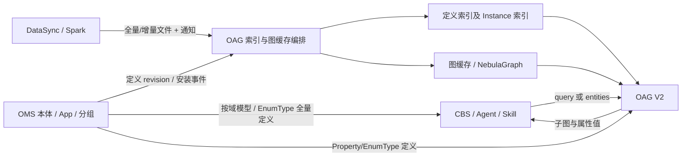
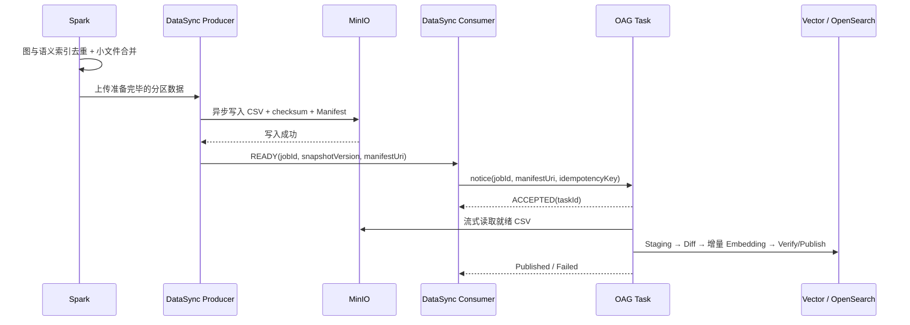
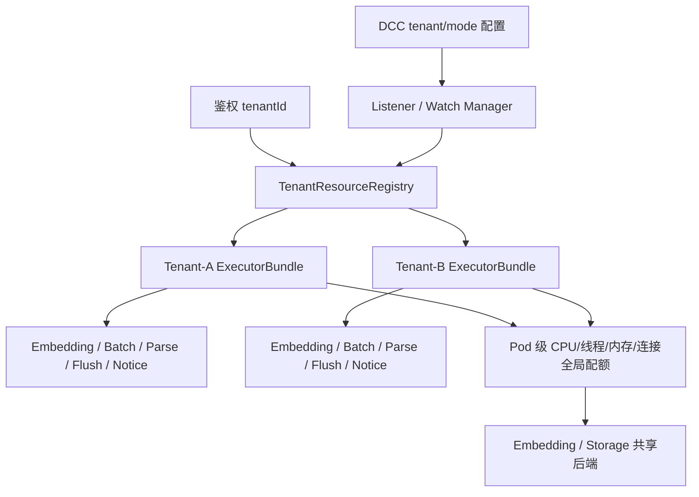

# Agentic Operation Center 27.3.0 功能设计说明书（IRxxx 软件Q4需求）

> 版本：V1.1（2026-10-31 Q4 需求、DCC与性能规格修订稿）  
> 日期：2026-10-31  
> 范围：OMS、OAG、DFx、安全、语义索引构建/检索、DataSync/Spark 联调及内部 Skill  
> 依据：本次最新 Q4 20 项需求；附件《新增Value参数统计_2026-10-31.md》《子图检索的查询性能规格(10-26).md》。原工作量 7.9 来源于旧版，**最新清单不含工作量，不再沿用**。  
> 定位：本文件是 Q4 跨模块功能设计，**不是已实现清单或经过压测的性能报告**。

**相关设计**：[软件场景准确性和性能优化增强需求设计说明书](./软件场景准确性和性能优化增强需求设计说明书.md) · [OAG 本体锚点语义检索与向量索引设计方案 V6.7](./OAG本体锚点语义检索与向量索引设计方案.md) · [本体维值建模与检索需求分析](./需求分析Spec_本体维值建模与检索.md) · [V2 请求 Schema](./schemas/oag-software-subgraph-request.schema.json) · [V2 响应 Schema](./schemas/oag-software-subgraph-response.schema.json)。

**阅读规则**：第 1 章为最新 20 项需求，第 2～6 章为实现方案，第 7 章为 @Value 参数 DCC 分类与**租户资源池监听**，第 8 章为子图查询规格和验收。区分原需求、代码扫描默认值、有效 DCC 配置及正式测试规格；附件是本次输入，不代表已独立上传仓库。新增 API、配置键和状态仍须联调确认。

---

## 1. 设计目标、场景与需求基线

### 1.1 业务背景与目标

CBS 面向运营商问账、集团客户问账，以及经营、销售、运营、运维人员的问计、问因和辅助决策。例如预付费账户数量、优惠余额、套餐月活 TOP3、账单风险等。业务 IRB 目标为**准确率 90%、业务端到端 5 分钟**；这不是 OAG 单接口 SLA。当前 CBS 本体参考规模为 **144 个 ObjectType、2896 个 Property、370 个 Relationship、11 个业务域**，模型仍在迭代。

本期 Q4 的重点是让 OMS/OAG 具备**安全交付、接口统一、自动索引、多实例扩展、配置治理、可恢复的数据同步与可量化的检索性能**。

### 1.2 最新目标与交付边界

| 目标 | 最新要求 | 主责 |
|---|---|---|
| OMS 安全 / DFx | 模型加密参数拆分，详细方案跟随《本体模型文件支持加密》；OMS 分域/定义接口及 Agent/OMS 双级缓存 | OMS/GDE |
| 公共 DFx | OMS/OAG 场景包分层与恢复指导书遵循 GDE 统一要求 | OMS/OAG/GDE |
| OAG 统一 | V2 query/entities 双模式、Skill V1 → V2，枚举不建索引、Property 全量返回枚举 | OAG/Skill |
| App 自动化 | **先修复手动创建索引偶现问题**，再自动触发建索引及图缓存刷新 | OMS/OAG |
| 全量增量 | 1000 万行首次全量、10 万行增量；DataSync 异步生产通知、Spark 合并小文件及前置去重 | Spark/DataSync/OAG |
| 租户资源 | **线程池、队列与并发配额按租户划分，线程池资源参数按租户 DCC 监听**；系统级参数不进入 DCC | OAG/配置底座 |
| 子图查询 | 依照附件：**2U4G 单实例 10 QPS、平均 ≤5 s、极端限流拒绝率 <20%**；3U4G 为建议压测规格 | OAG/性能测试 |
| 检索预研与安全 | 仅 OpenSearch 倒排检索及 ID-only 安全索引要共同评审 | OMS/OAG/安全 |

**边界**：保留 Q4-01～20 原编号；公共 GDE 和加密专项仅定义集成责任，不重复制定安全或运维底座规范。详细 Task API、DCC Watch 协议、数据库 LVQ 与索引删除时点属于待联调实现；不能把本文目标描述成已上线能力。

### 1.3 术语与主链路

| 术语 | 本文含义 |
|---|---|
| OMS | 本体模型/分组、App 包与元数据版本的权威管理者 |
| OAG | 本体定义索引、Instance 值索引、语义子图检索、图缓存与任务编排服务 |
| OAC | 业务数据访问与 Binding/OQL 能力；不承担 OAG 语义索引事务最终提交 |
| DataSync / Spark | 执行数据抽取、去重/分片、生产快照或增量文件并通知 OAG |
| V2 query / entities | 同一子图检索 API 的两种输入模式；query 可继续自然语言检索，CBS 以 entities 为主要输入 |
| Enum / Instance | Enum 是 OMS 的 EnumType/values[] 权威定义；Instance 是业务数据中真实的属性值 |
| DCC | 后续按租户配置覆盖的配置服务；真实命名空间与 API 待联调 |
| 资源 U | 原估算资源单位，尚无 CPU/内存物理定义，不能直接视为核数 |
| Stable Key | 实例值索引比较键：ontologyId + objectTypeId + propertyId + normalized(value)；规范化规则必须一致 |



### 1.4 最新需求范围与需求清单（2026-10-31）

根据本次最新输入，保留原先 20 条的序号与基本能力边界。**最新清单没有工作量列**，不将旧版 7.9 视为当前预算。

| 需求编号 | 模块与能力 | 本轮需求描述 | 详细设计 |
|---|---|---|---|
| Q4-01 | OMS / 本体加密 | 参数拆分；详细方案跟随《本体模型文件支持加密》 | §2.1、§6 |
| Q4-02 | DFx / OMS 分域 | 分域/本体定义接口规范，Agent 缓存+OMS 内部缓存避免实时全量查询 | §2.2 |
| Q4-03 | DFx / OMS 多实例 | 水平扩展及负载分担 | §2.3 |
| Q4-04 | DFx / OMS 恢复 | 公共故障恢复指导书，跟随 GDE 统一要求 | §2.5 |
| Q4-05 | DFx / OMS 配置 | 场景包参数分层，跟随 GDE 统一要求 | §2.4、§7 |
| Q4-06 | OAG / 统一接口 | 服务/软件场景统一；默认不建枚举检索索引，子图属性全量返回枚举 | §3.1 |
| Q4-07 | 接口统一 / Skill | V1 切换 V2，V1 标记 deprecated | §3.2 |
| Q4-08 | DFx / 自动索引 | **先修复手动建索引偶现问题**，再由 OMS App 安装触发 OAG 建索引并刷新图 | §3.3 |
| Q4-09 | DFx / 多实例 | OAG 多实例、内存图同步刷新及接口负载分担 | §3.4 |
| Q4-10 | DFx / 配置分层 | 组网参数场景包、系统参数配置中心、任务参数 API；租户线程池/DCC Watch | §3.5、§7 |
| Q4-11 | DFx / 恢复 | 公共故障恢复指导书，跟随 GDE 统一要求 | §3.5 |
| Q4-12 | 性能 / 数据导入 | **1000 万行全量、10 万行增量**；DataSync 生产/消费异步通知、Spark 小文件合并、Spark 图/语义去重，Embedding/向量库评估 | §4.1、§4.7 |
| Q4-13 | 性能 / 子图查询 | 单实例 10 QPS、水平扩展；最新附件为 2U4G 平均 ≤5 s、拒绝 <20% | §5.1、§8 |
| Q4-14 | 性能 / 定义索引 | 数据库全量比对、差异 Embedding | §4.2 |
| Q4-15 | 性能 / LVQ | LVQ 建表前置、COPY 后免 rebuild 的目标及 DCC COPY 大小调优 | §4.5 |
| Q4-16 | 性能 / 删除 | Delete 语义索引删除接口联调 | §4.6 |
| Q4-17 | 性能 / 增量 | Incremental 在向量库比对，缺失/变化才向量化插入 | §4.3 |
| Q4-18 | 性能/准确率 / 预研 | 实例值只进 OpenSearch 不进向量库，OMS 配语义字段；关键词单路路由及覆盖范围评估 | §5.3 |
| Q4-19 | 安全 / 索引字段 | 向量/OpenSearch 去名称描述、ID 反查内存图/NebulaGraph，详情跟随加密专项 | §6.1 |
| Q4-20 | 安全 / 明文屏蔽 | 后台日志及前端子图明文脱敏，通过加密堆栈参数控制，详情跟随加密专项 | §6.2 |

**核心依赖链**：Q4-08 的手动索引缺陷修复先于自动化；Q4-12 的 Spark→DataSync→MinIO→OAG 要明确异步生产/消费边界；Q4-10 必须有物理线程池/队列隔离，而不只是 DCC 字面配置；Q4-13 性能规格不能沿用旧 3 秒值；Q4-19 的 ID-only 与 Q4-18 的关键词模糊检索存在设计冲突。

### 1.5 需求到设计与验收追踪

| 设计专题 | 需求项 | 主要交付 | 验收用例组 |
|---|---|---|---|
| OMS 安全、分域及可用性 | Q4-01～05 | 模型加密、查询/缓存规范、OMS 集群、场景包参数与恢复手册 | OMS-Q4-01～05 |
| OAG V2 与 App 自动交付 | Q4-06～09 | 统一 V2、Skill 迁移、自动建索引和多实例图刷新 | OAG-Q4-06～09 |
| 配置及高可用 | Q4-10～11 | 分层参数、DCC 演进、多实例恢复手册 | DFx-Q4-10～11 |
| 索引与检索性能 | Q4-12～17 | FULL/INCREMENTAL/DELETE、数据库差异同步、LVQ 预研、压测与资源模型 | IDX-Q4-12～17 |
| 倒排-only 与安全 | Q4-18～20 | 属性检索模式预研、索引明文治理、日志/界面保护 | SEC-Q4-18～20 |

---

## 2. OMS 功能设计：本体加密、分域访问与高可用（Q4-01～05）

### 2.1 本体模型加密与参数拆分（Q4-01）

本项详细方案**跟随《本体模型文件支持加密》**，本文只要求 OMS 明确加密相关场景包/系统配置/请求参数边界，以及安装、升级、回滚、多实例加载时的参数传递、配置验证和集成测试。不得在此另行发明加密算法、密钥格式或 `onto_encrypt` 0/1 的含义。安全及模型文件兼容性验收由专项主导，OMS/OAG 承担接口和功能回归。

### 2.2 分域与本体定义查询（Q4-02）

沿用既有 OMS 分组模型：`ontologyGroup`、`groupMember` 是本体元数据；CBS Agent 负责按域选组，OAG **不接受 groupFilter、也不以分组截断子图连接**。。

**建议复用的三类接口**：

| 能力 | 建议路径 | 缓存与边界 |
|---|---|---|
| 查询分组列表 | `GET /api/v1/ontologies/{ontologyId}/list` | 用于查询当前本体中的可见分组，适用于分组列表 |
| 查询组成员及模型定义 | `POST /api/v1/ontologies/{ontologyId}/group/members` | 按分组返回当前本体中的分组定义及对象成员 |


**双层缓存**：OMS 服务端缓存 Key 建议为 `(tenantId, ontologyId, revision, visibilityScope, groupId, pageCursor)`；客户端 Agent 缓存同样带 tenant/revision，TTL 是失效兜底而非唯一一致性策略。App 发布或模型修订变更时服务端失效旧 revision 缓存，Agent 通过版本头/响应字段发现变化并重新取数。禁止将无权限用户的缓存结果复用给其他租户。

**避免实时全量查询**：正常请求命中 OMS/Agent 缓存；首次访问、revision 变化和缓存失效才重新拉取。并发冷启动采用 single-flight 去重与最大并发/大小限制；只允许请求内同一 revision 的定义组成上下文。分组的准确性以真实业务域定义验收，不把“节省 90% Token”当作已实测承诺。

### 2.3 OMS 多实例水平扩展（Q4-03）

OMS 保持服务无状态或将可恢复状态外置；在本体加密的需求中跟踪。

### 2.4 OMS 场景包参数分层（Q4-05）

该项是 **GDE 公共需求**。OMS 提供场景包/系统参数与接口参数清单，适配 GDE 统一参数规范和配置校验、安装/升级/回滚机制，不单独设计一套 OMS 配置底座。OAG 的租户 DCC 资源池专项见第 7 章。

### 2.5 OMS 故障快速恢复（Q4-04）

**GDE 公共恢复指导书**为权威：OMS 补充模型 revision、分组缓存、多实例状态、加密依赖、App 安装与权限异常等专项章节，按公共模板输出症状、指标与命令、止损、恢复、校验和演练结果。RTO/RPO 以 GDE 统一标准为准，不自定新指标。

---

## 3. OAG 统一接口、自动交付与高可用（Q4-06～11）

### 3.1 按附件最新 V2 接口统一服务与软件场景（Q4-06）

**实际接口契约**：《1.子图检索接口设计v2.md》定义 `POST /v2/onto-retrieval/subgraph/semantic-search`、`Content-Type=application/json`。原 V1 中位于 Path 的 `ontologyId` 进入 V2 Body；`query`/`entities` 至少提供一个，**`entities` 在 HTTP Body 是 1～102400 字符的 JSON String**；两者均存在时优先 entities 并跳过实体提取。

| 参数 | 最新 V2 规则 | Skill 兼容性 |
|---|---|---|
| `ontologyId` | Body String，1～256 字符，必填 | CLI `--ontology-id` 或 `ONTOLOGY_ID` |
| `query` | 可选，1～1024 字符 | 保留 `python scripts/semantic_subgraph_search.py --query "..."` |
| `entities` | 可选，JSON 字符串，内含 `{"entities":{"extractedEntities":[...]}}` | Script 将 JSON 文件/对象序列化为 String；不发送嵌套的 `entities.entities` |
| `adaptiveRetrieval` | API 默认 1；软件场景传 0 | Script query-only 默认 1、entities 默认 0；显式 0 不丢失 |
| `seedRetrievalMode` | 接口默认 `vector`，可选 keyword/hybrid | Skill 为兼容旧调用**显式指定 hybrid** |
| `similarityThreshold` | 默认 0.6，vector/hybrid 有效 | 支持 CLI/完整 Body 覆盖 |
| `topk` | **小写 k**，默认 3 | 旧 CLI `--topK` 仍接收，Body 只发送 `topk` |
| `graphExpansionStrategy` / `hopLimit` | minimal/khop/component，hopLimit 默认 3 | `--hopLimit` 别名保留 |
| `includeFunctions` / `includeActions` | API 默认 0/0 | Skill 保留原 includeFunctions=1（显式传值） |

**entities 内容约束**：`extractedEntities` **非空**、各项必须有 `objectType`，`properties` 可省略（软件场景已约定不传）；`propertyValues` 可省略。每个值组的 `objectType` 非空、`value` 非空；`property` 可省略或使用 `""`，表示按该对象所有可检索语义字段链接。`seedNodes` 只包含对象，不构造 Property 种子。枚举不建立 `t_oag_enum_{ontology_id}` 检索索引，OMS 属性 EnumType 全量返回；实例值链接只使用 `t_oag_instance_{ontology_id}`。

**V2 结果关键差异（以附件响应示例 2-1 为准）**：

```json
{
  "resultCode": 200,
  "resultMessage": "success",
  "result": {
    "seedNodes": [],
    "propertyValuesLinks": [],
    "nodes": [
      {
        "id": "payment-type-property-id",
        "label": "property",
        "properties": {"name": "paymentType", "dataType": "enum", "enumDataType": "string"},
        "propertyEnumValues": [
          {"value": "Prepaid", "isDefault": "true", "defaultDataValue": "0"},
          {"value": "Postpaid", "isDefault": "false", "defaultDataValue": "1"},
          {"value": "Hybrid", "isDefault": "false", "defaultDataValue": "2"}
        ]
      }
    ],
    "edges": [],
    "functions": [],
    "actions": []
  }
}
```

这里 `propertyEnumValues` **在 `nodes[]` 节点顶层，不在 `nodes[].properties` 内部**；`propertyInstanceValues` 也位于节点顶层，且仅当 Property 支持语义检索、存在本次实例链接结果时返回。`properties.dataType=enum` 时另带 `enumDataType`。`propertyValuesLinks[].valuesLinks[].valuesMapping[]` 是独立的值链接证据，附件示例包含 `canonicalValue/defaultDataValue/score`；**不能混同 `propertyInstanceValues`**。`isDefault` 使用 `"true"/"false"` 字符串，枚举全量由 OMS 定义决定；不得把所有枚举自动作为 Cypher 过滤值。

**尚未统一的两套结果形态**：附件 query 示例1-2 使用旧式 `nodes[].type` 与 `edges[].name`，而 entities 示例2-1 使用 `label/properties` 与 `edgeType/propertyMap`；本次 Schema 允许两套示例，Skill 不进行静默错误转换，后端统一 DTO 时需专门回归。旧 V2 Schema 曾把双数组放进 `properties` 的定义已修正；旧 V1 的独立响应结构在 deprecated 期间不变。

### 3.2 Skill 和脚本从 V1 迁移到 V2（Q4-07）

**本次改造文件**：`ontology-platform-unified-skill/SKILL.md`、`ontology-platform-unified-skill/scripts/semantic_subgraph_search.py`。原脚本按 `/v1/onto-retrieval/{ontologyId}/subgraph/semantic-search` 拼接 URL、Body 使用 `topK`、强制 query，不支持 entities，并且 HTTP 失败可能被当成成功。迁移后的脚本改用 `/v2/onto-retrieval/subgraph/semantic-search`，`ontologyId` 入 Body、发送 `topk`，支持 query-only、entities-only 与混合输入，并进行本地参数校验。

**Skill 调用**：

```bash
python scripts/semantic_subgraph_search.py --query "<问题/业务主题>"
python scripts/semantic_subgraph_search.py --ontology-id "<本体ID>" --entities-file ./entities.json --adaptive-retrieval 0
python scripts/semantic_subgraph_search.py --query-json @request-v2.json
```

第一条需要环境变量 `ONTOLOGY_ID`；仍需 `SERVICE_NAMESPACE`、`TENANT_ID`。`--entities-file` 或 `--entities` 传入内部对象或 `{"entities":{...}}` 包装后自动转 HTTP JSON String。完整 Body 支持显式 0，不再通过 `or default` 覆盖。脚本正确识别 HTTP 非 2xx、`resultCode` 失败、`result=null`、非法 JSON 和网络超时，失败时输出结构化错误并返回非零退出；**保留原 `message_type=message_ontololgy_subgraph` 以避免上游包装契约突变**。

**维护副本边界**：GitHub 仓库存在 `0713/...` 和 `onto-skill/platform-skill/...` 的历史脚本与 Skill 副本；本次实际修改的是根目录 `ontology-platform-unified-skill` 主版本。发布前必须确认部署入口是否引用其他副本，若是，应将同等 V2 适配同步到正式发布位置，不能误以为修改主版本就完成了所有运行节点的升级。

**V1 deprecation**：迁移各调用方后可按正式评审添加 `Deprecation`/`Sunset` 公告，监控旧端点调用来源及流量；V1 不立即删除，需业务回归、灰度回退和退役批准。

### 3.3 App 安装自动建索引：先修复手动问题（Q4-08）

**前置 P0**：当前**手动创建本体索引偶现失败**，先建立故障复现场景并定位：任务并发/重试、数据和 revision 校验、定义索引写入、图缓存刷新、Verify/Publish、异常清理以及旧索引可用性。应回归重试、两个 Pod 同时构建、空数据、任务中断、失败后重建；没有通过手动建索引稳定性验收，**不得直接扩大自动触发范围**。

**后续自动流程**：OMS 安装/升级 App 冻结 revision 后通知 OAG 创建异步索引任务并刷新内存图；建议 API（非现有已确认）：`POST /internal/v1/ontologies/{ontologyId}/index-sync`，携带 appId/revision/operation/idempotencyKey，从鉴权上下文确定租户。OAG 持久化 Task → 构建与缓存预热 → 校验同 revision → 发布 activeRevision；失败保留原可用版本。OMS 必须区分模型元数据安装成功与 OAG 索引/图可检索就绪，不将 HTTP 202 误当完成。

| 阶段 | 交付/门禁 |
|---|---|
| 修复手动建索引 | 问题归因、故障恢复验证、重入/幂等、旧版本不中断 |
| 开通 OMS 自动触发 | 安装事件不丢、重复通知幂等、任务状态可查 |
| 图缓存与索引原子发布 | 每次请求 indexRevision == graphRevision；多实例切换不混版 |

### 3.4 OAG 多实例与图缓存同步（Q4-09）

在《ICT服务与软件/Agentic Operation Center/Docs/27/27.3.0/02.设计/02.设计文档/Agentic Operation Center 27.3.0 功能设计说明书（IR20260731000589 SR20260806887975&SR20260806887798本体模型支持内存图管理和子图检索）.md》中详细描述。

### 3.5 OAG 参数分层与公共故障恢复（Q4-10～11）

分层规则见 §7.1；**线程池资源按租户隔离，线程池参数按租户 DCC 监听**（详见 §7.3～§7.5），不能用全局 `@Value` 静态注入声称支持租户热更新。容器还须有全局资源上限。

故障快速恢复**跟随 GDE 公共需求**，OAG 专项增加：Embedding 服务 503、Instance Task 卡住、MinIO READY/NOTICE 丢失、租户队列饥饿/配置 Watch 错误、图缓存 revision 不一致等场景。提交证据包括监控/日志、恢复动作与演练结果；RTO/RPO 仍按 GDE 统一要求执行。

---

## 4. 实例索引构建、差异同步与性能（Q4-12、Q4-14～17）

### 4.1 DataSync/Spark 异步导入与去重前移（Q4-12）

**工作负载**：单表首次全量 1000 万行（对应 100 万用户场景），增量 10 万行。业务数据的生产、文件落地和 OAG 索引构建需异步解耦，按同一 `jobId/snapshotVersion/ontologyRevision` 固定完整快照边界。三项优化分别为：

1. **DataSync 生产者/消费者异步拆分（需求指定：爱华）**：Producer 将 CSV 分区文件、checksum 和 Manifest 先写入 MinIO，全部对象写入成功后发布 **READY**；Consumer 独立消费 READY，调用 OAG notice 接口传 taskId/jobId/Manifest URI（实际参数以现有协议为准）。这样从 OAG“创建语义索引”同步调用路径中移除**上游 CSV 上传与等待**，但 OAG **仍须从 MinIO 读取已就绪 CSV**，不是删除 MinIO 读取过程。Consumer 在 OAG 接受并持久化任务后才确认消息；失败重试、死信与重放必须幂等。
2. **Spark 合并小文件（需求指定：振鲁）**：上游 Spark 对图数据和语义索引数据按快照、租户/本体、Property 分区进行 coalesce/compaction，减少 DataSync 大量小文件请求、MinIO OPEN/LIST 与文件解析线程争用。目标文件大小、文件数阈值按 1000 万行压测确定；不得跨 snapshot/revision 或不同归属键任意合并。
3. **Spark 前置数据去重（图和语义）**：图数据按完整实体/边主键和版本去重；语义值按 `(tenantId, ontologyId, objectTypeId, propertyId, normalized(value))` 去重并结合来源事件序号保证新写优先，减少 COPY 主键冲突。上游去重是性能优化，**OAG/向量库仍需唯一约束及幂等校验**，尤其是重传、跨分区和历史增量乱序场景。



**失败及背压边界**：只有 Manifest 表示预期分区全部 READY、checksum/行数核对通过时，FULL_REPLACE 才允许执行差异删除；不能每收到一个并发 CSV 批次就做全量 DELETE。Producer/Consumer/OAG 以 jobId + partitionId + 文件版本幂等；队列满时返回可重试错误，不可无限等待或丢消息。索引服务应将上传用时、READY→NOTICE 延迟、OAG MinIO 读时、COPY/Embedding/双写时分别统计，**异步转移不等于端到端耗时消失**。

**联调交付**：Spark 端输出合并前/后文件数量、去重前/后行数与归属校验；DataSync 输出 READY/ACK/重放；OAG 输出 Task/Manifest/checksum/差异行数及双库存储一致性；在 1000 万全量、10 万增量、重复通知、乱序分区和中断恢复下共同验收。

### 4.2 定义索引“全量比对 + 增量 Embedding”（Q4-14）

验证结果：
```
SELECT  
test."value",  
test.object_type_id,  
test.property_id  
FROM test  
WHERE NOT EXISTS (  
SELECT 1  
FROM "t_oag_instance_dtmi.ontology.65313863.1"  
WHERE "t_oag_instance_dtmi.ontology.65313863.1"."value" = test."value"  
AND "t_oag_instance_dtmi.ontology.65313863.1".object_type_id = test.object_type_id  
AND "t_oag_instance_dtmi.ontology.65313863.1".property_id = test.property_id  
);  
ontoretrievalvectordb2000=# SELECT  
ontoretrievalvectordb2000-# test."value",  
ontoretrievalvectordb2000-# test.object_type_id,  
ontoretrievalvectordb2000-# test.property_id  
ontoretrievalvectordb2000-# FROM test  
ontoretrievalvectordb2000-# WHERE NOT EXISTS (  
ontoretrievalvectordb2000(# SELECT 1  
ontoretrievalvectordb2000(# FROM "t_oag_instance_dtmi.ontology.65313863.1"  
ontoretrievalvectordb2000(# WHERE "t_oag_instance_dtmi.ontology.65313863.1"."value" = test."value"  
ontoretrievalvectordb2000(# AND "t_oag_instance_dtmi.ontology.65313863.1".object_type_id = test.object_type_id  
ontoretrievalvectordb2000(# AND "t_oag_instance_dtmi.ontology.65313863.1".property_id = test.property_id  
ontoretrievalvectordb2000(# );  
value | object_type_id | property_id  
--------------+---------------------------------------+-------------  
温控器A | oag_instance_dtmi.ontology.65313863.1 | P1001  
3号车间-东区 | oag_instance_dtmi.ontology.65313863.1 | P1002  
(2 rows)
```

### 4.3 Incremental 和 FULL_REPLACE 的数据库差异比对（Q4-17）

**核心实现目标**：以数据库内组合键比较替代全量删表/全量重复 Embedding。建议实例稳定键为 `(object_type_id, property_id, normalized(value))`，并加 `tenantId/ontologyId` 物理隔离；源值归一化语义必须固定。若当前物理库使用 `value` 作为键，须明确规范化发生在写库前且原值是否另存。

示意存储：

```sql
-- 示意结构，非可直接上线的 GaussVector/PG DDL
-- active: t_oag_instance_{ontology_id} (..., value, object_type_id, property_id, vector)
-- stage: 由任务管理的持久化 staging，含 job_id、snapshot_version、上述组合键
CREATE UNIQUE INDEX IF NOT EXISTS idx_stage_job_key
  ON instance_stage(job_id, object_type_id, property_id, value);
```

**FULL_REPLACE（完整快照）**：
1. 所有并行分批数据只写入**同一个 jobId 的 staging**，每批以 `(jobId, partitionId, batchNo)` 幂等确认；不允许线程各建一张目标表、各自执行 Diff/Delete。
2. 只有 `expectedPartitions` 全部完成、校验通过且快照水位固定后，才执行一次数据库集合差：`stage EXCEPT active` 为新增、`active EXCEPT stage` 为待删除，交集为复用向量。需按组合键 `JOIN/NOT EXISTS`，不能把 `vector=NULL` 当作数据变更。
3. 对新增键先有界批量调用 Embedding（去重后），写入新的版本/影子索引；所有双写和索引 Verify 通过后原子切换 active version。对于需同表更新的方案，先安全插入/复用并通过事务或版本标记隔离可见性，最后处理删除；全表大事务和长时间锁应专项评估。
4. 删除必须基于**该完整快照**，不能据某一个尚未到齐的上传批次删除现网其他值。失败或 Task 取消时不能使 Active 丢失数据。

**INCREMENTAL（只有变更集）**：仅对明确的 `ADD/UPSERT/DELETE` 变更操作计算差集；新键不存在时才 Embedding、插入；现有键如果文本与模型签名未变化则跳过向量计算。增量包未声明的旧键**不删除**。同键并发写按 `(sourceVersion, operationSequence)` 保证顺序，旧事件不得覆盖新事件。

**幂等与隔离**：每个 ontology 只允许一个冲突的 FULL 发布；不同分区文件可并行 ingest，但发布/删除互斥。必要时使用租约、advisory lock 或 Task 行 CAS；不能用仅 JVM 内锁跨 Pod 协调。日志可记录 jobId、差异数量，不打印完整用户值。

### 4.4 Embedding 并发、线程池隔离与 DCC 管理（Q4-12、14、17）

**租户资源归属**：Embedding 外层提交线程池、模型内部执行线程池、实例索引解析/COPY/Flush、Task 通知队列均根据鉴权 `tenantId` 选用受控资源实例；跨租户不能互相挤占专属队列、错误地沿用 ThreadLocal 租户上下文或读取其他租户的配置。内部 embedding 服务如仍有独立并行任务/请求上限，必须额外校验，不能把外层 `embedding-thread-pool-size=1` 理解为上下游所有并发均为 1。

**统一执行模型**：`tenantId → TenantResourceRegistry → TenantExecutorBundle`，其中包含 Embedding、batchInstance、parseFile、parallelFlush、notice 与查询准入配额；ResourceRegistry 同时受 Pod 级总线程/CPU/内存/连接预算限制。实际可采用按租户懒创建的独立有界线程池或能保证租户队列隔离/配额的等效调度器；闲置租户池应安全退役，**不能为所有历史租户永久创建固定数量线程**。

**嵌套并发控制**：从 DataSync Task → Embedding batch 只使用明确的一处任务编排和并发令牌；CompletableFuture 任务可以先提交到有界队列，但**执行中的请求数不能超过租户允许的 in-flight 限额**。同一轮 Task 的 Batch Future 全部 join/收敛状态；失败批次按稳定 Key 幂等重试，拒绝/超时区分可重试与业务失败。跨线程传递 tenantId、traceId 和任务上下文必须在执行前设置、执行结束清理，防止线程复用串租户。

**DCC 热更新**：参数动态监听、修改线程池 core/max、租户 Batch/Flush/Parse 配额与全局容量校验遵循 §7.4；排队中的老 Task 保持原 tenantId、任务版本和可恢复语义；若降低配额，不强制中断正在 Embedding 的请求，等待排空后逐步调整。在线修改 `batchInstance.maxBatchSize` 只对新建批次生效，避免一个正在 COPY 的分片中途改变切分边界。

**度量**：每租户 `activeThreads/queuedTasks/rejected/timeout/embeddingInFlight/batchSize`、模型端实际请求并发、向量写入水位、CPU/内存/GC、全局资源使用率；DCC 版本变化与前后配置快照需可追踪。测试必须包含 2+ 租户同时入库、大租户满队列、小租户正常完成及多 Pod 不同租户任务接管。

### 4.5 LVQ 预建与 COPY 批大小 DCC 调优（Q4-15）

本需求要求在建表阶段尝试创建 LVQ，使数据 COPY 后无需 rebuild；必须在目标 GaussVector 版本通过 A/B 验证：A=COPY 后创建/REBUILD LVQ；B=预先创建 LVQ 再 COPY。对同一 1000 万行数据、同硬件/副本/任务并发比较**总耗时、COPY rows/s、索引状态、索引写放大、Recall、查询 P95 和失败恢复**。预建索引可能增加每行写入开销，**不得未经验证就认定 B 必然更优**。

**租户级 DCC 参数**：附件统计列出 `batchInstance.maxBatchSize=1000/4000` 两种代码扫描默认值，与本需求新增的 `copy-batch-size` **不等价**。设计中分别定义：① Spark 合并后文件目标大小，② Instance 逻辑批大小，③ GaussVector COPY 分片大小，④ Embedding 请求 Batch 大小；不混为同一参数。新 `copy-batch-size` 若实现应按租户 DCC 注册，受 Pod 最大写入内存、数据库连接/事务和索引容量上限约束，**只对新任务或新 COPY 分片生效**。调参前后保存版本快照与测试数据，并提供按租户回退。

### 4.6 Delete 接口及索引删除联调（Q4-16）

沿用持久化任务状态与权限：仅允许授权调用者以 `ontologyId + snapshotVersion/jobId + deletionScope` 删除合法范围内的实体索引；`CLEAR` 全清与 `INCREMENTAL DELETE` 指定键需要明确区分。**不依赖无条件数据库 TRUNCATE**：请求需幂等、重复执行可审计；删除与全量发布冲突时串行化；OpenSearch 和 GaussVector 一库成功另一库失败时不能立即宣告成功，需重试/对账或补偿。

删除本体定义时须处理其 Instance 外键/归属关系，并确认是否需要级联；若业务数据还在持续同步，必须通过事件版本防止旧写入“复活”已删值。索引删除接口的最终路径、鉴权与错误码以 DataSync/OAG 联调冻结。

### 4.7 联调与容量测算（Q4-12）

压测分为：① 1000 万行首次 FULL；② 10 万行增量中分别注入 0%、10%、100% 新值（用于观测嵌入重用）；③ 批次乱序、重试、断连、分区缺失；④ 双库存储故障；⑤ 多实例故障接管与任务恢复。明确模型 ID、去重率、值平均长度、Embedding 模型和限流参数、数据源快照版本、COPY 方式、数据库副本和资源规格；输出全链路瓶颈与建议配置，而非仅给单线程 rows/s。

---

## 5. 查询性能与分级索引预研（Q4-13、Q4-18）

### 5.1 子图检索性能规格与横向扩展（Q4-13）

**权威性能输入**：《子图检索的查询性能规格(10-26).md》。该指标专用于软件场景，Pipeline **只包含实体链接 → 实体裁剪 → 子图构建**；不计 CBS 业务分词、索引数据入库或 Cypher 执行。**本轮正式规格从旧草案“3 s”调整为附件给出的“2U4G 单实例、10 QPS、平均耗时 ≤5 s、极端拒绝比例 <20%”**。附件另建议**实际压测按 3U4G 开展**；二者须分开标注并各自测量，不能拿 3U4G 的成绩证明 2U4G 指标。

| 约束类别 | 附件值 | 验收边界 |
|---|---|---|
| 本体模型 | ObjectType **≤150**，Property **≤3000**，Edge **≤400** | 当前 CBS 144/2896/370 在约束内，后续 revision 超限需重新评估 |
| 单实例配置 | **2U4G** | 静态内存图预算 **1 GB（10 × 100 MB）**；该规格最多承载 **10 个本体** |
| CPU 单核下限 | SHA-256 256B **≥280 万 ops/s、≥700 MB/s** | CPU 密集型基准；附件有 openssl 命令 |
| 输入对象 | `entities` 对象数 **<20** | 超出范围不可直接按此性能基线承诺 |
| `propertyValues` 数量分布 | **1–4：40%；4–8：50%；8–12：<10%** | 4/8 边界重合且占比未封闭为 100%，压测脚本需先冻结分桶含义，不自行修改附件 |
| 流量与样本 | 每秒发 **10 个请求，连续 1000 次**，CXO 黄金测试集 L1 | 记录成功、拒绝、业务异常和超时；发送约 100 秒 |
| 平均耗时 | **≤5 s** | 平均统计口径与未完成/拒绝请求处理须评审冻结；P95/P99 可观测但**不是附件硬阈值** |
| 吞吐 | **最大 10 QPS** | 这是附件列出的输入/吞吐规格，需同时报告成功 QPS |
| 流控拒绝 | 极端场景 **<20%** | 队列满的拒绝属正常但必须单独统计比例 |
| 内存/资源变化 | 后续新增 CPU 密集任务 | 应下调性能基线或增加资源，不默认仍保持 2U4G 指标 |
| 硬件 | ARM 鲲鹏 920C 物理机为标配，x86 Intel 2288 HV6/E9000 虚拟机为局点情况 | 记录架构、CPU 单核基准和虚拟化条件 |

**固定参数快照**（附件使用 `topK`，正式 V2 Body 字段可能为 `topk`，按 API DTO 联调适配）：

| 参数 | 本次测试条件 | 说明 |
|---|---|---|
| `seedRetrievalMode` | `hybrid` | 向量+关键词 |
| `similarityThreshold` | **0.7** | 与 V2 接口缺省 0.6 不同 |
| `topK` / V2 `topk` | **≤3** | >3 不在附件测试范围 |
| `hopLimit` | **≤3** | khop 生效 |
| `adaptiveRetrieval` | **1** | 小本体 ≤300 节点可全量；具体计数边界需核实 |
| `includeFunctions` / `includeActions` | **0 / 0** | 不扩大关联对象 |
| `graphExpansionStrategy` | **minimal** | 路径低冗余策略 |
| `subgraph-retrieval-cache-switch` | **false** | **压测关闭问题缓存**，不能用缓存命中虚增指标 |

**执行规则**：重启后预热 **3 分钟**，前 **3 次**压测结果不计；**查询高峰不得并行进行实例值向量化入库**，需错峰。测试在 2U4G 基准和 3U4G 建议资源分别运行，采集成功请求平均时延、P50/P95/P99、拒绝率、错误率、CPU/内存/GC、OMS EnumType 读取、Instance 检索和图算法耗时、每租户活跃线程及排队情况。扩到 2/3 Pod 时分别固定总入口 QPS 和每 Pod 压力，评估共享向量库/图库饱和，而非默认线性扩展。

### 5.2 租户级查询准入与信号量流控

《新增Value参数统计_2026-10-31.md》扫描值：`semantic-search.max-pool-size=30`、`semantic-search.queue-capacity=50`、`semantic-search.timeout-seconds=300`。**旧 Q4 草案 max-pool-size=25**，两者为不同来源而非同时生效的真值；必须读取运行配置并冻结基线。并发许可、队列容量与 ThreadPoolExecutor 核心线程数不是同一概念。

**租户隔离**：每个 `(tenantId, query/entities 输入模式)` 按需建立准入控制器（或等效配额记录），独立统计 inflight/queued/rejected/timeout；所有租户共享宿主 Pod/后端全局上限与公平调度，拒绝不能转嫁给另一租户。按租户 DCC Watch 变更配额，不能只修改 Java `@Value` 字段；Watch 详细方案见 §7.3～§7.5。

原草案设计在 transport 线程等待许可最长 300 秒，可能耗尽入口线程；建议在详细设计中评估异步短等待和快速拒绝。队列已满时返回可归因的限流响应（原设计 503），并与上游连接失败、Embedding 503 区分。附件 **<20% 拒绝比例**只适用于其指定负载与配置，不能为日常服务故障开脱。

### 5.3 OMS Property `retrieval` 索引模式扩展设计（Q4-18，预研）

**设计输入**：现有属性定义在 `retrieval` 下只有 `enabled`（样例 `accountId` 为 `false`）。新增**可选** `indexMode`（建议命名，需 OMS 模型 Schema 评审），支持 **仅关键词、仅向量、混合**三种取值；未填写 `indexMode` 且启用检索时默认**混合索引**，以兼容既有开启检索的属性。保留 `retrieval.enabled=false` 的优先级，**禁用属性不能因为省略 indexMode 被自动启用**。

**OMS Property 最小改造示例**（原 `id/name/display/description/status/extensions/dataType/refSynonymTypeName/createdAt` 等属性字段全部保留）：

```json
{
  "id": "dtmi.65313863.property-type.38396236-3130393330653430.1",
  "name": "accountId",
  "dataType": "long",
  "retrieval": {
    "enabled": true,
    "indexMode": "KEYWORD_ONLY"
  }
}
```

完整字段表：

| 字段 | 类型 | 默认 / 取值 | 规则 |
|---|---|---|---|
| `retrieval.enabled` | boolean | 沿用模型既有值，如 `false` | **false=不构建实例语义索引，也不参与值召回**；属性仍可在 OMS 建模/Binding/子图属性补全出现 |
| `retrieval.indexMode` | string（可省略） | `HYBRID`（当 enabled=true 且字段缺失时） | `KEYWORD_ONLY` / `VECTOR_ONLY` / `HYBRID`；建议仅 enabled=true 时生效 |
| `retrieval` 整体缺失 | 继承既有模型规范 | 不在本文另行改变 enabled 的缺省 | 防止新字段引入对旧模型的隐式索引启用 |

**四种有效运行状态**：

| enabled / indexMode | OpenSearch | GaussVector | Embedding | 查询通道 |
|---|---|---|---|---|
| `false` / 任意（建议不填） | 不建 | 不建 | 不调用 | 无 |
| `true` / 字段省略或 `HYBRID` | 建 | 建 | 调用 | Keyword + Vector，RRF 或既有融合 |
| `true` / `KEYWORD_ONLY` | **建** | 不建 | 不调用 | **仅 Keyword** |
| `true` / `VECTOR_ONLY` | 不建 | **建** | 调用 | **仅 Vector** |

**OMS → OAG 建库闭环**：

1. OMS 模型字段支持配置检索启用/模式，下发真实 Property ID、ObjectType ID、revision、enabled/indexMode；前端单选提供“混合/仅关键词/仅向量”，只有 enabled=true 时可编辑，默认混合。保存时校验枚举值并保证旧数据兼容。
2. OAG 在索引任务启动时按同 revision 生成 `(ObjectTypeId, PropertyId, mode)` 构建计划；**只对可用通道写数据**。KEYWORD_ONLY 跳过 Embedding/GaussVector；VECTOR_ONLY 跳过 OpenSearch；HYBRID 双写。旧任务/模型 revision 不可混用不同模式。
3. 模式变化应按**增删索引通道做增量迁移**：HYBRID→KEYWORD_ONLY 删除该属性原向量文档，KEYWORD_ONLY→HYBRID 补建向量（需要 Embedding），VECTOR_ONLY→HYBRID 补建词法，enabled=true→false 按安全策略清理两类索引；采用版本化发布/双库对账，不使一半迁移的模式对外可见。
4. 对 `accountId` 这类长数字/标识串，词法建议采用 **keyword 精确索引**（必要时另设授权前缀匹配），不依赖 BGE-M3 Dense 相似度识别数字差一位的真实身份；是否支持模糊分词由安全与业务确认。

**查询路由与融合**：进入 Instance Value Linking 时按 `objectType + propertyId` 确定其 indexMode，然后将请求全局 `seedRetrievalMode` 与 Property 支持通道做**交集**。全局 `hybrid` + KEYWORD_ONLY 只执行 Keyword，+VECTOR_ONLY 只执行 Vector；只有一个可用通道时不应以“缺少另一通道分数”进行惩罚；RRF 仅对实际执行的通道融合，`similarityThreshold` 仅约束 Vector。若全局请求为 `vector` 而属性只有 KEYWORD_ONLY，**不得偷偷改为 keyword**；应定义空候选/显式不兼容诊断（具体 API 行为待评审）。当 `property` 省略或 `""` 时，检索当前 ObjectType 下**所有 `retrieval.enabled=true` 的语义字段**，并按各属性模式分派查询，不无条件扫描所有非语义属性。

**是否所有实例都入 OpenSearch？** 否。只有 `HYBRID`/`KEYWORD_ONLY` 的有效属性值进入 OpenSearch；`VECTOR_ONLY` 只入向量库；`enabled=false` 不入二者。**EnumType/values[] 永远来自 OMS 本体定义，不由 `indexMode` 启动枚举索引。**

**与 Q4-19 安全方案的依赖**：如果最终要求 OpenSearch 严格 ID-only，基于 name/description/value 的 BM25/Keyword 检索能力将受限，须安全评审允许的受控词法字段或明确精确检索/召回降级，不得声称在严格 ID-only 下完整保留模糊召回。

**预研验收**：验证四状态的实际索引内容与 Embedding 调用次数；全文/向量单通道路由、hybrid 的 RRF 与 topK；revision 模式切换/删除、跨租户隔离、无 property 过滤时的对象内字段路由；使用纯数字 AccountId、英文/中文短文本、同义词测试 Recall@K/Precision@K、磁盘量、入库/查询耗时。正式 DTO 字段名和值取值、模式变化是全量重建还是增量、禁用后索引删除授权等由 OMS/OAG/安全联评后冻结。

---

## 6. 数据安全与明文治理（Q4-19～20）

### 6.1 向量与 OpenSearch 去名称描述、按 ID 回查（Q4-19）

**详细方案跟随《本体模型文件支持加密》**。OMS/OAG 负责字段适配和权限回归：向量/全文索引尽量只持久化稳定 ID、归属和必要检索元数据，名称/描述查询通过 OMS/内存图/NebulaGraph 按 ID 或经授权的 name→id 方案补齐，不能跨租户读取其他模型数据。哪些明文字段允许保留、加密格式及密钥轮换由专项冻结。

**功能冲突必须决策**：OpenSearch 若只存 ID，无法原样执行针对 name/description 的 BM25 与 fuzziness；Q4-18 的 lexical-only 在安全评审前不能同时承诺严格 ID-only 和完整模糊召回。需明确授权词法字段或接受能力降级，基于真实黄金集测试召回、ID 回查、索引迁移、旧客户端兼容和性能影响。固定哈希不等于模糊文本检索。

### 6.2 后台日志与前端子图明文脱敏（Q4-20）

**详细方案跟随《本体模型文件支持加密》**。原需求提出后台可打印子图明文、前端页面子图明文脱敏，开关由**加密堆栈参数**控制。何时允许后台明文、默认开关状态、授权角色与环境范围必须由加密/安全专项确认，**不意味着常规生产日志应默认打印完整子图**。

建议仅在获授权、时效受控且可审计的调试场景允许后台子图明文；平时日志记录 traceId、revision、节点/边数量、任务 ID、错误码。前端遮盖应在服务端鉴权后执行相应字段/可见性策略，不能只依赖 CSS；导出、响应、异常栈、APM 也应一致。加密堆栈开关属于安全/部署级配置，**不纳入普通租户线程池 DCC 配置**。OMS/OAG 的验收仅覆盖专项方案的接口联调、日志/页面/导出回归。

---

## 7. 参数分层、DCC 租户监听与资源池隔离（Q4-05、Q4-10）

### 7.1 参数统计口径与分级原则

**附件依据**：《新增Value参数统计_2026-10-31.md》统计最近 3 个月 Java 新增 `@Value`：**115 处注解、83 个唯一配置 Key**，统计提交范围为 `git log --since=2026-07-31`、最新提交 `e5d4d74d`（2026-10-27）。**该统计只说明代码新增声明和默认值，不证明所有键已注册到 DCC、具备动态监听或已在本体服务运行时生效**。**统计一致性注意**：附件摘要写 83 个唯一 Key，但七类明细表实际逐行列出 **72 个不同 Key**（本轮 DCC 候选 38 个、系统级 34 个），有 **11 个 Key 未在附件分类明细中列出**；必须重新对照源码扫描结果补齐后才可宣称完成全部 83 项分类。同名 Key 的不同默认值按原表保留，不能未经检查选一个作为正式配置。

| 分级 | 配置来源与示例 | 本次约束 |
|---|---|---|
| 场景包/部署组网 | `onto_encrypt`、`oag.cache.type`、图数据库依赖 | 跟随 GDE 公共参数分级；不能由租户 Body 越权修改 |
| **租户级 DCC** | §7.2 的线程池、资源准入、检索/排序、功能开关、索引任务参数 | **按租户隔离资源/队列，按租户 Watch/推送更新，具备资源上限、审计和安全回退** |
| 系统级非 DCC | 附件第 5/6/7 类：MinIO、Nebula、OpenSearch、证书与数据库、租户初始化/namespace、Pod/日志/探针 | **不放置在 DCC**，由部署底座/系统密钥或环境管理；租户不能随意覆盖基础设施连接参数 |
| 请求/任务级 | V2 query/entities、topk、hopLimit、jobId、snapshotVersion、COPY 任务模式 | 原 API 参数不自动提升为 DCC；请求可覆盖项受安全/资源限额约束 |

**优先级（建议）**：实际执行以 `认证租户 → inputMode(query/entities) → DCC tenant/mode override → DCC 已登记基线 → 版本兼容预置` 解析，并受 Pod/集群硬上限约束。对于 Body 已定义的检索参数，先遵守接口规定的显式值与默认值优先级，DCC 仅对允许覆盖的资源/功能执行配置，不得悄然重写用户显式合法请求。DCC 读不到、键非法或 Watch 断线时不得把安全策略、队列上限解释成无限制。

### 7.2 需要纳入 DCC 的候选参数清单（按附件原 Key）

以下四类为本轮**DCC 注册与分类候选**，默认值严格采用附件扫描值，`8/20`、`1000/4000`、`1/6` 是**源码多个位置不同默认值**，需先统一实际含义。实际名字、租户/模式作用域、热更新安全性、值域与 DCC 注册方式在联调时冻结。

**A. 线程池/批处理/模型缓存（10 项，全部明确资源归属）**

| 参数 Key | 附件默认值 | 资源属性与 DCC 生效要求 |
|---|---|---|
| `embedding-thread-core-pool-size` | `8` | 模型内部租户执行池 core；按 tenant 建配额，不能只建立一个全局池 |
| `embedding-thread-max-pool-size` | `32` | 模型内部租户执行池 max，必须 `core ≤ max` 且受全局预算 |
| `embedding-model-cache-size` | `10` | 模型对象缓存容量，**不是线程数**；按租户划分缓存占用和可见性、全局有界 |
| `embedding-thread-pool-size` | `1` | Embedding 外层批任务并发；附件显示 5 处使用，不可假设它控制内层全部并发 |
| `batchInstance.threadPoolSize` | `8 / 20` | Instance 批次执行资源，租户独立队列/配额，默认冲突待收敛 |
| `batchInstance.maxBatchSize` | `1000 / 4000` | 批处理大小，按 tenant 配置，影响下一批次而非中途重切 |
| `batchInstance.retry` | `3` | 任务失败重试次数，租户级重试节流防止雪崩 |
| `parallelFlush.Size` | `8 / 20` | 向量库并行 Flush 额度；真实 Key 的大小写必须保持并核实实际读取 |
| `parseFile.threadPoolSize` | `20` | CSV 解析资源；按租户限制文件并行处理数和排队 |
| `notice.threadPoolSize` | `20` | Notice/任务消费资源；防止大租户挤占小租户的通知 |

**B. 查询准入、排序/检索与 RRF（16 项）**

| 参数 Key | 附件默认值 | 建议作用域 |
|---|---|---|
| `semantic-search.max-pool-size` | `30` | 租户级查询并发许可（旧 Q4 25，仅历史草案） |
| `semantic-search.queue-capacity` | `50` | 租户级等待队列长度 |
| `semantic-search.timeout-seconds` | `300` | 租户级许可等待超时；300 s 风险需复评 |
| `rrf.k` | `10` | 租户+query/entities 模式的融合平滑参数 |
| `rrf.channel-weights.ontology-object-vector` | `0.5` | 对象 vector 通道权重，核实与 dense 是否为别名 |
| `rrf.channel-weights.ontology-object-lexical` | `0.5` | 对象关键词权重 |
| `rrf.channel-weights.ontology-object-dense` | `0.5` | 对象 dense 权重，注意同义 Key 重复 |
| `rrf.channel-weights.instance-vector` | `0.5` | 实例 vector 通道权重，核实与 dense 是否为别名 |
| `rrf.channel-weights.instance-lexical` | `0.5` | 实例关键词权重 |
| `rrf.channel-weights.instance-dense` | `0.5` | 实例 dense 权重，检查双重加权 |
| `ontology-object-similarity-threshold` | `-1` | 租户/模式覆盖；`-1` 哨兵含义待定义 |
| `instance-similarity-threshold` | `-1` | 同上；不能以 -1 作为实际余弦阈值 |
| `instance-topk` | `-1` | 实例候选 TopK，实际最大值需约束 |
| `rrf-topk` | `-1` | RRF 输出 TopK，不能无限放大 |
| `adjacency-cache-max-size` | `1000` | 租户级图邻接缓存额度，亦受总堆内存约束 |
| `rule-config-path` | 无 | **文件系统路径属于特殊风险项**；建议系统级受控白名单路径或仅 DCC 发布可信 Rule 版本 ID，不允许租户任意指定本地路径，最终归属待安全评审 |

**C. 检索开关 / 子图过滤（7 项）**

| 参数 Key | 附件默认值 | 作用 |
|---|---|---|
| `subgraph.undirected-filter` | `false` | 附件源码默认 false；既有软件 V2 预置 true，需按版本+模式冻结 |
| `enable-object-linking` | `false` | 软件 entities 关闭已对齐对象的二次链接 |
| `enable-property-linking` | `false` | 软件 entities 关闭已对齐属性的二次链接；query 不得被误关闭 |
| `enable-property-value-linking` | `true` | 当前软件 V2 仅 Instance Value Linking，不再构建 Enum 索引 |
| `include-all-properties` | `true` | Property 属性补全，枚举全量另遵循 Schema |
| `include-keys` | `false` | Key 属性返回控制，不能绕过必要模型完整性规则 |
| `subgraph-retrieval-cache-switch` | `true` | 查询缓存开关；**性能压测必须覆盖为 false** |

**D. 索引任务与任务保留（5 项）**

| 参数 Key | 附件默认值 | 作用 |
|---|---|---|
| `index-build.max-retry` | `3` | 租户索引任务失败重试；结合全局重试洪峰控制 |
| `index-task.max-concurrent-tasks` | `10` | 租户后台任务并发许可，另有全局上限 |
| `index-task.queue-length` | `200` | 租户后台排队上限与公平性 |
| `index-task.queue-timeout-hours` | `1 / 6` | 不同源码默认冲突；按任务类别核实实际 timeout |
| `index-task.file-ttl-hours` | `168` | 文件有效期，不能短于可恢复任务处理窗口 |

**系统级排除**：附件第 5/6/7 类标注无需进入 DCC：MinIO scheme/证书/实例名/bucket、GaussVector/OpenSearch 实例名、Nebula IP/port/space、Elasticsearch URI/证书、JDBC 连接、`support_new_tenants`/tenantId 初始化、namespace/镜像模板、`POD_NAME/NODE_NAME/HOST_IP/LOG_LEVEL_CONFIGMAP_PATH` 和探针端口。`server.ssl.trust-store-password` 等敏感信息须由密钥机制管理，**不复制真实密码到 DCC**。上述配置虽涉及环境/租户身份，也不因字段含 tenant 就自动成为租户 DCC 开关。

**本轮参数差异收口**：10 + 16 + 7 + 5 = **38 个已列出的 DCC 候选**（其中 `rule-config-path` 尚需安全评审），另有 **34 个系统级明细 Key 明确不进入 DCC**。附件摘要与明细差 **11 个未列出 Key**，先追溯扫描源码再归类，不能默认这些缺失项属于 DCC。配置注册清单还须核对同 Key 不同默认值、权限和实际生效点。

### 7.3 线程池资源按租户划分：实现架构

**目标不只是“不同租户读取不同参数”，而是线程池/队列/并发资源真正隔离。**



- 入口从认证上下文获取 `tenantId`，不能信任任意 Body 伪造；每个 TenantExecutorBundle 按租户持有独立的提交配额、执行队列、Worker 与缓存预算，或采用能证明等效隔离的有界虚拟队列调度器。
- Bundle 可按活跃租户**懒创建、空闲回收**，不能为每个历史租户永久分配 core=8、max=32 导致线程数爆炸。保留已排队任务的 Tenant 所属信息，Pod 重启通过持久化 Task 恢复。
- ThreadPoolExecutor 至少校验 `corePoolSize ≤ maxPoolSize`、queueCapacity/拒绝策略、keepAlive；租户专属并发许可还要受 Pod `maxTotalWorkers/maxConcurrentEmbeddings/maxConnections` 之类的**全局硬预算**约束（这些新名称只是待设计资源上限，不是当前配置 Key）。
- 跨线程通过任务上下文明确设置/清理 tenantId、traceId、revision，不得因 ThreadLocal 复用串租户。Embedding 模型内部可能另起线程或 HTTP 请求；外层 `embedding-thread-pool-size=1` 不证明实际模型并发只有 1，须做真实请求 in-flight 观测。
- 大租户满队列不能挤占小租户的队列；后端 GaussVector/Embedding 连接等共享依赖仍有全局限制和公平调度。不同 Pod 的租户 DCC 配置须统一；**仅按 Pod 设置 10 个并发配额不等于租户集群总配额是 10**。若需全局租户限额，应采用集中配额/一致性租约或将目标配额在副本间分配，最终选择需联调冻结。

### 7.4 DCC 按租户监听、热变更及线程池安全迁移

**推荐控制流程（设计建议，不宣称 DCC 现有 SDK 已支持）**：

1. **配置登记**：将 §7.2 的候选 Key 逐项定义 `tenantId + inputMode/operationType + configKey + version + value + range + dynamic/restartRequired`；记录来源、默认值和审计，支持既有租户预置迁移。`@Value` 只是在 Bean 初始化时读取一次，**不具备自动 DCC 动态监听能力**。
2. **订阅与初始化**：OAG 每 Pod 通过 DCC 官方 Listener/Watch SDK（或等价机制）订阅对应租户/键范围；首次加载和重连后获取**完整配置快照**并按版本检查，不能只消费增量事件而丢失中间更新。
3. **校验后生效**：先对线程 `core ≤ max`、批大小/队列/超时合理区间、权限及 Pod 总预算做整套校验；通过则以不可变 `TenantConfigSnapshot` 原子发布。当前请求固定所用 `configVersion`；新请求使用新版本，不混用半组新旧字段。
4. **线程池平滑调整**：增长时先调整最大容量再调整 core；缩小时先降低 core/限制入队，再安全降低 max（需按实际线程池合法 API 顺序）；旧 Worker 正在执行的任务允许自然完成，不强制中断 Embedding/COPY；不能把已排队的任务转到其他租户队列。
5. **无法原地改变的配置**：队列容量、部分拒绝策略和资源池类型不一定支持在线调整；可在本租户创建新版本 ExecutorBundle，切换新任务入口，旧 Bundle **drain → shutdown**，超过恢复窗口则将持久化 Task 交给重试队列，不强制丢弃。
6. **DCC 不可用/版本跳跃**：按同租户已校验的最后有效配置或发布预置继续运行，记录 `degraded/configStale` 并告警；越权/非法修改拒绝并保持旧值，任何失败**不得放宽安全或全局线程限制**。订阅恢复时做全量对账，防止 Pod 之间配置漂移。
7. **可观测性**：配置回调记录 tenantId（可脱敏）、key、configVersion、来源、结果/原因和生效时间；资源面监控每租户 `active/queued/rejected/completed`, embedding 请求 in-flight、Batch/Flush 队列深度、内存/线程上限、DCC 监听延迟和失败次数。

**示意伪代码**（不代表当前运行 API）：

```java
void onTenantConfigChanged(String tenantId, ConfigEvent event) {
    TenantConfigSnapshot next = dcc.loadAndValidateSnapshot(tenantId, event.version());
    budgetGuard.validate(tenantId, next); // 多个线程池/队列总配额一起验证
    resourceRegistry.applyAtomically(tenantId, next); // 新任务见新快照，旧任务安全 drain
}
TenantExecutorBundle bundle = resourceRegistry.getOrCreate(authTenantId);
bundle.submit(task.withTenant(authTenantId).withConfigVersion(bundle.configVersion()));
```

### 7.5 DCC 参数兼容、冲突和验收

| 决策项 | 附件/旧草案情况 | 本轮规则 |
|---|---|---|
| 搜索并发 | 附件 `max-pool-size=30`，旧 Q4 为 25 | **记录版本差异**，以实际租户有效值冻结；不是性能附件证明了 30 最优 |
| 批次线程数 | `batchInstance.threadPoolSize=8/20`、`parallelFlush.Size=8/20` | 查源码有效注入点、作用阶段和具体模式后再统一 DCC 默认 |
| 批大小 | `batchInstance.maxBatchSize=1000/4000`，需求另有 COPY 批大小 | 区分逻辑 Batch、COPY 分片与 Spark 合并文件大小，不能复用同一 Key |
| 任务队列超时 | `index-task.queue-timeout-hours=1/6` | 按任务类型/版本决定，确保不少于消息重放窗口 |
| 无向图 | 统计显示 `undirected-filter=false`，软件 V2 设计 true | 明确租户 + query/entities + 发布版本的生效矩阵并回归，不静默修改 |
| 缓存开关 | 统计 `subgraph-retrieval-cache-switch=true` | **性能压测强制 false**，并保存 DCC 快照与请求参数 |
| RRF 权重 | `vector` 与 `dense` 两组同值、合计不能假设已归一 | 先核查是否同一通道别名，防止重复融合权重 |
| 配置差异与多实例 | 静态 @Value + DCC 事件 | 完整回放、Watch 重连、Pod 重启和配置版本对账 |
| 容量安全 | 每租户线程数可独立调节 | 一次修改需验证所有活跃租户和 Pod 全局预算，不能因租户数增长导致 OOM/线程耗尽 |

**租户隔离测试矩阵**：T1=租户 A 满载 embedding、租户 B 仍可查询/写入；T2=更新 A 池 max/queue、B 无变化；T3=A 缩小 pool、旧请求自然完成且不丢任务；T4=Pod A/B Watch 事件乱序、断线重连后同版本；T5=异常值、过量配额、DCC 不可达时保留旧快照；T6=新租户首次创建/空闲回收；T7=多 Pod 受总配额/后端资源限制且不会跨租户泄漏。所有测试记录实际线程数、拒绝、Task 完成率和内存曲线。

---

## 8. 验收标准、发布门禁与技术决策

### 8.1 最新 20 项需求验收矩阵

| 用例组 | 对应需求 | 最低验收断言/验证依据 |
|---|---|---|
| OMS-Q4-01 | Q4-01 | OMS 加密参数分层/透传与模型文件加密专项一致；加密算法/密钥与安全测试跟随专项 |
| OMS-Q4-02 | Q4-02 | Agent 与 OMS 缓存减少实时全量取定义；同 tenant/revision/权限范围可见数据一致，缓存失效可重取 |
| OMS-Q4-03 | Q4-03 | 2/3 实例负载均衡、OMS revision 与读写权限一致，不跨 Pod 泄漏 |
| OMS-Q4-04 | Q4-04 | 按 GDE 公共恢复指导书交付 OMS 专项场景、诊断指标及演练记录 |
| OMS-Q4-05 | Q4-05 | 参照 GDE 公共参数分级完成 OMS 场景包/系统/接口参数映射和安装回归 |
| OAG-Q4-06 | Q4-06 | V2 query/entities 检索同入口；不建/不查 t_oag_enum；Property 完整枚举、真实 Instance 映射，移除旧 semanticExtensions |
| OAG-Q4-07 | Q4-07 | 已发布 Skill V2、topK/topk 与认证适配正确；V1 标记 deprecated 但未误删 |
| OAG-Q4-08 | Q4-08 | **手动建索引偶现问题先闭环**；随后 OMS App 自动建索引、图/索引同 revision，失败保留旧 active |
| OAG-Q4-09 | Q4-09 | 多 Pod 图缓存与索引 revision 一致、跨实例负载分担，滚动升级与任务接管可恢复 |
| DFx-Q4-10 | Q4-10 | **租户线程池/队列真实隔离且按租户 DCC Watch 生效**；合法变更、缩容 drain、跨 Pod 对账和全局资源限制 |
| DFx-Q4-11 | Q4-11 | OAG 专项故障纳入 GDE 公共 Runbook，有演练、证据和恢复结果 |
| IDX-Q4-12 | Q4-12 | **1000 万行 FULL / 10 万行增量**；DataSync Producer/Consumer 异步通知与 MinIO READ；Spark 小文件合并、图/语义去重；COPY 无主键冲突、失败可恢复 |
| IDX-Q4-13 | Q4-13 | 附件的 2U4G/10 QPS/平均 ≤5 s/拒绝 <20% 及全部固定条件可复现；**3U4G 建议压测单独出结果** |
| IDX-Q4-14 | Q4-14 | 定义索引未变更的向量复用；模型/输入变化才触发增量 Embedding，元数据/词法索引仍正确更新 |
| IDX-Q4-15 | Q4-15 | LVQ 先建/后建同环境 A/B；预建可用性与 COPY 总耗时、Recall 验证，COPY 批大小可按租户 DCC 调整/回退 |
| IDX-Q4-16 | Q4-16 | Delete/CLEAR 与 DataSync 联调，双库成功对账、幂等、重试及冲突处理 |
| IDX-Q4-17 | Q4-17 | FULL 与 incremental 的数据库差异对比准确；无新键不调用 Embedding、不误删已有键；分批并发安全 |
| SEC-Q4-18 | Q4-18 | OMS retrieval.enabled + 可选 indexMode（HYBRID/KEYWORD_ONLY/VECTOR_ONLY），disabled 不建；混合/单路建库查询、模式迁移、无 property 路由与旧数据兼容 |
| SEC-Q4-19 | Q4-19 | name/description 索引最小化、ID→定义回查与权限正确，严格 ID-only/BM25 矛盾完成加密专项安全评审 |
| SEC-Q4-20 | Q4-20 | 加密堆栈参数控制后台日志明文和前端脱敏；专项认证与生产日志/导出/异常回归无泄露 |

### 8.2 子图查询性能规格专用验收（附件 10-26）

| 测试编号 | 条件/数据集 | 验证与交付结果 |
|---|---|---|
| PERF-Q4-01 | **2U4G** 单实例；≤150 ObjectType、≤3000 Property、≤400 Edge，静态图 1 GB、≤10 本体 | 固定环境镜像、CPU 单核 SHA-256 ≥280 万 ops/s/700 MB/s、JVM、实例数与本体 revision |
| PERF-Q4-02 | CXO L1 黄金集，entities 对象数 <20，propertyValues 分桶 40% / 50% / <10% | 冻结输入用例、随机种子及 **4/8 边界重叠的解释方式**；未冻结不得声称完全复现附件 |
| PERF-Q4-03 | hybrid、0.7、topK≤3、hopLimit≤3、adaptive=1、minimal、Functions/Actions=0 | 快照并记录 V2 `topk` 实际绑定、无向开关与 DCC 租户配置；问题缓存 **false** |
| PERF-Q4-04 | 重启后预热 ≥3 min，前 3 次结果剔除，查询高峰无实例向量化入库 | 记录预热时点与错峰窗口，不允许缓存命中/后台任务影响对照 |
| PERF-Q4-05 | **10 请求/秒，连续 1000 请求**，2U4G 基准 | **平均成功耗时 ≤5 s**（均值统计口径需签审）、拒绝总比例 <20%；同时报告成功 QPS、P50/P95/P99、失败/超时 |
| PERF-Q4-06 | **3U4G 建议压测**，同用例/参数并与 2U4G 对照 | 单独报告耗时与吞吐，不能作为 2U4G 达标替代证据 |
| PERF-Q4-07 | 2/3 Pod 水平扩展 + 两个租户并行 | 在总入口 QPS 固定/每 Pod QPS 固定两种情形下验证扩展效率、租户池隔离和全局后端瓶颈 |
| PERF-Q4-08 | CPU 单核达标与不达标、ARM/x86 混合、图数/Property 数/枚举值规模梯度 | 测试超出附件约束后的性能降级；正式规格只针对符合约束的环境 |

**拒绝率和时延不得混算**：拒绝率建议按 `flowRejected / submitted`；平均耗时建议按成功完成响应统计，并同时给出失败/排队独立分位值，最终以压测评审冻结的测量口径为准。附件规定的是**平均 ≤5 秒**，没有给出 P95/P99 硬门槛；这些分位统计应采集，但不能用旧草案“3 s”偷偷替代正式验收指标。**3U4G 的结果必须独立标识。**

### 8.3 DataSync/Spark 与租户资源专项测试

| 编号 | 场景 | 准入断言 |
|---|---|---|
| ING-Q4-01 | DataSync Producer 上传完成→Consumer 通知 OAG；重复 READY、Notice 重放、网络短断 | OAG 不等上游 MinIO 上传，仍按 Manifest 读取；Task 只创建一次有效任务，无丢消息 |
| ING-Q4-02 | Spark 小文件多/少对照，保持相同输入行数和 revision | DataSync 请求数与 MinIO 文件数下降，CPU/线程等待和索引总耗时可量化 |
| ING-Q4-03 | Spark 图与语义索引数据跨分区重复，COPY 压测 | 图主键/语义组合键去重正确，COPY 无主键冲突；OAG 保留幂等校验 |
| ING-Q4-04 | FULL 1000 万行的部分分区滞后，增量 10 万行乱序和重试 | FULL 不因单分片到达误删，增量只有真正新增键调用 Embedding，版本旧消息不覆盖新值 |
| DCC-Q4-01 | 租户 A 池满、租户 B 保持轻载 | 租户间队列/Worker/配额隔离，A 满不会拖垮 B |
| DCC-Q4-02 | 线程池 core/max、Batch/Flush/Parse 和查询队列配置变更 | 各 Tenant Watch 并稳定生效；在线缩容不丢已执行/排队任务 |
| DCC-Q4-03 | DCC Listener 断线、重连、版本跳跃、非法值/超出总预算 | 老配置继续可用且告警；非法值拒绝生效；多 Pod configVersion 一致 |
| DCC-Q4-04 | 大量闲置租户、2/3 Pod 同时创建资源池 | 懒创建/回收，系统总线程数与连接数不超限；隔离和副本级预算正确 |
| DCC-Q4-05 | `25/30`、`8/20`、`1000/4000`、`1/6`、`undirected-filter` 差异 | 所有冲突 Key 的生效版本与模式有回归证据，不能任意取较大/较小值 |

### 8.4 发布顺序与依赖关系

| 阶段 | 实施重点 | 准入门禁 |
|---|---|---|
| A—接口与配置基线 | 20 项责任冻结、加密专项/GDE 公共依赖、V2 DTO、DCC 38 项候选审查 | 参数默认冲突、系统级排除和租户监听接口明确 |
| B—基础稳定性 | **手动索引偶现问题修复**、Task/Manifest、图/索引同 revision | 手动构建可恢复、旧 active 不污染；才可进入自动化 |
| C—DataSync/Spark 流水线 | Producer/Consumer 异步、Spark 合并小文件/图与语义去重、差异 Embedding | 1000 万/10 万、重试/乱序/故障联调通过 |
| D—OAG 多实例/DCC | 自动索引、租户池和 Watch、V2 Skill、公共恢复手册 | 多 Pod/多租户隔离回归，DCC 断线有安全回退 |
| E—检索规格与安全预研 | 2U4G 指标、3U4G 对照、LVQ A/B、Keyword-only 与 ID-only 评审 | 性能报告、资源评估、加密专项决策、未决项留档 |

**仅表示建议技术依赖顺序**；正式版本、需求优先级、工作量和每项资源预算需项目管理确认。分层配置公共需求和故障 Runbook 不在本文件重复独立建设。Q4-18 为预研，不宜在安全/搜索方案未冻结前承诺全部局点上线。

### 8.5 统一可观测性与验收证据

检索与建库日志按安全策略脱敏记录：`traceId、tenantId（授权或脱敏）、ontologyId/revision、queryMode、jobId、partitionId、sourceVersion、configVersion、indexVersion、graphCacheVersion、submitted/accepted/rejected、activeThreads、queuedTasks、embeddingInFlight、rowCount/duplicateCount/rowDiff、copyDuration、indexBuildDuration、pipelineLatency、responseBytes、errorCategory`。按 Tenant / Pod / 输入模式分别展示 DCC Watch 状态、查询拒绝率、平均/P95/P99、模型实例数和图缓存预算；敏感名字/枚举实例原值只在授权路径可见。

测试报告必须包含：2U4G/3U4G 两套环境清单、CPU 单核 openssl 检测结果、模型版本与内存图数量、10 QPS/1000 次发送记录、3 分钟预热、缓存关闭、后台 Embedding 错峰、拒绝和超时分母、Spark/MinIO 文件数变化、Embedding 复用比例，以及各租户线程资源配置版本。无硬件/样本同一性时不得直接比较资源或性能。

### 8.6 待决策事项与评审责任

| 编号 | 必须冻结的议题 | 建议牵头 |
|---|---|---|
| D-01 | 最新 20 条需求的最终 owner、优先级与工作量；旧版 7.9 不沿用 | 项目管理/OMS/OAG |
| D-02 | OMS 加密、索引 ID-only 与后台明文/前台脱敏参数，统一跟随《本体模型文件支持加密》 | OMS/安全 |
| D-03 | GDE 公共场景包分层与故障恢复规范、OMS 分域接口/缓存 revision | GDE/OMS/CBS |
| D-04 | 手动建索引偶现根因、修复验收后 OMS 自动通知/发布流程 | OMS/OAG |
| D-05 | DataSync READY/NOTICE/ACK、Spark 文件合并与图/语义去重稳定 Key、快照水位 | Spark/DataSync/OAG |
| D-06 | **DCC 已列 38 项候选注册**、34 项系统级排除；核对附件摘要 83 与明细 72 差的 **11 个未列出 Key**，再定最终注册清单；包括默认冲突、Rule 路径与租户 Watch API | OAG/配置底座 |
| D-07 | Pod 与集群层面租户线程/队列/Embedding/连接池的总资源预算和副本间分配 | OAG/架构/资源管理 |
| D-08 | 2U4G 与 3U4G 的测试职责、平均延迟的统计分母、propertyValues 分桶边界 | OAG/测试/CBS |
| D-09 | V2 `topk`/附件 `topK`、`undirected-filter=false/true` 以及 25/30 并发默认 | OAG/Skill/配置底座 |
| D-10 | LVQ 提前建索引的数据库版本支持、COPY Batch 值域和回退 | OAG/GaussVector |
| D-11 | OMS `retrieval.indexMode` 值域、默认、迁移/旧数据兼容；Keyword/Vector 单路入库与 ID-only 的 BM25 安全冲突 | OMS/OAG/安全 |
| D-12 | 10 QPS 压测是否需要集群级租户配额服务，DCC Watch 失效时如何保护查询资源 | OAG/平台底座 |

**设计收口**：本轮方案将 Q4 最新 20 项需求聚焦为“公共加密/GDE 依赖 → 手动索引稳定性 → 异步索引全量/增量 → 租户级 DCC 资源隔离 → OAG V2 统一查询 → 精确的性能与安全验收”。所有原始配置键与新附件的规模、约束、测试条件均分别标明；**没有把代码扫描的默认值当成运行配置，也没有把 3U4G 建议压测当成 2U4G 已验收。**
