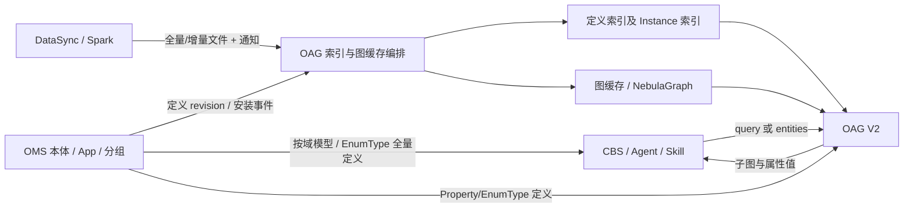

# Agentic Operation Center 27.3.0 功能设计说明书（IRxxx 软件Q4需求）

> 版本：V1.0（功能设计评审稿）  
> 日期：2026-10-31  
> 范围：OMS、OAG、DFx、安全、语义索引构建/检索、DataSync/Spark 联调及内部 Skill  
> 依据：本文件原始“需求范围与需求清单”20 项及参数清单；工作量合计 **7.9（原文未注明单位）**。  
> 定位：本文件是 Q4 跨模块功能设计，**不是已实现清单或经过压测的性能报告**。

**相关设计**：[软件场景准确性和性能优化增强需求设计说明书](./软件场景准确性和性能优化增强需求设计说明书.md) · [OAG 本体锚点语义检索与向量索引设计方案 V6.7](./OAG本体锚点语义检索与向量索引设计方案.md) · [本体维值建模与检索需求分析](./需求分析Spec_本体维值建模与检索.md) · [V2 请求 Schema](./schemas/oag-software-subgraph-request.schema.json) · [V2 响应 Schema](./schemas/oag-software-subgraph-response.schema.json)。

**阅读规则**：第 1 章是原始需求与边界；第 2～6 章给出跨模块设计；第 7 章是配置基线；第 8 章是发布、性能和验收。既有方案与本轮 Q4 发生冲突时，**保留两套口径并列为待决策项**，不擅自认为配置、路由和数据库代码已完成迁移。接口名称、DDL 和状态机中标注“建议”的部分均需详细设计/联调冻结。

---

## 1. 设计目标、场景与需求基线

### 1.1 业务背景与目标

CBS 面向运营商问账、集团客户问账，以及经营、销售、运营、运维人员的问计、问因和辅助决策。例如预付费账户数量、优惠余额、套餐月活 TOP3、账单风险等。业务 IRB 目标为**准确率 90%、业务端到端 5 分钟**；这不是 OAG 单接口 SLA。当前 CBS 本体参考规模为 **144 个 ObjectType、2896 个 Property、370 个 Relationship、11 个业务域**，模型仍在迭代。

本期 Q4 的重点是让 OMS/OAG 具备**安全交付、接口统一、自动索引、多实例扩展、配置治理、可恢复的数据同步与可量化的检索性能**。

### 1.2 目标、原则与交付边界

| 目标 | 要求 | 责任 |
|---|---|---|
| 安全治理 | OMS 本体模型加密；索引最小化明文字段；前端/日志敏感子图可控 | OMS/OAG/安全 |
| 接口统一 | OAG V2 同时服务通用 query 与 CBS entities；Skill 迁移 V2，V1 标记 deprecated | OAG/Skill |
| 自动化交付 | App 安装触发 OAG 定义索引构建、内存图刷新，具备版本一致性与恢复能力 | OMS/OAG |
| DFx 扩展 | OMS、OAG 均支持多实例负载分担、配置分层、故障诊断与快速恢复 | OMS/OAG/运维 |
| 高效数据同步 | 全量 1000 万行、增量 10 万行的实例索引建库/比对/Embedding 优化 | DataSync/Spark/OAG |
| 性能规格 | OAG 单实例 10 QPS、3 s 作为**待验证的原始目标**，制定资源和横向扩展模型 | OAG/性能测试 |
| 可控预研 | 允许部分语义属性只建 OpenSearch 倒排索引，不走向量链路 | OMS/OAG |

**范围**：包括需求表的 20 项及其必要的接口、数据模型、任务状态、并发安全和验收方案。不在本文擅自确定：安全加密算法和密钥服务、DCC 真实接口、LVQ 的数据库版本能力、具体部署副本数、存量表物理删除时间、向量库采购规格。现网 V1 的退役须完成消费者盘点和回归。

### 1.3 术语与主链路

| 术语 | 本文含义 |
|---|---|
| OMS | 本体模型/分组、App 包与元数据版本的权威管理者 |
| OAG | 本体定义索引、Instance 值索引、语义子图检索、图缓存与任务编排服务 |
| OAC | 业务数据访问与 Binding/OQL 能力；不承担 OAG 语义索引事务最终提交 |
| DataSync / Spark | 执行数据抽取、去重/分片、生产快照或增量文件并通知 OAG |
| V2 query / entities | 同一子图检索 API 的两种输入模式；query 可继续自然语言检索，CBS 以 entities 为主要输入 |
| Enum / Instance | Enum 是 OMS 的 EnumType/values[] 权威定义；Instance 是业务数据中真实的属性值 |
| DCC | 后续按租户配置覆盖的配置服务；真实命名空间与 API 待联调 |
| 资源 U | 原估算资源单位，尚无 CPU/内存物理定义，不能直接视为核数 |
| Stable Key | 实例值索引比较键：ontologyId + objectTypeId + propertyId + normalized(value)；规范化规则必须一致 |



### 1.4 原需求范围与工作量清单

原文件的部分行只有“分类、说明、工作量”三列。下表按照其前后 OMS/OAG 段落**推定模块归属，仅用于设计责任分解，须由计划负责人确认**。原工作量值逐项保留；**7.9 为数值求和，原文未说明单位及是否含联调/测试**。

| ID | 归属（整理） | 分类 | 原需求要点 | 原工作量 |
|---|---|---|---|---:|
| Q4-01 | OMS | 安全 | 模型加密，多实例与参数拆分 | 0.5 |
| Q4-02 | OMS | DFx | 分域/本体定义接口规范，Agent 与 OMS 双侧缓存 | 0.2 |
| Q4-03 | OMS | DFx | 多实例水平扩展与负载分担 | 0.1 |
| Q4-04 | OMS | DFx | 故障快速恢复指导书 | 0.5 |
| Q4-05 | OMS | 配置 | App 安装参数分层分级 | 0.1 |
| Q4-06 | OAG | 接口统一 | 服务/软件场景合一，枚举索引默认不入库、属性枚举全量返回 | 0.1 |
| Q4-07 | OAG/Skill | 接口统一 | 开放 Skill V1 → V2，V1 标记 deprecated | 0.3 |
| Q4-08 | OMS/OAG | DFx | App 安装时 OMS 自动触发 OAG 建索引、刷新内存图 | 0.5 |
| Q4-09 | OAG | DFx | 多实例、内存图同步与负载分担 | 0.1 |
| Q4-10 | OAG/底座 | 配置 | 场景包/配置中心/接口参数分层 | 0.5 |
| Q4-11 | OAG | DFx | 故障快速恢复指导书 | 0.5 |
| Q4-12 | OAG/DataSync/Spark | 性能 | 全量单表 1000 万行（100 万用户）、增量 10 万行，Embedding/向量库容量 | 1.0 |
| Q4-13 | OAG | 性能 | 单实例 3 s / 10 QPS 与水平扩展 | 1.0 |
| Q4-14 | OAG | 索引效率 | 本体定义索引全量对比、仅差异行 Embedding | 0.5 |
| Q4-15 | OAG/向量库 | 索引效率 | LVQ 索引在建表时创建；COPY 后免二次 rebuild；DCC 批大小 | 0.2 |
| Q4-16 | OAG/数据生产者 | 联调 | 语义索引 Delete 接口及删除动作 | 0.1 |
| Q4-17 | OAG | 索引效率 | incremental 时数据库内比对，不存在才向量化插入 | 0.5 |
| Q4-18 | OMS/OAG | 预研 | 语义字段只入 OpenSearch、不建向量 | 0.5 |
| Q4-19 | OMS/OAG/安全 | 安全 | 向量/全文索引去名称描述、仅保留 ID，名称反查转内存图/NebulaGraph | 0.5 |
| Q4-20 | OMS/OAG/前端 | 安全 | 后台子图明文日志和前台子图展示的可控屏蔽 | 0.2 |

### 1.5 需求到设计与验收追踪

| 设计专题 | 需求项 | 主要交付 | 验收用例组 |
|---|---|---|---|
| OMS 安全、分域及可用性 | Q4-01～05 | 模型加密、查询/缓存规范、OMS 集群、场景包参数与恢复手册 | OMS-Q4-01～05 |
| OAG V2 与 App 自动交付 | Q4-06～09 | 统一 V2、Skill 迁移、自动建索引和多实例图刷新 | OAG-Q4-06～09 |
| 配置及高可用 | Q4-10～11 | 分层参数、DCC 演进、多实例恢复手册 | DFx-Q4-10～11 |
| 索引与检索性能 | Q4-12～17 | FULL/INCREMENTAL/DELETE、数据库差异同步、LVQ 预研、压测与资源模型 | IDX-Q4-12～17 |
| 倒排-only 与安全 | Q4-18～20 | 属性检索模式预研、索引明文治理、日志/界面保护 | SEC-Q4-18～20 |

---

## 2. OMS 功能设计：本体加密、分域访问与高可用（Q4-01～05）

### 2.1 本体模型加密及安全边界（Q4-01）

**原要求**：本体模型加密、多实例与参数拆分；给定场景包示意参数为 `onto_encrypt: "0"`。安全设计参见：《Agentic Operation Center 27.3.0 功能设计说明书（IR20260731000589 SR20260806887817本体模型文件支持加密）.md》。


### 2.2 分域与本体定义查询（Q4-02）

沿用既有 OMS 分组模型：`ontologyGroup`、`groupMember` 是本体元数据；CBS Agent 负责按域选组，OAG **不接受 groupFilter、也不以分组截断子图连接**。。

**建议复用的三类接口**：

| 能力 | 建议路径 | 缓存与边界 |
|---|---|---|
| 查询分组列表 | `GET /api/v1/ontologies/{ontologyId}/list` | 用于查询当前本体中的可见分组，适用于分组列表 |
| 查询组成员及模型定义 | `POST /api/v1/ontologies/{ontologyId}/group/members` | 按分组返回当前本体中的分组定义及对象成员 |


**双层缓存**：OMS 服务端缓存 Key 建议为 `(tenantId, ontologyId, revision, visibilityScope, groupId, pageCursor)`；客户端 Agent 缓存同样带 tenant/revision，TTL 是失效兜底而非唯一一致性策略。App 发布或模型修订变更时服务端失效旧 revision 缓存，Agent 通过版本头/响应字段发现变化并重新取数。禁止将无权限用户的缓存结果复用给其他租户。

**避免实时全量查询**：正常请求命中 OMS/Agent 缓存；首次访问、revision 变化和缓存失效才重新拉取。并发冷启动采用 single-flight 去重与最大并发/大小限制；只允许请求内同一 revision 的定义组成上下文。分组的准确性以真实业务域定义验收，不把“节省 90% Token”当作已实测承诺。

### 2.3 OMS 多实例水平扩展（Q4-03）

OMS 保持服务无状态或将可恢复状态外置；在本体加密的需求中跟踪。

### 2.4 OMS App 安装参数分层（Q4-05）

OMS 读取的网络拓扑、加密模式等由场景包版本化配置；在本体加密需求中详细描述，包含本体加密参数、参数拆分。

### 2.5 OMS 快速恢复指导书（Q4-04）

形成可执行 Runbook：① 判断 OMS Pod/网关、数据库、KMS 与缓存依赖；② 读取 traceId、任务 ID 和版本；③ 区分只读降级、模型写入失败、组缓存失效、密钥不可达；④ 恢复应用副本与外部依赖、重新装载指定 revision；⑤ 核验组成员、权限与多实例一致性。**不建议未经授权直接改数据库、清空所有租户缓存或临时关闭加密。** 灾备 RTO/RPO 在实际演练后冻结。

---

## 3. OAG 统一接口、自动交付与高可用（Q4-06～11）

### 3.1 一个 V2 入口覆盖服务和软件场景（Q4-06）

统一使用 `POST /v2/onto-retrieval/subgraph/semantic-search`。

**Q4 默认行为**：不再建立或读写枚举值索引 `t_oag_enum_{ontology_id}`；值索引只检索 `t_oag_instance_{ontology_id}`。对于保留下来的 Enum Property，从 OMS 的 EnumType/values[] 同 revision **全量读取** `value/isDefault/defaultDataValue/description/synonyms`，装入 Property 节点 `propertyEnumValues`；实例命中装入 `propertyInstanceValues`；V2 结果不再输出 `semanticExtensions`。无有效实例索引命中不意味着“枚举不存在”，显式 `extractedEntities` 必须保留。

**兼容关系**：返回结构体中增加了可选的propertyvalue等字段，排查上游业务（OWS、SEC、NIS）解析子图的代码逻辑。

接口描述参见：
ICT服务与软件/Agentic Operation Center/Docs/27/27.3.0/02.设计/02.设计文档/Agentic Operation Center 27.3.0 功能设计说明书(IR20260729001097_OAG子图检索能力增强)

**接口样例（query-only）**：

```json
{
  "ontologyId": "cbs-ontology-id",
  "query": "查询账户及关联对象属性",
  "seedRetrievalMode": "hybrid",
  "graphExpansionStrategy": "minimal",
  "topk": 3,
  "includeFunctions": 1
}
```

**Property 值结构示意（响应片段）**：

```json
{
  "label": "property",
  "properties": {
    "name": "paymentType",
    "dataType": "enum",
    "propertyEnumValues": [
      {
        "value": "Prepaid",
        "isDefault": "true",
        "defaultDataValue": "0",
        "description": {"zh": "先付费再使用服务。", "en": "pay first and then use the service."}
      },
      {
        "value": "Postpaid",
        "isDefault": "false",
        "defaultDataValue": "1"
      }
    ],
    "propertyInstanceValues": []
  }
}
```

示例只说明字段结构，**实际必须返回 OMS 定义的全部枚举项**，不能将这两条视为完整模型。`isDefault` 在现有 V2 响应设计中为 `"true"/"false"` 字符串；具体 DTO 遵循 Schema。仅有枚举信息不能自动构造业务 Cypher 过滤条件。

### 3.2 Skill V1 → V2 与 deprecated 管理（Q4-07）

仓库中存在 `ontology-platform-unified-skill/scripts/semantic_subgraph_search.py` 及其他历史目录副本。当前所查脚本仍拼接 V1 URL，并使用 `topK`、默认 `hybrid`、`includeFunctions=1`。本期需要迁移**实际发布和运行**的 Python/Skill.md/前端等调用方，不仅修改某个文件路径。

迁移适配：
1. URL 从 `/v1/onto-retrieval/{ontologyId}/subgraph/semantic-search` 改为 `/v2/onto-retrieval/subgraph/semantic-search`。
2. 先发布 V2 兼容 Skill，再在 V1 返回响应头中**建议**加入 `Deprecation` 等公告（具体日期经评审，不自行设定）。
3. **deprecated 不等于立即删除**：观测 V1 调用来源、服务端流量清零、兼容回归及灰度回退全部完成后另行审批下线。V1 保持原路径和返回结构直到正式退役。

### 3.3 App 安装触发定义索引与内存图刷新（Q4-08）

保持现有的调用通道，在内存图场景重点验证。

### 3.4 OAG 多实例与图缓存同步（Q4-09）

在《ICT服务与软件/Agentic Operation Center/Docs/27/27.3.0/02.设计/02.设计文档/Agentic Operation Center 27.3.0 功能设计说明书（IR20260731000589 SR20260806887975&SR20260806887798本体模型支持内存图管理和子图检索）.md》中详细描述。

### 3.5 OAG 配置分层与故障恢复（Q4-10～11）

配置采用第 7 章的**场景包（网络/部署）、配置中心（租户/系统运行）、请求/任务（参数与幂等 Key）**三级；变更需校验类型、范围、版本并可审计回退。DCC 不可用时仅允许有明确、经过验证的配置基线回退；敏感安全参数不能因缺失而改为宽松设置。

OAG Runbook 至少覆盖：V2 503 限流/排队、Embedding 服务 503/重置、OpenSearch/GaussVector 不可用、LVQ 索引异常、OOM、索引 Task 卡住/重试、图缓存 revision 分歧、OMS 事件丢失及安全脱敏配置错误。每类记录**症状 → 证据指标 → 影响范围 → 止损措施 → 恢复动作 → 发布后校验**；禁止简单通过删除生产索引或关闭权限/加密恢复服务。RTO/RPO 作为演练验收项，不在本文猜数。

---

## 4. 实例索引构建、差异同步与性能（Q4-12、Q4-14～17）

### 4.1 全量/增量数据链路（Q4-12）

规模要求为：**单表首次全量 1000 万行（对应 100 万用户假设），增量 10 万行**；DataSync/Spark 按 `(tenantId, ontologyId, objectTypeId, propertyId)` 拆分读取、Normalize/Dedup 后形成分区文件和 Manifest，再通知 OAG 执行建库。

复用既有 OAG 的 MinIO CSV + 持久化 Task 体系。


### 4.2 定义索引“全量比对 + 增量 Embedding”（Q4-14）

验证结果：
```
SELECT  
test."value",  
test.object_type_id,  
test.property_id  
FROM test  
WHERE NOT EXISTS (  
SELECT 1  
FROM "t_oag_instance_dtmi.ontology.65313863.1"  
WHERE "t_oag_instance_dtmi.ontology.65313863.1"."value" = test."value"  
AND "t_oag_instance_dtmi.ontology.65313863.1".object_type_id = test.object_type_id  
AND "t_oag_instance_dtmi.ontology.65313863.1".property_id = test.property_id  
);  
ontoretrievalvectordb2000=# SELECT  
ontoretrievalvectordb2000-# test."value",  
ontoretrievalvectordb2000-# test.object_type_id,  
ontoretrievalvectordb2000-# test.property_id  
ontoretrievalvectordb2000-# FROM test  
ontoretrievalvectordb2000-# WHERE NOT EXISTS (  
ontoretrievalvectordb2000(# SELECT 1  
ontoretrievalvectordb2000(# FROM "t_oag_instance_dtmi.ontology.65313863.1"  
ontoretrievalvectordb2000(# WHERE "t_oag_instance_dtmi.ontology.65313863.1"."value" = test."value"  
ontoretrievalvectordb2000(# AND "t_oag_instance_dtmi.ontology.65313863.1".object_type_id = test.object_type_id  
ontoretrievalvectordb2000(# AND "t_oag_instance_dtmi.ontology.65313863.1".property_id = test.property_id  
ontoretrievalvectordb2000(# );  
value | object_type_id | property_id  
--------------+---------------------------------------+-------------  
温控器A | oag_instance_dtmi.ontology.65313863.1 | P1001  
3号车间-东区 | oag_instance_dtmi.ontology.65313863.1 | P1002  
(2 rows)
```

### 4.3 Incremental 和 FULL_REPLACE 的数据库差异比对（Q4-17）

**核心实现目标**：以数据库内组合键比较替代全量删表/全量重复 Embedding。建议实例稳定键为 `(object_type_id, property_id, normalized(value))`，并加 `tenantId/ontologyId` 物理隔离；源值归一化语义必须固定。若当前物理库使用 `value` 作为键，须明确规范化发生在写库前且原值是否另存。

示意存储：

```sql
-- 示意结构，非可直接上线的 GaussVector/PG DDL
-- active: t_oag_instance_{ontology_id} (..., value, object_type_id, property_id, vector)
-- stage: 由任务管理的持久化 staging，含 job_id、snapshot_version、上述组合键
CREATE UNIQUE INDEX IF NOT EXISTS idx_stage_job_key
  ON instance_stage(job_id, object_type_id, property_id, value);
```

**FULL_REPLACE（完整快照）**：
1. 所有并行分批数据只写入**同一个 jobId 的 staging**，每批以 `(jobId, partitionId, batchNo)` 幂等确认；不允许线程各建一张目标表、各自执行 Diff/Delete。
2. 只有 `expectedPartitions` 全部完成、校验通过且快照水位固定后，才执行一次数据库集合差：`stage EXCEPT active` 为新增、`active EXCEPT stage` 为待删除，交集为复用向量。需按组合键 `JOIN/NOT EXISTS`，不能把 `vector=NULL` 当作数据变更。
3. 对新增键先有界批量调用 Embedding（去重后），写入新的版本/影子索引；所有双写和索引 Verify 通过后原子切换 active version。对于需同表更新的方案，先安全插入/复用并通过事务或版本标记隔离可见性，最后处理删除；全表大事务和长时间锁应专项评估。
4. 删除必须基于**该完整快照**，不能据某一个尚未到齐的上传批次删除现网其他值。失败或 Task 取消时不能使 Active 丢失数据。

**INCREMENTAL（只有变更集）**：仅对明确的 `ADD/UPSERT/DELETE` 变更操作计算差集；新键不存在时才 Embedding、插入；现有键如果文本与模型签名未变化则跳过向量计算。增量包未声明的旧键**不删除**。同键并发写按 `(sourceVersion, operationSequence)` 保证顺序，旧事件不得覆盖新事件。

**幂等与隔离**：每个 ontology 只允许一个冲突的 FULL 发布；不同分区文件可并行 ingest，但发布/删除互斥。必要时使用租约、advisory lock 或 Task 行 CAS；不能用仅 JVM 内锁跨 Pod 协调。日志可记录 jobId、差异数量，不打印完整用户值。

### 4.4 Embedding 并发与资源限流（Q4-12、14、17）

建议一层统一的有界执行器协调去重后 Embedding 批次，不在请求级/批次级反复创建子线程池。外层通过 semaphore 限制“同时在飞请求数”，内部服务端调用也要校验限流是否真的生效；CompletableFuture 任务必须完整汇聚等待，失败 batch 可重试且不会重复写已成功键。监控包含排队耗时、超时、in-flight、batch size、token、模型 GPU/CPU 利用率、向量写入水位及失败比例。

对于 BGE-M3 1024 维，FP32 单条原始向量约 4096 字节（不含索引、复制与文本），**1000 万条的理论原始向量数据约 38.1 GiB**，但实际需按**去重后语义值条数**而非源业务记录总行数计算，并补充 LVQ/倒排索引、冗余、存储副本和备份空间。1024 维系既有方案，不代表所有模型均固定该维度。

### 4.5 LVQ 建表前置与 COPY 批次调优（Q4-15）

原需求希望 **LVQ 在建表阶段创建，COPY 后免 rebuildindex**。这应列为**需基于当前 GaussVector 版本实测验证的优化假设**，不能仅凭需求就保证预建索引一定比批量导入后再建更快：空表先建索引可能加大每批 COPY 的维护成本，并影响 WAL/IO、写放大及召回。

设计 A/B：A=先建表/COPY 后建立或 REBUILD LVQ；B=先建 LVQ 再 COPY，结束验证索引有效且无需二次 rebuild。在相同数据、并发和资源条件下比较总耗时、COPY rows/s、存储体积、峰值 CPU/IO、索引状态、Recall/Latency 和失败恢复。**只有数据库能力验证通过，才把 B 设置为默认**。

`copy-batch-size` 建议纳入后续 DCC 租户/任务配置，但须明确参数边界和受控范围：一次 COPY 文件的记录数与 DataSync 的上传分区大小、Embedding 批大小是三个独立参数，不可混用。基于实际数据库版本校验有效取值与热修改语义。

### 4.6 Delete 接口及索引删除联调（Q4-16）

沿用持久化任务状态与权限：仅允许授权调用者以 `ontologyId + snapshotVersion/jobId + deletionScope` 删除合法范围内的实体索引；`CLEAR` 全清与 `INCREMENTAL DELETE` 指定键需要明确区分。**不依赖无条件数据库 TRUNCATE**：请求需幂等、重复执行可审计；删除与全量发布冲突时串行化；OpenSearch 和 GaussVector 一库成功另一库失败时不能立即宣告成功，需重试/对账或补偿。

删除本体定义时须处理其 Instance 外键/归属关系，并确认是否需要级联；若业务数据还在持续同步，必须通过事件版本防止旧写入“复活”已删值。索引删除接口的最终路径、鉴权与错误码以 DataSync/OAG 联调冻结。

### 4.7 联调与容量测算（Q4-12）

压测分为：① 1000 万行首次 FULL；② 10 万行增量中分别注入 0%、10%、100% 新值（用于观测嵌入重用）；③ 批次乱序、重试、断连、分区缺失；④ 双库存储故障；⑤ 多实例故障接管与任务恢复。明确模型 ID、去重率、值平均长度、Embedding 模型和限流参数、数据源快照版本、COPY 方式、数据库副本和资源规格；输出全链路瓶颈与建议配置，而非仅给单线程 rows/s。

---

## 5. 查询性能与分级索引预研（Q4-13、Q4-18）

### 5.1 单实例 3 秒 / 10 QPS 与横向扩展（Q4-13）

原需求明确 **单实例“3s、10QPS”**。实现评测建议将 3 s 定义为**待评审 P95 候选**，明确它是否含 OMS EnumType 读取、网络与图库算法，且区分冷/热缓存。不能将“3s”未经评审自动当作 P99 或整个 CBS 端到端 SLA。

建议同一版本/本体/索引快照分别测试 query/entities、低/中/高种子数、minimal/khop/component、实例值命中/未命中、Enum Property 数量和全量枚举基数；采集单实例稳态 10 QPS 时的 P50/P95/P99、错误率、GC、队列延迟、Embedding/向量库/图库 QPS。再测 2/3 实例伸缩，计算 `scaleEfficiency = aggregateQPS / (singleQPS × instanceCount)`，并区分共享数据库成为瓶颈的情形。

### 5.2 语义检索信号量限流

原始参数为 `semantic-search.max-pool-size=25`、`queue-capacity=50`、`timeout-seconds=300`，说明在 transport 线程就地等待并发许可、满队列返回 503。**这只是原配置草案，不是合理超时的实测证明**；transport 线程同步排队 300 秒可能放大入口线程阻塞，应优先评估异步排队、短等待或立即拒绝与客户端重试退避。限流须按实际 token/租户/实例预算，并监控 active、queued、wait、rejected、timeout。服务不可用 503 与限流 503 应可追踪区分。

### 5.3 只入 OpenSearch 的语义字段预研（Q4-18）

OMS Property 增加**建议**检索模式枚举：

| 模式（建议） | 行为 | 边界 |
|---|---|---|
| `HYBRID` | OpenSearch 关键词 + GaussVector 向量 | 保留既有混合检索及权重融合 |
| `LEXICAL_ONLY` | 仅 OpenSearch（无需 Embedding/向量建库） | ID/编码/号码等精确或分词属性适合预研 |
| `DISABLED` | 不参加 Instance 语义索引 | 不影响本体模型/业务真实数据 |

该模式属于 **Q4-18 预研**，不等同于已有 OMS 正式 Property 配置字段。业务属性统一由 OMS 定义模式，OAG 按同一 revision 读取并在索引/检索两端一致执行；不能建库只写 OpenSearch、查询却仍发 GaussVector 请求。

评测须按属性值分层：纯数字/长 ID、中文/英文短值、多义名称、长描述、同义词、大小写和符号。比较 Recall@K/Precision@K、误召回率、索引体积、写入和查询资源；若安全脱敏导致 OpenSearch 无法存储名称描述，参照 §6.1 的兼容性风险处理。

---

## 6. 数据安全与明文治理（Q4-19～20）

### 6.1 向量与 OpenSearch 只保留 ID（Q4-19）

**原要求**：去除向量表和 OpenSearch 的名称、描述，尽可能只保留 ID；通过内存图或 NebulaGraph 按 name/id 获取本体定义。这一要求与既有方案的 **BM25/fuzziness、原文/同义词 Embedding** 有直接冲突，**不能把删除文本列描述为对召回毫无影响**。

建议将数据分为两层：

| 层 | 允许的数据 | 设计建议 |
|---|---|---|
| OMS / 权威本体图 | name、description、synonyms、EnumType 等 | 按权限读取、授权时解密/审计 |
| GaussVector | 稳定实体 ID、归属 ID、版本、向量及索引必需元数据 | 索引写入尽量不持久化明文 name/description；查 ID 后到内存图或 Nebula 获取定义 |
| OpenSearch | 稳定 ID、归属 ID、配置允许的搜索字段 | 若严格“只存 ID”，**不再具备原始文本 BM25/fuzzy 索引能力**；必须重新设计受控 token 索引或降级为精确 ID 检索 |

**两种待评审路线**：A（严格 ID-only）：取消敏感词法全文索引或仅存不可逆、可安全匹配的受控 token，明确牺牲模糊召回；B（保留检索语义）：对必要的最小化词法字段采用经安全批准的专用受控索引和访问边界，而不是声称“只存 ID”。**不能无安全评审自行以固定哈希代替 BM25**（哈希无法保持相似排序，还可能泄露低熵词）；最终实施需安全、业务、搜索团队共同冻结。

**反查策略**：索引只输出 ID/版本，OMS/内存图/Nebula 负责受控 `getById`/批量 ID→name/description 映射；原 `name→id` 检索需转为授权图定义查询或重新批准的索引机制。ID 不是秘密，仍需认证、租户隔离与完整审计。

### 6.2 后台日志与前端子图明文屏蔽（Q4-20）

将“默认不打印完整子图、默认 UI 按权限屏蔽敏感字段”作为**建议的安全优先实现**。日志只记录 traceId、ontologyId 哈希/脱敏标识、revision、任务 ID、阶段耗时、节点/边数量及错误类别；调试明文开关需要 RBAC、过期时间、审计、受控环境，不能由任意用户通过请求参数开启。

前端按照真实用户权限及数据分级显示或遮盖对象/属性名称、描述、枚举实例值；屏蔽必须在**服务端授权响应阶段**执行，CSS/前端隐藏不能作为唯一安全机制。运行时快照、页面下载、网络响应、异常堆栈和日志均不能绕过。开关启停后回归检索准确性与业务授权场景。

---

## 7. 参数分层与原始配置清单（Q4-05、Q4-10）

### 7.1 分层原则

| 层级 | 来源 | 典型参数 | 约束 |
|---|---|---|---|
| 组网/场景包级 | App/场景包安装清单 | `onto_encrypt`、`oag.cache.type`、图数据库依赖和组网拓扑 | 与部署版本绑定，不能由租户请求随意覆盖 |
| 系统/租户配置级 | 配置中心（DCC） | `semantic-search.*`、模型/实例阈值、topk、链接开关、索引 COPY 大小 | 明确 tenantId+输入模式，记录版本、审计及回退 |
| 请求/任务级 | V2 API、索引 Task | ontologyId、query/entities、检索策略、jobId、mode、sourceVersion | 只允许已定义参数覆盖；不能越过安全/资源全局上限 |

**读取优先级（建议）**：显式合法请求字段遵守 API 契约；系统安全/容量上限始终约束执行；租户 + 模式覆盖仅适用于允许覆盖的参数，缺失时采用版本化系统预置。配置中心不可用时不允许把安全相关限制解释成无限制。

### 7.2 原文参数保留与建议解释

以下先**如实保留原 Q4 参数和值**；字段是否支持热更新、DCC 的真实命名空间、`-1` 的语义与运行范围需要代码/配置评审确认。不要将本表直接复制成已上线 YAML：

| 级别 | 原配置键 | 原值 | 设计说明 |
|---|---|---|---|
| 场景包 | `onto_encrypt` | `"0"` | 加密开关原值；0/1 语义待安全评审 |
| 场景包 | `oag.cache.type` | `CACHE_TYPE` 变量 | 内存图/图库依赖选择，合法值待查 |
| DCC | `semantic-search.max-pool-size` | `25` | 最大并发请求数 |
| DCC | `semantic-search.queue-capacity` | `50` | 等待队列上限 |
| DCC | `semantic-search.timeout-seconds` | `300` | 等待并发许可的秒数 |
| DCC | `include-all-properties` | `true` | 全量属性装配 |
| DCC | `include-keys` | `false` | 是否输出键属性的原始配置值 |
| DCC | `subgraph.undirected-filter` | **`false`** | **Q4 原文默认 false**；见 §7.3 与软件 V2 新默认冲突 |
| DCC | `ontology-object-similarity-threshold` | `-1` | 原始哨兵值；必须确认是“继承默认”还是“禁用” |
| DCC | `instance-similarity-threshold` | `-1` | 同上，不能按合法相似度负数直接参与计算 |
| DCC | `instance-topk` | `-1` | 哨兵值，不可直接交给 TopK 检索 |
| DCC | `rrf-topk` | `-1` | 哨兵值，实际融合排名数需校验 |
| DCC | `enable-object-linking` | `false` | 软件 entities 模式跳过 Object 重复链接 |
| DCC | `enable-property-linking` | `false` | 原备注称通用默认 true，软件场景覆盖 false |
| DCC | `enable-property-value-linking` | `true` | 原备注称通用默认 false；**新 V2 仅 Instance**，不再启用 Enum 索引 |
| 建议 DCC | `embedding-thread-pool-size` | 未给值 | Embedding 并发有界控制；原文只给了键名 |
| 建议 DCC | `copy-batch-size` | 未给值 | 仅是原需求中的拟新增项，范围待性能评审 |

### 7.3 原文配置与既有软件设计冲突清单

| 冲突 | Q4 原文 | 既有软件场景文档 | 处理原则与待决策 |
|---|---|---|---|
| 无向图开关 | `undirected-filter: false`，历史方向逻辑为默认 | V2 minimal 设计采用默认 `true`，10/30 先预置、后续再 DCC | **不得静默覆盖其中一方**；需要按实际发布版本 + query/entities 模式明确生效值，并形成升级回归/回退策略 |
| 值链接语义 | 备注称“enum/instance 值召回” | 最新 V2 只使用 `t_oag_instance_{ontology_id}`，OMS 全量返回 Enum | `enable-property-value-linking=true` 仅启动 Instance 链接，Enum 链接分支应移除 |
| DCC 时序 | Q4 直接列出租户级参数 | 软件专项把 10/30 定为服务端预置，后续 DCC 注册接管 | 先冻结运行有效值，再按租户/模式登记，防止升级漂移 |
| 本体敏感字段 | “向量/全文索引只保留 ID” | 通用 OAG 设计使用 name/description/synonyms 和 BM25 | 在安全评审前不能同时保证严格 ID-only 和完整 fuzzy 召回 |
| 检索阈值 | `-1` | V2 Body `similarityThreshold=0.6`（示例默认） | 先定义 -1 继承/禁用含义及 Body/DCC 优先级，不得将 -1 当真实相似度 |

### 7.4 配置发布与回滚

配置更新先校验 Schema、上下限、权限和租户/模式作用域，记录 configVersion 与操作者；同一请求只读取一致快照。灰度可按租户或 OAG 实例进行，错误率和时延异常时回滚到上一个已知有效版本。安全/加密参数、向量维度和索引类型等需要重建或重启的参数必须标识 `restartRequired/reindexRequired`，不能直接宣称热生效。

---

## 8. 验收、性能规格与发布实施

### 8.1 验收矩阵（逐项覆盖原 20 条）

| 用例组 | 需求 | 最低验收断言 |
|---|---|---|
| OMS-Q4-01 | Q4-01 | 加密旧包升级、密钥轮换、多实例重启、权限与密文访问不回退 |
| OMS-Q4-02 | Q4-02 | 按域批量读取、同 revision、Agent/OMS 缓存命中和权限隔离 |
| OMS-Q4-03 | Q4-03 | 双副本负载均衡与模型更新一致，无跨 Pod 脏数据 |
| OMS-Q4-04 | Q4-04 | OMS 异常、密钥/数据库故障有 Runbook 和恢复演练记录 |
| OMS-Q4-05 | Q4-05 | 场景包/配置中心/任务分层正确，越权参数被拒绝 |
| OAG-Q4-06 | Q4-06 | V2 query/entities 兼容；仅 Instance 值链接；Property 返回完整枚举，两数组及旧扩展移除 |
| OAG-Q4-07 | Q4-07 | 已部署 Skill V2、topK→topk，V1 deprecated 且未误删存量路由 |
| OAG-Q4-08 | Q4-08 | App 安装触发任务，按 revision 建库/预热/发布；失败保留旧版本 |
| OAG-Q4-09 | Q4-09 | 多 Pod 图缓存 version 一致；故障切换不返回新索引旧图 |
| DFx-Q4-10 | Q4-10 | 配置类型/权限/层次/审计、灰度和回滚正确 |
| DFx-Q4-11 | Q4-11 | OAG 故障、索引损坏与缓存错配可按 Runbook 恢复 |
| IDX-Q4-12 | Q4-12 | 全量 1000 万、增量 10 万：成功率/rows/s/资源/向量调用数完整留痕 |
| IDX-Q4-13 | Q4-13 | 单实例 10 QPS、3 s 的统计口径通过评审并测出 P50/P95/P99；2/3 副本扩展报告 |
| IDX-Q4-14 | Q4-14 | 全量定义对比无变更时不重算向量；文本/模型变化正确触发 Embedding |
| IDX-Q4-15 | Q4-15 | LVQ 先建/后建 A/B 对照，COPY 结束索引有效；批大小调参可回退 |
| IDX-Q4-16 | Q4-16 | 指定键 Delete、CLEAR、重复请求与双库失败补偿一致 |
| IDX-Q4-17 | Q4-17 | 增量只对缺失键/有效变化嵌入；分批并发不误删旧键、任务幂等 |
| SEC-Q4-18 | Q4-18 | LEXICAL_ONLY 预研与 HYBRID 对照：索引量/准确率/耗时可解释 |
| SEC-Q4-19 | Q4-19 | 不落敏感名称描述，ID→权威定义回查正确；BM25 功能降级/替代方案获评审 |
| SEC-Q4-20 | Q4-20 | 后端日志、前端详情、导出、异常堆栈在非授权情况下不泄密 |

### 8.2 发布顺序与依赖

| 阶段 | 优先工作 | 门禁 |
|---|---|---|
| A — 契约与安全评审 | 完成 V2 DTO、配置冲突、加密模式、字段敏感级别、索引模式选择 | 正式接口、模型 revision、责任清单冻结 |
| B — 可恢复索引路径 | OMS 安装事件、Task/Manifest、分批 staging、仅差异 Embedding、删除/对账 | 全量/增量/删除正确，失败不污染 active |
| C — 接口与多实例 | Skill V2 迁移、图缓存版本同步、多实例并行与限流 | V1/V2 回归，跨 Pod 一致性和故障演练 |
| D — 性能优化和预研 | 1000 万/10 万负载、10 QPS/3 s、LVQ A/B、LEXICAL_ONLY 安全评估 | 有测试报告、容量模型及风险决策 |
| E — 灰度与交付 | Q4 特性开关、配置/密钥回滚、运维手册和安全测试 | 需求表 20 项逐项验收且遗留项备案 |

**注意**：上述是建议技术顺序，**不是用户已确认的具体日期或组织承诺**；实际并行关系、发布范围和每项工作量单位仍须项目管理确认。

### 8.3 统一可观测性与验收记录

每个请求/任务至少记录（脱敏）：`traceId、tenantId(受控)、ontologyId、revision、operation/mode、jobId、sourceVersion、configVersion、indexVersion、cacheVersion、stageLatency、rowsScanned、rowsInserted、rowsDeleted、embeddingCount、retryCount、errorCategory`。按 OMS/OAG 多实例、DataSync/Spark、OpenSearch/GaussVector、图库和 Embedding 模型维度建立看板。正式验收保存数据集、脚本、配置、压测报告、故障注入和恢复证据。

对“单实例 3 s / 10 QPS”至少列出成功率、响应大小、P50/P95/P99、CPU/内存/GC、图库和底层检索负载；对 1000 万/10 万同步分别给出批次完成率、恢复时间和向量复用率。模型/硬件和数据规模不一致时，禁止直接比较吞吐。

### 8.4 待决策事项与评审输出

| 编号 | 待确认事项 | 建议牵头 |
|---|---|---|
| D-01 | 原工作量 7.9 的单位、20 行模块归属和最终优先级 | 项目管理/OMS/OAG |
| D-02 | `onto_encrypt` 0/1、加密范围、KMS、密钥轮换与恢复 | OMS/安全 |
| D-03 | 组查询正式 API、分页、revision 与缓存失效协议 | OMS/CBS |
| D-04 | Q4 `undirected-filter=false` 与软件 V2 预置 true 的版本/模式生效矩阵 | OAG/版本管理 |
| D-05 | V2 entities String/Object、Skill topk、V1 deprecated 响应与下线条件 | OAG/Skill/前端 |
| D-06 | OMS→OAG App 事件/任务 API、发布一致性、重试/补偿策略 | OMS/OAG |
| D-07 | LVQ 当前数据库版本是否允许预建且 COPY 后无需 rebuild，COPY 批大小范围 | GaussVector/OAG |
| D-08 | `-1` 语义、DCC 配置作用域及服务不可达时的回退 | OAG/配置底座 |
| D-09 | 严格 ID-only 与 OpenSearch BM25 模糊检索之间的安全/能力权衡 | 安全/OAG/业务 |
| D-10 | 3 s 的 P95/P99 口径、10 QPS 稳态条件、CPU/内存与副本规模 | OAG/性能测试 |

**设计结论**：本 Q4 方案以保留 OMS/OAG 权威边界和版本一致性为前提，将 20 项需求串成“模型与 App 安装 → 版本化索引构建/差异同步 → V2 统一检索 → 多实例可用 → 安全与性能验收”的闭环。所有原始数量级和配置原值均保留；新提议的 API、状态、参数名和安全替代方案只作为**待评审设计**，以实现联调及验收结果为准。
