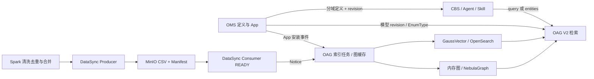
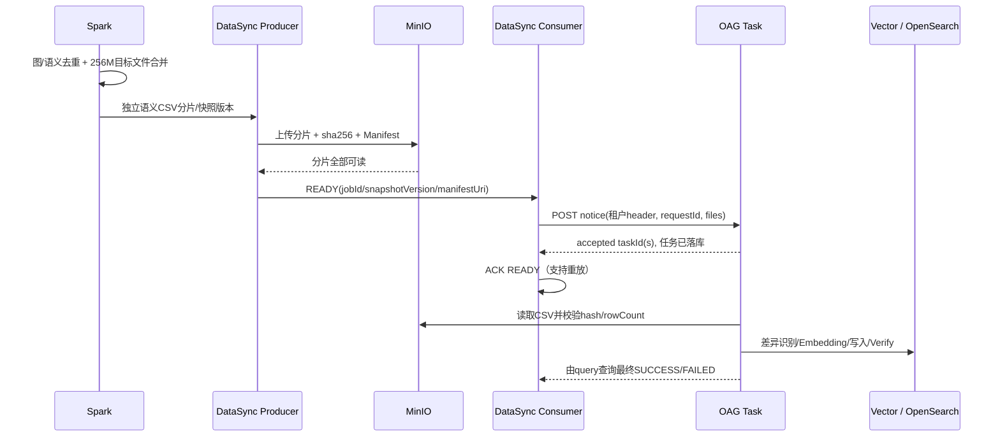
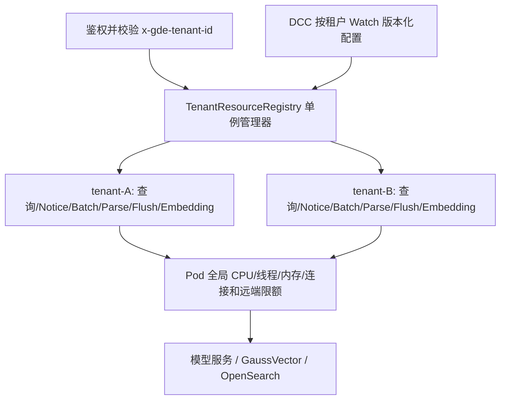

# Agentic Operation Center 27.3.0 功能设计说明书（IRxxx 软件Q4需求）

> 版本：V1.3（2026-11-02）  
> 范围：OMS、OAG、DFx、语义索引构建与检索、DataSync/Spark 联调、本体安全及 Skill 接口  
> 设计目标：面向 CBS 软件上车场景，统一本体模型访问与子图检索能力，实现索引自动化构建、增量同步、水平扩展、租户资源隔离和性能规格化管理。

---

## 1. 设计目标、场景与需求基线

### 1.1 业务背景与目标

CBS 面向运营商问账、集团客户问账，以及经营、销售、运营、运维人员的问计、问因和辅助决策。例如预付费账户数量、优惠余额、套餐月活 TOP3、账单风险等。业务 IRB 目标为**准确率 90%、业务端到端 5 分钟**；OAG 单接口按照独立检索性能规格验收。当前 CBS 本体参考规模为 **144 个 ObjectType、2896 个 Property、370 个 Relationship、11 个业务域**，模型仍在迭代。


本期 Q4 的重点是让 OMS/OAG 具备**安全交付、接口统一、自动索引、多实例扩展、配置治理、可恢复的数据同步与可量化的检索性能**。

### 1.2 最新目标与交付边界

| 目标 | 最新要求 | 主责 |
|---|---|---|
| OMS 安全 / DFx | 模型加密参数拆分，详细方案跟随《本体模型文件支持加密》；OMS 分域/定义接口及 Agent/OMS 双级缓存 | OMS/GDE |
| 公共 DFx | OMS/OAG 场景包分层与恢复指导书遵循 GDE 统一要求 | OMS/OAG/GDE |
| OAG 统一 | V2 query/entities 双模式、Skill V1 → V2，枚举不建索引、Property 全量返回枚举 | OAG/Skill |
| App 自动化 | **先修复手动创建索引偶现问题**，再自动触发建索引及图缓存刷新 | OMS/OAG |
| 全量增量 | 1000 万行首次全量、10 万行增量；DataSync 异步生产通知、Spark 合并小文件及前置去重 | Spark/DataSync/OAG |
| 租户资源 | **线程池、队列与并发配额按租户划分，线程池资源参数按租户 DCC 监听**；系统级参数不进入 DCC | OAG/配置底座 |
| 子图查询 | **原始 10 QPS/3s 目标保留**；10-26 附件定义 2U4G/10 QPS/平均 ≤5s、极端拒绝 <20%，3U4G 建议压测；两口径需联合评审 | OAG/性能测试 |
| 检索预研与安全 | 仅 OpenSearch 倒排检索及 ID-only 安全索引要共同评审 | OMS/OAG/安全 |

**边界**：保留 Q4-01～20 原编号；公共 GDE 和加密专项仅定义集成责任，不重复制定安全或运维底座规范。详细 Task API、DCC Watch 协议、数据库 LVQ 与索引删除时点属于待联调实现；不能把本文目标描述成已上线能力。

### 1.3 术语、责任边界与主链路

| 术语/责任 | 本文明确的边界 |
|---|---|
| OMS | 本体定义、EnumType、分域分组、模型 revision、App 安装状态与元数据权限的权威来源 |
| OAG | 定义索引和 Instance 值索引、V2 子图检索、内存图、异步任务生命周期、索引发布与租户资源隔离 |
| CBS/业务 Agent | 分域本体定义缓存；query 或提前抽取的 entities；对子图与业务知识进一步使用，不把 OAG 当业务推理引擎 |
| Spark | 计算侧生成图与语义索引数据、合并小文件、两类数据按完整业务键去重 |
| DataSync Producer/Consumer | 写 MinIO 不可变分片/Manifest → READY → 消费通知并调用 OAG Notice；不代替 OAG 的索引构建 |
| GaussVector / OpenSearch / NebulaGraph | 实例 Vector、词法倒排、图数据/内存图回源的不同存储依赖；故障与版本发布分别管理 |
| DCC | 租户线程池与配额等候选运行参数的动态配置来源，真实 SDK/命名空间需与平台底座核实 |
| 稳定业务键 | 实例值逻辑键 `(tenantId, ontologyId, objectTypeId, propertyId, normalized(value))`；若按租户/本体物理隔离，可在单表内使用后三项，**原值归一化规则必须冻结** |



**数据一致性原则**：Notice 受理不等于建库成功；任务状态与索引发布版本必须持久化，多实例请求使用相同的 active revision。敏感 ID/数据值在日志、缓存、接口中按 tenant/ontology 权限隔离。

### 1.4 最新需求范围与需求清单（2026-10-31）

本期建设范围包含 OMS、OAG、DFx、性能与安全共 20 项需求，按 Q4-01～Q4-20 建立设计和验收对应关系。

| 需求编号 | 模块与能力 | 本轮需求描述 | 详细设计 |
|---|---|---|---|
| Q4-01 | OMS / 本体加密 | 参数拆分；详细方案跟随《本体模型文件支持加密》 | §2.1、§6 |
| Q4-02 | DFx / OMS 分域 | 分域/本体定义接口规范，Agent 缓存+OMS 内部缓存避免实时全量查询 | §2.2 |
| Q4-03 | DFx / OMS 多实例 | 水平扩展及负载分担 | §2.3 |
| Q4-04 | DFx / OMS 恢复 | 公共故障恢复指导书，跟随 GDE 统一要求 | §2.5 |
| Q4-05 | DFx / OMS 配置 | 场景包参数分层，跟随 GDE 统一要求 | §2.4、§7 |
| Q4-06 | OAG / 统一接口 | 服务/软件场景统一；默认不建枚举检索索引，子图属性全量返回枚举 | §3.1 |
| Q4-07 | 接口统一 / Skill | V1 切换 V2，V1 标记 deprecated | §3.2 |
| Q4-08 | DFx / 自动索引 | **先修复手动建索引偶现问题**，再由 OMS App 安装触发 OAG 建索引并刷新图 | §3.3 |
| Q4-09 | DFx / 多实例 | OAG 多实例、内存图同步刷新及接口负载分担 | §3.4 |
| Q4-10 | DFx / 配置分层 | 组网参数场景包、系统参数配置中心、任务参数 API；租户线程池/DCC Watch | §3.5、§7 |
| Q4-11 | DFx / 恢复 | 公共故障恢复指导书，跟随 GDE 统一要求 | §3.5 |
| Q4-12 | 性能 / 数据导入 | **单表 1000 万行全量（100 万用户）、10 万行增量**；DataSync Producer/Consumer 异步通知（爱华）、Spark 目标 256M 小文件合并（振鲁）及图/语义去重、Embedding/向量库资源与入库规格 | §4.1、§4.7 |
| Q4-13 | 性能 / 子图查询 | **原始需求：单实例 10 QPS、3 s，并支持水平扩展**；10-26 测试附件：2U4G 10 QPS、平均 ≤5 s、拒绝 <20%——两种口径并列，验收优先级待冻结 | §5.1、§8 |
| Q4-14 | 性能 / 定义索引 | 数据库全量比对、差异 Embedding | §4.2 |
| Q4-15 | 性能 / LVQ | LVQ 建表前置、COPY 后免 rebuild 的目标及 DCC COPY 大小调优 | §4.5 |
| Q4-16 | 性能 / 删除 | Delete 语义索引删除接口联调 | §4.6 |
| Q4-17 | 性能 / 增量 | Incremental 在向量库比对，缺失/变化才向量化插入 | §4.3 |
| Q4-18 | 性能/准确率 / 预研 | 实例值只进 OpenSearch 不进向量库，OMS 配语义字段；关键词单路路由及覆盖范围评估 | §5.3 |
| Q4-19 | 安全 / 索引字段 | 向量/OpenSearch 去名称描述、ID 反查内存图/NebulaGraph，详情跟随加密专项 | §6.1 |
| Q4-20 | 安全 / 明文屏蔽 | 后台日志及前端子图明文脱敏，通过加密堆栈参数控制，详情跟随加密专项 | §6.2 |

**需求差异与优先级**：Q4-08 手动索引缺陷先于自动化；Q4-12 需完成 Spark→DataSync→MinIO→OAG 三项优化及 1000 万行验证；Q4-10 必须物理隔离租户线程池/队列；Q4-13 原始 **10 QPS/3s** 是不能删除的目标，附件 **2U4G/平均 5s** 是另一测试口径，**未评审前均保留，不能宣称 3s 已满足或已被正式取消**；Q4-18 的 Keyword-only 与 Q4-19 的 OpenSearch ID-only 存在安全与召回冲突。

### 1.5 需求到设计与验收追踪

| 设计专题 | 需求项 | 主要交付 | 验收用例组 |
|---|---|---|---|
| OMS 安全、分域及可用性 | Q4-01～05 | 模型加密、查询/缓存规范、OMS 集群、场景包参数与恢复手册 | OMS-Q4-01～05 |
| OAG V2 与 App 自动交付 | Q4-06～09 | 统一 V2、Skill 迁移、自动建索引和多实例图刷新 | OAG-Q4-06～09 |
| 配置及高可用 | Q4-10～11 | 分层参数、DCC 演进、多实例恢复手册 | DFx-Q4-10～11 |
| 索引与检索性能 | Q4-12～17 | FULL/INCREMENTAL/DELETE、数据库差异同步、LVQ 预研、压测与资源模型 | IDX-Q4-12～17 |
| 倒排-only 与安全 | Q4-18～20 | 属性检索模式预研、索引明文治理、日志/界面保护 | SEC-Q4-18～20 |

---

## 2. OMS 功能设计：本体加密、分域访问与高可用（Q4-01～05）

### 2.1 本体模型加密与参数拆分（Q4-01）

OMS 完成本体加密相关参数拆分，实现组网级参数、系统级参数和接口级参数的分层配置。模型安装、升级、回滚及多实例加载过程传递统一加密参数，并完成模型权限、密钥依赖和配置校验。加密算法、密钥格式与堆栈开关遵循《本体模型文件支持加密》的统一设计。OMS、OAG 完成加密模型的索引构建、查询及权限联调。

### 2.2 分域查询与定义接口、Agent/OMS 双级缓存（Q4-02）

OMS 基于现有内存图提供本体分域查询和定义查询能力。业务 Agent 在会话开始或分域切换时加载相关本体定义，并缓存对象、属性和关系信息；后续轮次优先读取 Agent 缓存。OMS 使用内存图完成服务端查询与缓存，实现业务 Agent 与 OMS 两级查询加速。

| 功能 | 接口 | 处理说明 |
|---|---|---|
| 分域列表查询 | `GET /api/v1/ontologies/{ontologyId}/list` | 根据租户、本体 ID 和权限返回可见分组 |
| 分域成员查询 | `POST /api/v1/ontologies/{ontologyId}/group/members` | 根据分组 ID 获取 ObjectType、Property 和 Relation 成员定义 |
| 本体定义查询 | OMS 既有本体定义查询接口 | 批量获取对象、属性及关系定义，复用服务端内存图 |

**缓存策略**：Agent 缓存按 `(tenantId, ontologyId, groupId, 会话/授权范围)` 管理，模型发生变更时更新对应缓存；OMS 内存图统一提供当前有效本体定义。对话流内复用已加载分域，减少 OMS 远程调用与网络消耗。缓存命中率、加载耗时、OMS 请求量及堆内存按会话和租户统计。

**性能规格与资源评估**：OMS 单实例按 **1U2G** 部署配置开展分域接口服务级压测，测试场景为 **10 个在线会话、10 路并发，单次分域/定义查询 3 秒内完成**。基于业务真实分域模型，同时设置 Agent 缓存命中与首次加载两组负载，记录 1U2G 条件下的成功 QPS、平均/P95/最大时延、CPU/内存、图缓存占用和 GC。预期能力为在 Agent 复用缓存的常态下支撑 10 会话并发访问；**最终单实例可承载并发数按 1U2G 压测结果确认**，并据此配置服务限流和容量扩展阈值。

### 2.3 OMS 多实例水平扩展（Q4-03）

OMS 使用 LB/网关统一接入，基于健康实例与连接负载将分域和定义查询请求**均匀路由至多个 OMS 实例**。每个实例加载本体内存图并提供独立查询能力，支持 1→2→3 实例水平扩容、负载分担和故障实例自动摘流。

OMS 多实例内存图刷新、模型加密加载和变更通知按《本体模型文件支持加密》统一机制实施。新实例完成内存图加载与健康检查后加入服务池；实例退出后由网关将请求分配至其他健康节点。验证 1U2G 单实例基准、双实例并发能力、负载均衡比例、实例故障接管及扩容后的查询耗时。

### 2.4 OMS 场景包参数分层（Q4-05）

OMS 场景包参数遵循 GDE 统一分级规范：组网级参数随场景包交付，系统级参数纳入配置中心，单次任务参数由接口传递。安装阶段校验参数完整性及合法范围，升级与回滚阶段延续配置兼容规则。配置治理涵盖模型加密、内存图加载、分域查询与服务实例资源。

### 2.5 OMS 故障快速恢复（Q4-04）

OMS 按 GDE 公共故障恢复规范补充本体模型加载失败、分域查询超时、缓存异常、加密参数异常、实例退出及 App 安装失败等场景的操作指导。每个场景包含故障现象、诊断指标、恢复步骤、恢复后的业务校验和演练记录。RTO、RPO 与恢复入口执行 GDE 统一标准。

## 3. OAG 统一接口、自动交付与高可用（Q4-06～11）

### 3.1 服务/软件场景统一 V2 本体子图接口（Q4-06）

OAG 提供统一的本体语义子图检索接口，支持自然语言问题和业务已抽取实体两种输入。服务场景使用 `query`，软件场景使用 `entities` 并关闭重复的对象/属性链接处理。子图返回对象、属性、关系、Function 与 Action 的模型信息，并按属性类型装配枚举和实例值。

**接口**：`POST /v2/onto-retrieval/subgraph/semantic-search`，`Content-Type: application/json`。

| 参数 | 类型与默认值 | 功能说明 |
|---|---|---|
| `ontologyId` | String，必填，1～256 字符 | 指定当前检索本体 |
| `query` | String，可选，1～1024 字符 | 输入自然语言业务问题 |
| `entities` | String，可选，1～102400 字符 | 输入 JSON String 形式的结构化实体，优先执行此模式 |
| `adaptiveRetrieval` | int，默认 1 | 软件实体检索时设置 0 |
| `seedRetrievalMode` | `vector/keyword/hybrid`，默认 `vector` | 设置种子检索通道；Skill 使用 `hybrid` |
| `similarityThreshold` | 默认 0.6 | 向量检索相似度阈值 |
| `topk` | 默认 3 | 设置每阶段候选数量 |
| `graphExpansionStrategy` / `hopLimit` | 默认 minimal / 3 | 设置子图构建策略及跳数 |
| `includeFunctions` / `includeActions` | 默认 0 / 0 | 控制模型附加信息返回 |

**软件场景组合**：`entities` 非空，`adaptiveRetrieval=0`，配置 `enableObjectLinking=false`、`enablePropertyLinking=false`、`enablePropertyValueLinking=true`、`includeAllProperties=true`。`extractedEntities` 至少包含一个 `objectType`；每个 `propertyValues` 项携带实例 `value`，`property` 支持空串或省略，用于按对象下全部可检索实例字段进行链接。对象种子经裁剪后连接成最小连通子图，属性通过 `has_property` 边补齐。

**请求示例**：

```json
{
  "ontologyId": "dtmi.ontology.example.1",
  "query": "How many prepaid accounts are there?",
  "entities": "{\"entities\":{\"extractedEntities\":[{\"objectType\":\"Account\"}],\"propertyValues\":[{\"objectType\":\"Account\",\"propertyValues\":[{\"property\":\"paymentType\",\"value\":\"prepaid\"}]}]}}",
  "adaptiveRetrieval": 0,
  "seedRetrievalMode": "hybrid",
  "similarityThreshold": 0.7,
  "topk": 2,
  "graphExpansionStrategy": "minimal",
  "includeFunctions": 0,
  "includeActions": 0
}
```

**响应**：`resultCode/resultMessage/result`；`result` 下返回 `seedNodes/nodes/edges/functions/actions/propertyValuesLinks`。`seedNodes` 存储 ObjectType 种子；Property 节点顶层根据属性类别返回 `propertyEnumValues`（OMS EnumType 全量枚举）和 `propertyInstanceValues`（实例属性命中值），`properties` 存储 name、dataType、enumDataType 等属性元数据。`propertyValuesLinks` 保存值链接候选、规范值及分数。兼容期同时支持 query 模式的 `nodes[].type` 和 entities 模式的 `nodes[].label/properties` 两种结构，统一接口 DTO 逐步收敛。枚举值采用 OMS 权威定义并随属性全量返回，实例值检索访问 `t_oag_instance_{ontologyId}`。

### 3.2 Skill 和脚本从 V1 迁移到 V2（Q4-07）

**Skill 改造文件**：`ontology-platform-unified-skill/SKILL.md`、`ontology-platform-unified-skill/scripts/semantic_subgraph_search.py`。原脚本按 `/v1/onto-retrieval/{ontologyId}/subgraph/semantic-search` 拼接 URL、Body 使用 `topK`、强制 query，不支持 entities，并且 HTTP 失败可能被当成成功。迁移后的脚本改用 `/v2/onto-retrieval/subgraph/semantic-search`，`ontologyId` 入 Body、发送 `topk`，支持 query-only、entities-only 与混合输入，并进行本地参数校验。

**Skill 调用**：

```bash
python scripts/semantic_subgraph_search.py --query "<问题/业务主题>"
python scripts/semantic_subgraph_search.py --ontology-id "<本体ID>" --entities-file ./entities.json --adaptive-retrieval 0
python scripts/semantic_subgraph_search.py --query-json @request-v2.json
```

第一条需要环境变量 `ONTOLOGY_ID`；仍需 `SERVICE_NAMESPACE`、`TENANT_ID`。`--entities-file` 或 `--entities` 传入内部对象或 `{"entities":{...}}` 包装后自动转 HTTP JSON String。完整 Body 支持显式 0，不再通过 `or default` 覆盖。脚本正确识别 HTTP 非 2xx、`resultCode` 失败、`result=null`、非法 JSON 和网络超时，失败时输出结构化错误并返回非零退出；**保留原 `message_type=message_ontololgy_subgraph` 以避免上游包装契约突变**。

**V1 deprecation**：迁移各调用方后可按正式评审添加 `Deprecation` 公告，监控旧端点调用来源及流量；V1 不立即删除，需业务回归、灰度回退和退役批准。

### 3.3 App 安装自动创建索引、刷新内存图（Q4-08）

**第一阶段：修复手动创建索引异常。**

故障复现步骤：

1. 完成环境与本体 App 初始安装，确认 OMS 本体定义可查询。
2. 在管理页面手动执行创建本体索引，等待任务状态显示创建成功。
3. 调用 V2 本体子图检索接口，使用可命中的对象或业务问题进行查询。
4. 检查返回的 `result.nodes/result.edges` 是否为空，并核对索引表记录数、内存图节点数及检索日志。
5. 在相同安装环境重复执行上述流程，定位“索引任务成功、子图检索返回空结果”的偶发场景。

修复索引创建成功状态与实际检索可用状态的联动，建立索引数据、内存图加载和检索返回的统一校验。验证检索可用后完成手动建索引验收。

**第二阶段：App 安装自动化。** OMS 在本体 App 安装或更新完成后调用 OAG 创建索引接口；OAG 依次执行创建索引任务、构建定义索引、刷新内存图和检索验证，任务成功后对外提供新模型检索能力。重复安装按租户、本体和任务标识幂等处理，失败任务按可恢复阶段重试；安装、建索引及子图检索完成状态在 OMS/OAG 管理界面可查询。

### 3.4 OAG 多实例水平扩展、内存图刷新与负载分担（Q4-09）

OAG 经 LB/网关将检索请求均匀路由至健康实例，支持多实例水平扩容和租户流量分担。每个实例在本地内存中**仅维护当前最新本体图版本**，服务启动或模型发生更新时从 OMS/图存储加载最新定义并整体刷新内存图。模型变更完成后通知各 OAG 实例同步刷新；遗漏通知的实例通过定期版本检查恢复一致。

本体图缓存采用按租户和本体隔离的内存管理方式，刷新后清理旧图占用，保障每个实例的内存预算。索引后台任务由持久化任务状态与租约机制协调执行，故障实例的任务根据 Checkpoint 恢复。

多实例验收覆盖 1/2/3 Pod 负载分担、网关路由均匀度、最新内存图刷新、一台 Pod 退出、Pod 重启后的图加载、租户隔离和检索结果一致性。按单实例与双实例的吞吐及下游依赖利用率评估横向扩容收益。

### 3.5 OAG 参数分层与公共故障恢复（Q4-10～11）

分层规则见 §7.1；**线程池资源按租户隔离，线程池参数按租户 DCC 监听**（详见 §7.3～§7.5），不能用全局 `@Value` 静态注入声称支持租户热更新。容器还须有全局资源上限。

故障快速恢复**跟随 GDE 公共需求**，OAG 专项增加：Embedding 服务 503、Instance Task 卡住、MinIO READY/NOTICE 丢失、租户队列饥饿/配置 Watch 错误、图缓存 revision 不一致等场景。提交证据包括监控/日志、恢复动作与演练结果；RTO/RPO 仍按 GDE 统一要求执行。

---

## 4. 实例索引构建、差异同步与性能（Q4-12、Q4-14～17）

### 4.1 Spark/DataSync 全量与增量数据入库、1000 万行验收（Q4-12）

**原始规格**：单表首次全量 **1000 万行 / 100 万用户**，增量 **10 万行**。源需求的三项措施及责任不合并：

1. **DataSync 生产者—消费者异步（爱华）**：Producer 接收 Spark 已生成的独立语义索引 CSV（不重复生成），写入 MinIO **不可变文件**，完成 写入后发布 READY；Consumer 只有收到完整 READY 才调用 `index-data/notice`。这样去掉**接口同步等待 CSV 上传 MinIO**，但 OAG 必须仍读取 CSV、做真实入库、异步更新任务状态。
2. **Spark 合并小文件（振鲁）**：计算侧按对象粒度合并图数据/语义索引小文件，**目标单文件 256M**。
3. **Spark 图/语义去重前移**：图按完整顶点/边复合键及事件版本去重；语义按 `(tenantId, ontologyId, objectTypeId, propertyId, normalized(value))` 去重。新的语义索引文件由 Spark 单独生成，DataSync 直接上传 MinIO；**后端仍保留唯一索引与幂等**，避免跨批、回放和乱序导致 COPY 主键冲突。



#### 4.1.1 全量与增量同步性能测试结果

入库测试采用 **OAG 3U4G、8/16 并发**及两类服务器，统计各阶段的处理速率与总耗时。

| 测试模型 | 服务器类型 | OAG规格 | 数据量 | 测试场景 | OAG接口同步（条/s） | Embedding读数据（条/s） | 向量入库（条/s） | 总耗时（s） |
|---|---|---|---|---|---:|---:|---:|---:|
| 单文件全量 | 920C 物理机 | 3U4G | 10万 | 8并发 | 345.01 | 526.73 | 814.71 | 289.85 |
| 单文件全量 | HV6 虚拟机 | 3U4G | 18万 | 8并发 | 340.74 | 463.32 | 706.09 | 528.26 |
| 多文件10并发全量 | 920C 物理机 | 3U4G | 200万 | 8并发 | 262.81 | 215.18 | 316.83 | 7610.10 |
| 多文件10并发增量 | 920C 物理机 | 3U4G | 20万 | 8并发 | 403.80 | 859.52 | 770.90 | 505.20 |
| 多文件10并发全量 | 920C 物理机 | 3U4G | 20万 | 16并发 | 387.32 | 1550.39 | 556.49 | 526.70 |
| 多文件10并发增量 | 920C 物理机 | 3U4G | 20万 | 16并发 | 451.32 | 1252.11 | 826.45 | 452.00 |


#### 4.1.2 100 万用户/1000 万行验证与容量评估

**服务级测试数据**：以业务测试构造的 **94 万条实例值数据**为基线，按业务对象、属性、值长度及数据分布扩展至 **100 万用户、单表 1000 万行实例值索引数据**。生成数据保持原有属性分布与合法对象归属，增量样本单独构建 10 万行；记录原始条数、扩充条数和去重后条数。

**测试场景**：

| 场景 | 数据规模 | 验证内容 |
|---|---|---|
| 首次全量同步 | 单表 1000 万条 | Spark/MinIO/Notice/Embedding/向量库完整流水线，统计总耗时和资源消耗 |
| 增量同步 | 10 万条 | 0%、10%、100% 新增值比例，对比 Embedding 调用数与差异入库耗时 |
| 多实例同步 | OAG 1/2/3 实例，Embedding 1/2/3 副本 | 验证批处理并发、模型副本扩容、GaussVector 写入能力及水平扩容效率 |
| 异常恢复 | 文件重传、任务重试、Pod 退出、模型超时、数据库连接异常 | 验证任务幂等、续处理与完整性校验 |

**性能估算**：基于已有增量同步测试的 **451.32 条/秒**作为端到端估算基准：

\[
T_{\mathrm{full}} = \frac{10{,}000{,}000}{451.32} \approx 22{,}157\ \mathrm{s} \approx 6.16\ \mathrm{h}
\]

\[
T_{\mathrm{incremental}} = \frac{100{,}000}{451.32} \approx 222\ \mathrm{s} \approx 3.69\ \mathrm{min}
\]

以上为**451.32 条/秒基准下的容量规划估算值**；生产验收依据 1000 万全量与 10 万增量实际测量值。通过压测进一步获取不同新增率的 Embedding TPS、向量库 COPY TPS、OpenSearch Bulk TPS、CPU、内存和存储 IO，并以各环节实测吞吐确定资源配置。

**验收**：全量索引行数与源数据对账一致、同一组合键幂等写入、增量差异识别准确、模型/向量库资源可稳定支撑业务同步周期；压测记录单实例吞吐及多实例扩容系数。

### 4.2 本体定义索引：全量比对、差异 Embedding（Q4-14）

**与 Q4-17 的区别**：Q4-14 处理 OMS 的 ObjectType/Property/Relationship 定义语义索引（`t_oag_{ontologyId}` 等权威表）；Q4-17 处理真实 Instance Value（`t_oag_instance_{ontologyId}`）。二者共享数据库增量判定思想，但不能把 Instance 的 `(value, object_type_id, property_id)` 键硬套到定义索引，也不能删除定义索引后全量重算。如下版本化定义索引逻辑为**建议实现**，实际定义索引唯一键及表字段须核对现有 Mapper。

1. **新记录和内容变化**只对该批差异计算 Embedding，已存在且内容散列不变的 Vector 保留；确保不同模型版本/维度不误用旧 Vector。参考 Q4-17 的 `TEMP B → SELECT NOT EXISTS/LEFT JOIN → Java Embedding → 幂等写 A`，但定义场景使用自己的定义主键和文本摘要列，不复用 Instance 的临时表 DDL。

**SQL 保留说明**：GaussDB 实测 SQL 实际查询的是 `t_oag_instance_...`，属于**Instance 记录增量比对**而非定义索引。

### 4.3 Instance 值增量：每批独立 TEMP B、数据库差异、Embedding 与幂等写入（Q4-17）

**增量索引方案**：每批默认 **4000 条**，每个批次创建独立 TEMP B，执行数据库差异识别、对新增组合键计算 Embedding，并将新数据幂等写入正式表 A。批次独立到达、独立处理，存量向量按组合键直接复用。

#### 4.3.1 既有 GaussDB 实测 SQL（保留原始语句及输出）

**GaussDB 新增数据识别 SQL**：使用 `test` 作为输入数据表、`t_oag_instance_...` 作为存量索引表，通过 `NOT EXISTS` 查询新增键。TEMP/ON COMMIT DROP、UPSERT 和 LVQ 语法按目标数据库版本验证。

```sql
SELECT
    test."value",
    test.object_type_id,
    test.property_id
FROM test
WHERE NOT EXISTS (
    SELECT 1
    FROM "t_oag_instance_dtmi.ontology.65313863.1"
    WHERE "t_oag_instance_dtmi.ontology.65313863.1"."value" = test."value"
      AND "t_oag_instance_dtmi.ontology.65313863.1".object_type_id = test.object_type_id
      AND "t_oag_instance_dtmi.ontology.65313863.1".property_id = test.property_id
);
```

源验证结果：

```text
value         | object_type_id                         | property_id
温控器A        | oag_instance_dtmi.ontology.65313863.1 | P1001
3号车间-东区   | oag_instance_dtmi.ontology.65313863.1 | P1002
(2 rows)
```

**正式 A 表结构（原有 SQL，保留供建表路径核查；不是 B 结构）**：

```sql
create table if not exists "${tableName}"
(
    vector floatvector(${vectorDim}) not null,
    value VARCHAR(4096),
    synonyms text,
    property_id VARCHAR(512) not null,
    property_name VARCHAR(512),
    object_type_id VARCHAR(256) not null,
    object_type_name VARCHAR(512),
    CONSTRAINT "uk_instance_${tableName}"
      PRIMARY KEY (object_type_id, property_id, value)
);
```

注意 `${tableName}` 是 MyBatis 原有动态标识符用法，**不得由上游任意传入字符串**；必须将其映射为白名单 tenant/ontology 对应的服务端表名并正确引用，不能把模型 ID 原样拼接 SQL 以形成注入面。上例正式表的 `vector NOT NULL` 不允许直接用 `LIKE A` 而只导入 3 字段的 B。

#### 4.3.2 独立临时表命名、防冲突与生命周期

| 项目 | 规范与原因 |
|---|---|
| 推荐表名 | `tmp_oag_emb_b_<batch_uuid32>`，示例 `tmp_oag_emb_b_a81f62c0d93e4b728f614c039ae725bd` |
| 生成规则 | 每批/每次重试由**服务端**生成独立 UUID v4、去连字符、转 32 位小写 hex；不使用毫秒时间戳/线程号/外部批次号直接拼表名 |
| 长度/过滤 | 共 **46 个 ASCII 字节**（固定前缀14+UUID32），≤PostgreSQL 常见 63 字节限制；正则 `^tmp_oag_emb_b_[0-9a-f]{32}$`，SQL identifier 按白名单校验后引用 |
| 两层隔离 | 命名 UUID + `pg_temp` 会话级独立 schema；不同 JDBC 连接不共享同一 TEMP；同连接禁止静默重用重名表 |
| DDL/事务 | `CREATE TEMP TABLE ... ON COMMIT DROP`，同一**物理 JDBC Connection**完成建表、插入、SELECT，短事务提交后自动删除；不能由 ORM 在三步间切换连接 |
| 数据类型 | B 只有 `value, object_type_id, property_id` 三列，按正式 A 类型（如 VARCHAR(4096)/VARCHAR(256)/VARCHAR(512)）定义，均 NOT NULL，不存 vector；默认一批约 4000 行，不建 B 索引 |
| 并发 | 每批 B 独立、不同批次可交错到达；唯一键仍由 A 的非延迟唯一约束保障。临时表不会承担跨批次互斥 |

**标识符示意（Java）**：

```java
private static final Pattern TEMP_NAME =
    Pattern.compile("^tmp_oag_emb_b_[0-9a-f]{32}$");

static String newTempTableName() {
    String name = "tmp_oag_emb_b_" +
        UUID.randomUUID().toString().replace("-", "");
    if (!TEMP_NAME.matcher(name).matches()) {
        throw new IllegalStateException("invalid temp name");
    }
    return name;
}

static String tempRef(String name) {
    if (!TEMP_NAME.matcher(name).matches()) {
        throw new IllegalArgumentException("unsafe temp identifier");
    }
    return "pg_temp.\"" + name + "\"";
}
```

#### 4.3.3 一批新增数据的 SQL 与事务时序

**阶段 I：短事务（创建 B、装载、找新键）**，B 的创建和查询绑定同一连接。在 PostgreSQL 兼容版本可采用：

```sql
BEGIN;
CREATE TEMP TABLE "tmp_oag_emb_b_a81f62c0d93e4b728f614c039ae725bd" (
    "value" VARCHAR(4096) NOT NULL,
    object_type_id VARCHAR(256) NOT NULL,
    property_id VARCHAR(512) NOT NULL
) ON COMMIT DROP;

-- 同一 JDBC 事务中的 PreparedStatement 批量 INSERT，参数严格绑定
INSERT INTO pg_temp."tmp_oag_emb_b_a81f62c0d93e4b728f614c039ae725bd"
    ("value", object_type_id, property_id) VALUES (?, ?, ?);

-- A 为经白名单解析、加 schema 引用的本体实例正式表
SELECT b."value", b.object_type_id, b.property_id
FROM (
    SELECT DISTINCT "value", object_type_id, property_id
    FROM pg_temp."tmp_oag_emb_b_a81f62c0d93e4b728f614c039ae725bd"
) b
WHERE NOT EXISTS (
    SELECT 1 FROM public."t_oag_instance_dtmi.ontology.65313863.1" a
    WHERE a."value" = b."value"
      AND a.object_type_id = b.object_type_id
      AND a.property_id = b.property_id
);
COMMIT;
```

**必须将 `SELECT` ResultSet 完整读取到 Java List 再 COMMIT**；`ON COMMIT DROP` 后不再查询 B。实际 JDBC 使用 Spring TransactionTemplate+JdbcTemplate 同 DataSource 的事务管理器，禁止远程模型调用在数据库事务内。某些 GaussVector 兼容层可能不支持 `TEMP/ON COMMIT DROP` 或标准 PostgreSQL `ON CONFLICT`，**先在目标版本做 DDL/事务/驱动验收**，若不支持只可选受控的每批 staging 表并显式 DROP/恢复，不得悄悄按 PostgreSQL 语义上线。

**阶段 II：Java 无事务的增量 Embedding**：只对阶段 I 的新增 DISTINCT 键计算向量；按照 BGE-M3 实际模型 embedding-request-size（参考 32）切片。一个 Batch 4,000 行、只新增 200 行时只需 200 次文本向量化输入，不是重新向量化 4,000；按每请求 32 个输入约需 7 次请求（不含重试）。校验返回数量/维度/非有限浮点数；**失败不允许以全零向量静默入库**。可选 SingleFlight 对跨批次相同完整键减少重复模型调用，但数据库 A 的唯一键才保证最终记录不重复。

**阶段 III：独立短事务，将有效向量批量写入 A**（PG 兼容语义示意）：

```sql
INSERT INTO public."t_oag_instance_dtmi.ontology.65313863.1"
    ("value", object_type_id, property_id, vector)
VALUES (?, ?, ?, ?)
ON CONFLICT (object_type_id, property_id, "value")
DO NOTHING;
```

当前 GaussVector 资料也出现 `ON DUPLICATE KEY UPDATE ... EXCLUDED` 方言；**两个写法不能未经目标版本语法验证混用**。生产使用经实测支持的 mapper SQL 和唯一键冲突策略；增量语义要求已有业务键的旧 vector 不覆盖，新增时同时向 OpenSearch 以一致业务键幂等写入（受 §5.3 的检索模式控制）。

| 事务段 | TEMP 存活 | 失败恢复 |
|---|---|---|
| I：CREATE B / JDBC BATCH / anti-join | 在短事务中 | ROLLBACK 后本事务创建表消失；重放同一原始批次 |
| II：Java Embedding | B 已随 COMMIT 自动删除 | 不调用数据库事务；可靠文件/Task 重放，不能依赖内存 List |
| III：向量写入 A / OpenSearch 补写 | 不依赖 B | A 主键冲突幂等跳过；OpenSearch 失败按 Task checkpoint 重试 |
| 全部完成 | 无 TEMP | 标记可观测成功，跨批次无需等待全量结束 |

**并发剩余风险**：两个 Pod 同时发现 A 缺相同键，可能都调用 Embedding，最终 A 唯一键只留一条；**不保证远程模型 exactly-once**。若该浪费成为瓶颈，按完整组合键加多实例可用的 SingleFlight/锁/租约（续租与 fencing）并二次检查 A，不能宣称仅靠临时表名解决重算。高频 4000 行物理建 DROP TEMP 也可能造成 PG 系统目录膨胀，持续监控 pg_class/pg_attribute/autovacuum。

#### 4.3.4 FULL_REPLACE 与 INCREMENTAL/DELETE 的边界

- **首次 FULL_REPLACE**：没有 A 的存量键时，按现有完整快照路径全部入库（每条有效记录必要时 Embedding、批量 COPY、按版本建/预建 LVQ）；每批数据文件可以独立处理，但**不得在缺少完整快照标志前做旧数据删除**。
- **后续 FULL_REPLACE**：语义是**全量替换**而非普通“只插入”增量。建议对完整 Manifest 先创建新的 staging generation，按 `(fullSnapshotVersion)` 完整装载/校验再原子切换 active generation，确认成功后按保留窗口清理旧代；如希望复用老 vector，可在同 tenant/ontology/Property/modelVersion 下按稳定键拷贝、并对未出现旧键在**新代**中删除，不得将已到达的局部批次视为全量集合。
- **INCREMENTAL**：每批 B 比对/INSERT，只添加不存在键；若有后续业务 `DELETE` 则以源事件顺序和完整键处理删除，不把“本批不存在”理解为要清理整个 A。
- **CLEAR**：已在当前 Task API 中表示清理整个 Instance 索引，不等同一条记录的 `DELETE`。CLEAR/模型 revision 变化与运行中的 INCREMENTAL 必须串行化或有明确代际栅栏，防止旧 Task 回写。
- **幂等与一致性**：源 Producer/Task 需记录快照版本、原始文件不可变 hash、模型 revision、batch/partition 序号和处理水位，先确认两类索引一致后发布；异常按文件/批次重试而不是丢失部分结果。

#### 4.3.5 配置、负载边界与验收

默认**单业务批 4000**（需从 DCC 注册映射到现有 `batchInstance.maxBatchSize` 并解决 1000/4000 代码默认差异），示例差异子批 JDBC 500、Embedding 请求 size32、插入 200、并发批 8 均为**压测起点非正式默认**。`copy-batch-size` 需与逻辑 Batch 区分并以 §4.5 为准。按租户限制连接池与查询线程，创建/建表频率、diff rows、Embedding HTTP in-flight、冲突跳过、写入总行数都可按 Task 查看。

测试：0/10/100% 新键、单批/跨批去重、两 Pod 重叠批次、三阶段故障、长间隔到达、对象/属性 ID 有效性、TEMP ROLLBACK 自动释放、未验证 PG 方言阻断上线、不更新旧 A vector、OpenSearch 部分失败重试及 FULL 旧版本不误删。

### 4.4 Embedding 并发与批量入库资源控制（Q4-12、14、17）

**数据处理流程**：`Notice → Task → CSV Parse → Batch De-dup → Diff → Embedding → GaussVector COPY/Upsert → OpenSearch Bulk → Verify/Publish`。改造涉及 `IndexTaskService`、`InstanceIndexServiceImpl`、`InstanceVectorServiceImpl`、`InstanceVectorBaseMapper.xml` 和 `ElasticSearchRestRepository`。

- **租户线程资源**：Notice、Parse、Instance Batch、Flush、Embedding 的 Worker/队列按认证 tenant 隔离，DCC 按 tenant 监听（§7.3～7.4）；每 Pod 仍有全局 CPU、线程、HTTP 连接、GaussVector 连接池、内存的硬限额，不可因为多个租户分别 20 worker 而突破 4G 上限。
- **实际并发**：历史 `parseFile.threadPoolSize=20`、`batchInstance.threadPoolSize=8/20`、`parallelFlush.Size=8/20`、`notice.threadPoolSize=20` 存在源码默认差异；内部 `ConfiguredEmbeddingModel.embedAll` 还可能自行并发，必须限制**实际 HTTP in-flight**，不能仅靠 `CompletableFuture` 数量或单个外层池配置推断真实 Embedding 并发。`embedding-thread-core-pool-size=8`、`max=32` 也须按租户/系统总预算验证。
- **失败与上下文**：执行任务前设置 tenantId/traceId/revision、执行后清理 ThreadLocal，不能跨租户串值。模型输出数量、维度、NaN/Inf 校验失败要中止相关 batch、标记可恢复错误并持久化 checkpoint；**原实现“错误时降级零向量”应改为失败重试，不允许将 1024 维全零向量作为正确语义索引静默写库**。OpenSearch bulk 部分失败按失败文档重试，GaussVector 成功不代表全 Task 成功。
- **DCC 调优**：区分 `batchInstance.maxBatchSize`（逻辑分批）、模型文本每请求数量、`parallelFlush.Size`（写入并发）、`copy-batch-size`（COPY 分片，新增待注册），不能把所有参数都叫 COPY Batch；缩容先停止新任务/排空旧连接，新配额仅影响后续批次。新增 `copy-batch-size` 的实际配置键和值域需由配置底座冻结。

### 4.5 LVQ 建表前置、取消无条件 rebuildindex 与 COPY 调优（Q4-15）

**原始目标**：实例语义索引在建向量表阶段预建 LVQ，COPY 完成**不再重复执行 rebuildindex**；COPY 分片大小通过**按租户 DCC**调优。参考现有实现资料：`InstanceVectorBaseMapper.xml` 目前 `createOntologyNoIndexTable` 先建**无索引表**，在 FULL_REPLACE 成功导入后补建 `gsdiskann`；`InstanceVectorBaseMapper.java` 有补建索引调用。该流程须按目标数据库版本做兼容验证后变更，不能只删 Mapper 中 SQL 而使索引缺失。

**LVQ 建表 SQL**：在向量表创建后、COPY 之前创建 LVQ 索引，距离算子和并行度按 GaussVector 版本及资源规格确定。

```sql
-- 建表及校验后、第一批 COPY 之前执行；需要先确认目标 GaussVector 语法
CREATE INDEX tablename_idx_lvq ON tablename
USING gsdiskann (vector COSINE)
WITH (
  enable_pq = true,
  lvq_nclus = 128,
  subgraph_count = 1,
  quantization_type = 'lvq',
  num_parallels = 5,
  enable_vector_copy = false,
  build_with_quantized_vector = true
);
```

**改造后的流程建议**：

1. `createOntologyNoIndexTable`/建表服务明确分支“预建 LVQ”开关，实际先创建与物理 `floatvector(${vectorDim})` 匹配的表和唯一键，再执行目标方言支持的 LVQ DDL，校验索引存在/可用；DDL 失败则将 Task 标记失败，不继续假装准备完毕。
2. 按 DCC 租户 `copy-batch-size` 选择 COPY 分片，建议由已测量的 1000/4000 分批大小向上下探索，但 `COPY` 批大小、JDBC load 批大小与模型嵌入批次严格分开。按 batch 的 checkpoint 支持失败重试，同一 revision 避免与旧的建索引 Task 并发抢占。
3. `COPY` 全批完成后校验行数、唯一键、LVQ 索引状态、Recall/查询样本，再标记 Task VERIFYING→SUCCESS；**成功路径删除/跳过原 `rebuildindex/create index after COPY` 的无条件调用**。若 GaussVector 版本实际不支持空表建 LVQ 或 COPY 后索引失效，按显式配置回退到**原后建流程**，记录原因和版本；不允许静默吞掉错误。
4. `SET maintenance_work_mem='4GB'` 是旧 SQL 的**数据库会话**建议值而不是 OAG Pod 堆内存，需在 GaussVector 集群侧核算并配置合规权限，不能单实例多个 DDL 同时无限叠加内存。

**A/B 回归**：A=原无索引表→COPY→建/重建 LVQ；B=建表→LVQ→COPY→无需 rebuild；同一模型、1000 万行、数据库版本与副本数下对比建表+导入+索引总耗时、rows/s、IO/CPU/写放大、向量 Recall@K、P95 查询、任务重试以及数据库恢复。**预建索引可能导致 COPY 更慢；只有 B 的端到端收益和 Recall 均经测试证实才能切主路径。** DCC 改动需提供版本快照、租户维度的生效/回退验证。

### 4.6 Delete 操作、Notice `delete` 字段与 CLEAR 的语义隔离（Q4-16）

**Notice 接口**：`POST /v1/onto-retrieval/{ontologyId}/index-data/notice`，Body `IndexFileImportRequest` 使用 `requestId/triggerTaskId/dataType/importMode/files`；CSV 记录以 `op=UPSERT/DELETE` 表达操作，任务 `importMode` 使用 `FULL_REPLACE/INCREMENTAL/CLEAR`。

**Notice 删除能力**：增加请求级可选 `delete` 字段，按业务组合键删除当前文件列出的实例记录；`CLEAR` 执行整份实例索引清理。新增字段作为兼容扩展，按下表定义处理语义：

| 字段/模式 | 语义 | 兼容与校验 |
|---|---|---|
| `importMode=INCREMENTAL, delete=true, files=[...]`（新增建议） | 文件所包含每条完整业务键都是 **DELETE 操作**，应从对应实例向量库/倒排库删除 | files 非空；需字段 `(object_type_id, property_id, value)`；与 CSV `op=UPSERT` 冲突则拒绝；不得删除同本体其他键 |
| `importMode=INCREMENTAL, delete=false/省略` | 继续兼容 CSV 各行 `op=UPSERT/DELETE`，表示混合事件流 | 默认 false；逐行读取 op 处理，支持 legacy 生产者 |
| `importMode=FULL_REPLACE` | 按完整快照替换 generation | 不接受 `delete=true`；文件内逐行 DELETE 也应拒绝 |
| `importMode=CLEAR` | 清理**整个本体的 INSTANCE_VALUE** 索引 | 与逐条 delete 严格不同；必须高权限与显式确认，仅在现有 CLEAR 事务防护流程下执行 |

`delete` 放在 `IndexFileImportRequest` 根（Boolean，缺省 false）只是当前**建议**，现有 DTO **未证明实现该字段**；若业务实际需要逐文件标识，可将其下沉到 `MinioCsvFile.delete`，但不能两种解释同时上线。旧 CSV `op=DELETE` 已提供逐条删除能力；新增字段只为明确整个文件批次的删除意图，**实际字段位置/默认行为待 API 评审冻结**。

**消息顺序和幂等**：Delete 必须携带 tenant/ontology、可信版本/Task、文件 checksum 与完整键；按 EventVersion / jobId/partitionId 建顺序栅栏，后到的旧 UPSERT 不能复活已删除键。GaussVector 与 OpenSearch 按相同稳定键删除，逐库失败要持久化并重试/对账，不能只在其中一库删成功就发布该 generation；同步返回 202 表示受理不表示两库物理删除完成。

**请求例（建议新增字段，非当前已上线协议）**：

```json
{
  "requestId": "delete-cbs-20261101-0001",
  "dataType": "INSTANCE_VALUE",
  "importMode": "INCREMENTAL",
  "delete": true,
  "files": [
    {
      "bucket": "oag-retrieval-import",
      "objectKey": "tenant-a/cbs/delete-0001.csv",
      "fileFormat": "CSV",
      "encoding": "UTF-8",
      "hasHeader": true,
      "sha256": "<sha256-64-hex>"
    }
  ]
}
```

该文件每行仅表示要删除的稳定业务键（也可带一致的 `op=DELETE`），**不得靠 `delete=true` 配合空 `files` 推断删除全部数据**。CSV 老规范 `property_name/object_type_name` 可继续保留用于归属校验，真正执行删除以 ID+value 及授权归属为准。验收：单条/批量/重复 Delete、DELETE 后迟到 UPSERT、双库失败恢复、跨 tenant 误删、CLEAR 权限与 FULL/INCREMENTAL 互斥。

### 4.7 全链路联调、故障回滚与容量报告（Q4-12、14～17）

联调执行顺序：① 10 万样本验证 Producer READY/Consumer ACK/Task 受理；② 200 万历史数据环境复测；③ 1000 万首次 FULL；④ 10 万 INCREMENTAL 且 0/10/100% 新值；⑤ Delete/CLEAR；⑥ 1/2/3 Pod 和 1/2/3 Embedding 副本。一次只改变一组关键变量，固定模型与数据、`DCC configVersion`、CPU/Pod/DB 版本和索引策略。

错误矩阵要求：上传失败/Manifest 缺分片、Checksum 不匹配、NOTICE 重放、TEMP 事务回滚、模型连接 503/限流、JDBC 连接断开、COPY 唯一键冲突、OpenSearch bulk 部分失败、LVQ DDL 不支持、任务 Cancel 中断、Pod 重启、新旧 snapshot 并发。所有可恢复错误有稳定 errorCode 和 checkpoint；旧 activeRevision 在未验证成功前保持读可用。输出文件数、总用时/各阶段耗时、行数对账、重复 Embedding、任务结果、CPU/内存/IO/网络、资源建议与未解决瓶颈，不把 1000 万推算值冒充实测。

**容量报表字段**：`tenantId（脱敏）/ontologyId/modelRevision/jobId/sourceRowCount/afterSparkDistinct/inputFiles/manifestBytes/taskCount/aExisting/aNew/embeddedRows/vectorInserted/lexicalInserted/deletedRows/lvqBuilt/totalWallTime/activePods/embeddingReplicas/actualEmbeddingTPS/gaussIOPS/opensearchBulkTPS/minioReadMBps`。首次全量必须拿完整 Manifest 作为删除/切换依据；不以单批临时表实现所谓全量删旧。

## 5. 查询性能、OAG 横扩与分级索引预研（Q4-13、Q4-18）

### 5.1 子图检索：原始 3 秒目标、10-26 附件 5 秒指标与横扩（Q4-13）

**双口径不得丢失**：原始 Q4-13 **单实例 10 QPS / 3 秒并可水平扩展**；《子图检索的查询性能规格(10-26).md》规定测试基准为 **2U4G 单实例、10 QPS、平均耗时 ≤5 秒、极端限流拒绝率 <20%**，并建议以 **3U4G** 规格压测。这不是已经完成 3s 交付。建议验收分两层：**A 阶段复现附件条件（平均 ≤5s）**、**B 阶段验证原始 3s 目标（统计口径需项目评审明确，是平均/P95/单请求时延）**。如 B 不达标，记录差距/优化/决策，不可只把 5s 替换成原始 3s 且声称无遗漏。

**范围**：此指标只覆盖软件本体子图检索中的“实体链接→实体裁剪→子图构建”，**不**包含 CBS 原始问题切词、实例索引构建、OQL/Cypher 执行、业务数据读取或 Agent 端到端 5 分钟。§2.2 OMS 10 并发/3 秒是另一场景指标。

| 约束 | 10-26 附件参数 | 测试说明 |
|---|---|---|
| 本体规模 | ObjectType ≤150 / Property ≤3000 / Edge ≤400 | CBS 原参考 144/2896/370，超上限需新基线 |
| 单 Pod 资源 | **2U4G**，图缓存预算 1GB ≈ 10×100MB、≤10 本体 | 另用 **3U4G** 做独立对照；不能用其成绩代替 2U4G |
| CPU 单核 | SHA-256 256B ≥280万 ops/s、≥700MB/s | 同 VM/物理机/架构记录 |
| 输入规模 | extractedEntities 对象 <20；propertyValues 1-4 约40%、4-8 约50%、8-12 <10% | 4/8 边界重合、总概率未严格闭合，压测数据生成规则须签认 |
| 请求 | 10 请求/秒，连续 1000 请求，CXO 黄金测试集 L1 | 记录真实发送时间与完成响应时间 |
| 语义参数 | hybrid、similarityThreshold=0.7、V2 `topk≤3`、`hopLimit≤3`、minimal | includeFunctions=0、includeActions=0 |
| 自适应 | adaptiveRetrieval=1 | 小本体 ≤300 节点全量；软件生产通常 entities+adaptive=0，**两模式分别评估** |
| 缓存 / 预热 | 关闭 `subgraph-retrieval-cache-switch`，重启后预热 ≥3min，前 3 次测试结果剔除 | 查询高峰与实例向量化入库错峰 |
| 指标 | **10 QPS、平均 ≤5s、极端拒绝率 <20%** | 成功 QPS、失败/超时、P50/P95/P99 一并提供，但附件未给分位硬阈值 |
| 基准硬件 | 鲲鹏 920C 物理机；HV6/E9000 等 x86/虚拟机局点另列 | 架构不可混报 |

**OAG 与 Embedding 联动扩容**：

令 `n` 为 OAG Pod 数、`m` 为 Embedding 服务实际可用模型副本数，单 Pod 实测 Query 吞吐约 10 QPS 的前提下，集群成功吞吐的物理上界可粗略写为：

\[
Q_{\mathrm{cluster}}\ \le\ \min(n\cdot Q_{\mathrm{OAG}}, Q_{\mathrm{embedding}}(m), Q_{\mathrm{Gauss/OS}}, Q_{\mathrm{gateway}})
\]

这只是容量分析表达式：**仅 OAG 从 1→2 Pod 不保证 10→20 QPS**，`semantic-search.max-pool-size=30` 也只是代码扫描值，不能等同于 30QPS。Embedding 原 原待办 约 **120 条/s 向量**是待同模型、同文本大小、同并发测量的基线，查询 Embedding 和批量建库可能共用该服务；2 副本理论 240 条/s 仅是零损耗上界，必须验证网关负载分配、后端饱和、CPU/GPU 与连接 503 UC。高峰错峰是基准测试约束，混合负载是另一个容量场景，不能混用报告。

| 测试矩阵 | OAG Pod | Embedding 副本 | 入口目标 | 要回答的问题 |
|---|---:|---:|---|---|
| 基线 | 1 | 1 | 10 QPS | 2U4G/3U4G 两套单实例基线 |
| 仅 OAG 扩容 | 2 | 1 | 20 QPS（目标） | 下游模型是否先饱和，是否真正翻倍 |
| 联动扩容 | 2 | 2 | 20 QPS（目标） | 模型吞吐、数据库/检索引擎是否成为瓶颈 |
| 可扩展性 | 3 | 3 | 30 QPS（探索） | 同租户全局限流、租户公平与效率曲线 |
| 故障降级 | 2 | 2→1 | 10/20 QPS 梯度 | 模型副本丢失、OAG 重路由与 503/429 比例 |

每组按**入口固定总 QPS**与**每 Pod 固定 QPS**分别测试；统计 `QPS_success/QPS_offered`、Pod 负载方差、模型实际 in-flight、Gauss/OS 延迟、网关重试和响应时延。不满足原始 3s 目标应追踪多实例/资源扩容是否改善，而非只调高排队超时。具体硬件 2U/3U 资源定义、各类请求均值统计分母和 3s 归属仍是评审事项。

### 5.2 按租户的查询准入、信号量与过载保护（Q4-10、13）

`semantic-search.max-pool-size=30`、`semantic-search.queue-capacity=50`、`semantic-search.timeout-seconds=300` 是《新增Value参数统计_2026-10-31.md》的源码默认扫描值，旧草案 25 属历史候选；**并发许可、工作线程和实际 QPS 不等价**。入口从鉴权确认租户，`TenantResourceRegistry` 为每个租户建立有界查询额度和队列，读取按租户 DCC Watch 发布的已校验配置，另受 Pod/集群全局预算约束。

准入步骤：`authTenant → resource/version lookup → tryAcquire(tenant semaphore) → 有界入队/快速拒绝 → 执行 OAG → finally 释放许可`。请求计数、排队时间、执行耗时、拒绝、超时按租户/POD分开。高峰不可在 HTTP IO/servlet 线程最长同步阻塞 300 秒，应评审短等待/异步排队并返回稳定可归因的限流错误（示意 HTTP 429/503）；不可与 Istio 上游连接失败 503 混为同一故障。缩容不取消在途执行，请求绑定 `configVersion` 后排空；B 租户不因 A 排满而饥饿。

压测区分：① 10QPS 稳定供给（检验 5s/3s）、② 超量突发（附件极端拒绝率 <20% 的指定工作负载）、③ 2/3 Pod 相同租户并行（判定“租户集群配额”与每 Pod 配额的差异）、④ embedding 延迟/断流和 DCC 不可用。整个压测保留有效 DCC 快照、拒绝分母及入口上游重试次数，**不能在负载未知时许诺所有极端流量都 <20% 拒绝**。

### 5.3 OMS Property `retrieval` 索引模式扩展设计（Q4-18，预研）

**设计输入**：现有属性定义在 `retrieval` 下只有 `enabled`（样例 `accountId` 为 `false`）。新增**可选** `indexMode`，支持 **仅关键词、仅向量、混合**三种取值；未填写 `indexMode` 且启用检索时默认**混合索引**，以兼容既有开启检索的属性。保留 `retrieval.enabled=false` 的优先级，**禁用属性不能因为省略 indexMode 被自动启用**。

**OMS Property 检索属性定义**：在现有 `id/name/display/description/status/extensions/dataType/refSynonymTypeName/createdAt` 等字段基础上，扩展 `retrieval.indexMode`。

```json
{
  "id": "dtmi.65313863.property-type.38396236-3130393330653430.1",
  "name": "accountId",
  "dataType": "long",
  "retrieval": {
    "enabled": true,
    "indexMode": "KEYWORD_ONLY"
  }
}
```

完整字段表：

| 字段 | 类型 | 默认 / 取值 | 规则 |
|---|---|---|---|
| `retrieval.enabled` | boolean | 沿用模型既有值，如 `false` | **false=不构建实例语义索引，也不参与值召回**；属性仍可在 OMS 建模/Binding/子图属性补全出现 |
| `retrieval.indexMode` | string（可省略） | `HYBRID`（当 enabled=true 且字段缺失时） | `KEYWORD_ONLY` / `VECTOR_ONLY` / `HYBRID`；建议仅 enabled=true 时生效 |
| `retrieval` 整体缺失 | 继承既有模型规范 | 不在本文另行改变 enabled 的缺省 | 防止新字段引入对旧模型的隐式索引启用 |

**`retrieval` 字段结构定义**：

```json
{
  "type": "object",
  "properties": {
    "enabled": {"type": "boolean"},
    "indexMode": {
      "type": "string",
      "enum": ["KEYWORD_ONLY", "VECTOR_ONLY", "HYBRID"],
      "default": "HYBRID"
    }
  },
  "required": ["enabled"],
  "additionalProperties": true
}
```

`default` 是 Schema 注释性约定，服务端必须主动应用；若整个 `retrieval` 缺失，**沿用旧版 OMS 对 enabled 的既有语义**，不得仅因新 `indexMode` 默认 HYBRID 就自动给所有属性建索引。

**四种有效运行状态**：

| enabled / indexMode | OpenSearch | GaussVector | Embedding | 查询通道 |
|---|---|---|---|---|
| `false` / 任意（建议不填） | 不建 | 不建 | 不调用 | 无 |
| `true` / 字段省略或 `HYBRID` | 建 | 建 | 调用 | Keyword + Vector，RRF 或既有融合 |
| `true` / `KEYWORD_ONLY` | **建** | 不建 | 不调用 | **仅 Keyword** |
| `true` / `VECTOR_ONLY` | 不建 | **建** | 调用 | **仅 Vector** |


**查询路由与融合**：进入 Instance Value Linking 时按 `objectType + propertyId` 确定其 indexMode，然后将请求全局 `seedRetrievalMode` 与 Property 支持通道做**交集**。全局 `hybrid` + KEYWORD_ONLY 只执行 Keyword，+VECTOR_ONLY 只执行 Vector；只有一个可用通道时不应以“缺少另一通道分数”进行惩罚；RRF 仅对实际执行的通道融合，`similarityThreshold` 仅约束 Vector。若全局请求为 `vector` 而属性只有 KEYWORD_ONLY，**不得偷偷改为 keyword**；应定义空候选/显式不兼容诊断（具体 API 行为待评审）。当 `property` 省略或 `""` 时，检索当前 ObjectType 下**所有 `retrieval.enabled=true` 的语义字段**，并按各属性模式分派查询，不无条件扫描所有非语义属性。

**是否所有实例都入 OpenSearch？** 否。只有 `HYBRID`/`KEYWORD_ONLY` 的有效属性值进入 OpenSearch；`VECTOR_ONLY` 只入向量库；`enabled=false` 不入二者。**EnumType/values[] 永远来自 OMS 本体定义，不由 `indexMode` 启动枚举索引。**

**与 Q4-19 安全方案的依赖**：如果最终要求 OpenSearch 严格 ID-only，基于 name/description/value 的 BM25/Keyword 检索能力将受限，须安全评审允许的受控词法字段或明确精确检索/召回降级，不得声称在严格 ID-only 下完整保留模糊召回。

**预研验收**：验证四状态的实际索引内容与 Embedding 调用次数；全文/向量单通道路由、hybrid 的 RRF 与 topK；revision 模式切换/删除、跨租户隔离、无 property 过滤时的对象内字段路由；使用纯数字 AccountId、英文/中文短文本、同义词测试 Recall@K/Precision@K、磁盘量、入库/查询耗时。正式 DTO 字段名和值取值、模式变化是全量重建还是增量、禁用后索引删除授权等由 OMS/OAG/安全联评后冻结。

---

## 6. 数据安全与明文治理（Q4-19～20）

### 6.1 向量与 OpenSearch 去名称描述、按 ID 回查（Q4-19）

**详细方案跟随《本体模型文件支持加密》**。OMS/OAG 负责字段适配和权限回归：向量/全文索引尽量只持久化稳定 ID、归属和必要检索元数据，名称/描述查询通过 OMS/内存图/NebulaGraph 按 ID 或经授权的 name→id 方案补齐，不能跨租户读取其他模型数据。哪些明文字段允许保留、加密格式及密钥轮换由专项冻结。

**功能冲突必须决策**：OpenSearch 若只存 ID，无法原样执行针对 name/description 的 BM25 与 fuzziness；Q4-18 的 lexical-only 在安全评审前不能同时承诺严格 ID-only 和完整模糊召回。需明确授权词法字段或接受能力降级，基于真实黄金集测试召回、ID 回查、索引迁移、旧客户端兼容和性能影响。固定哈希不等于模糊文本检索。

### 6.2 后台日志与前端子图明文脱敏（Q4-20）

**详细方案跟随《本体模型文件支持加密》**。原需求提出后台可打印子图明文、前端页面子图明文脱敏，开关由**加密堆栈参数**控制。何时允许后台明文、默认开关状态、授权角色与环境范围必须由加密/安全专项确认，**不意味着常规生产日志应默认打印完整子图**。

建议仅在获授权、时效受控且可审计的调试场景允许后台子图明文；平时日志记录 traceId、revision、节点/边数量、任务 ID、错误码。前端遮盖应在服务端鉴权后执行相应字段/可见性策略，不能只依赖 CSS；导出、响应、异常栈、APM 也应一致。加密堆栈开关属于安全/部署级配置，**不纳入普通租户线程池 DCC 配置**。OMS/OAG 的验收仅覆盖专项方案的接口联调、日志/页面/导出回归。

---

## 7. 参数分层、DCC 租户监听与资源池隔离（Q4-05、Q4-10）

### 7.1 参数统计口径与分级原则

**参数清单**：新增 `@Value` 声明 115 处、83 个唯一 Key，其中已分类的 72 项包含 38 个租户 DCC 配置候选和 34 个系统级参数；剩余 11 项完成源码归属核查并补齐配置清单。

| 分级 | 配置来源与示例 | 本次约束 |
|---|---|---|
| 场景包/部署组网 | `onto_encrypt`、`oag.cache.type`、图数据库依赖 | 跟随 GDE 公共参数分级；不能由租户 Body 越权修改 |
| **租户级 DCC** | §7.2 的线程池、资源准入、检索/排序、功能开关、索引任务参数 | **按租户隔离资源/队列，按租户 Watch/推送更新，具备资源上限、审计和安全回退** |
| 系统级非 DCC | 附件第 5/6/7 类：MinIO、Nebula、OpenSearch、证书与数据库、租户初始化/namespace、Pod/日志/探针 | **不放置在 DCC**，由部署底座/系统密钥或环境管理；租户不能随意覆盖基础设施连接参数 |
| 请求/任务级 | V2 query/entities、topk、hopLimit、jobId、snapshotVersion、COPY 任务模式 | 原 API 参数不自动提升为 DCC；请求可覆盖项受安全/资源限额约束 |

**优先级（建议）**：实际执行以 `认证租户 → inputMode(query/entities) → DCC tenant/mode override → DCC 已登记基线 → 版本兼容预置` 解析，并受 Pod/集群硬上限约束。对于 Body 已定义的检索参数，先遵守接口规定的显式值与默认值优先级，DCC 仅对允许覆盖的资源/功能执行配置，不得悄然重写用户显式合法请求。DCC 读不到、键非法或 Watch 断线时不得把安全策略、队列上限解释成无限制。

### 7.2 需要纳入 DCC 的候选参数清单（按附件原 Key）

以下四类为本轮**DCC 注册与分类候选**，默认值严格采用附件扫描值，`8/20`、`1000/4000`、`1/6` 是**源码多个位置不同默认值**，需先统一实际含义。实际名字、租户/模式作用域、热更新安全性、值域与 DCC 注册方式在联调时冻结。

**A. 线程池/批处理/模型缓存（10 项，全部明确资源归属）**

| 参数 Key | 附件默认值 | 资源属性与 DCC 生效要求 |
|---|---|---|
| `embedding-thread-core-pool-size` | `8` | 模型内部租户执行池 core；按 tenant 建配额，不能只建立一个全局池 |
| `embedding-thread-max-pool-size` | `32` | 模型内部租户执行池 max，必须 `core ≤ max` 且受全局预算 |
| `embedding-model-cache-size` | `10` | 模型对象缓存容量，**不是线程数**；按租户划分缓存占用和可见性、全局有界 |
| `embedding-thread-pool-size` | `1` | Embedding 外层批任务并发；附件显示 5 处使用，不可假设它控制内层全部并发 |
| `batchInstance.threadPoolSize` | `8 / 20` | Instance 批次执行资源，租户独立队列/配额，默认冲突待收敛 |
| `batchInstance.maxBatchSize` | `1000 / 4000` | 批处理大小，按 tenant 配置，影响下一批次而非中途重切 |
| `batchInstance.retry` | `3` | 任务失败重试次数，租户级重试节流防止雪崩 |
| `parallelFlush.Size` | `8 / 20` | 向量库并行 Flush 额度；真实 Key 的大小写必须保持并核实实际读取 |
| `parseFile.threadPoolSize` | `20` | CSV 解析资源；按租户限制文件并行处理数和排队 |
| `notice.threadPoolSize` | `20` | Notice/任务消费资源；防止大租户挤占小租户的通知 |

**B. 查询准入、排序/检索与 RRF（16 项）**

| 参数 Key | 附件默认值 | 建议作用域 |
|---|---|---|
| `semantic-search.max-pool-size` | `30` | 租户级查询并发许可（旧 Q4 25，仅历史草案） |
| `semantic-search.queue-capacity` | `50` | 租户级等待队列长度 |
| `semantic-search.timeout-seconds` | `300` | 租户级许可等待超时；300 s 风险需复评 |
| `rrf.k` | `10` | 租户+query/entities 模式的融合平滑参数 |
| `rrf.channel-weights.ontology-object-vector` | `0.5` | 对象 vector 通道权重，核实与 dense 是否为别名 |
| `rrf.channel-weights.ontology-object-lexical` | `0.5` | 对象关键词权重 |
| `rrf.channel-weights.ontology-object-dense` | `0.5` | 对象 dense 权重，注意同义 Key 重复 |
| `rrf.channel-weights.instance-vector` | `0.5` | 实例 vector 通道权重，核实与 dense 是否为别名 |
| `rrf.channel-weights.instance-lexical` | `0.5` | 实例关键词权重 |
| `rrf.channel-weights.instance-dense` | `0.5` | 实例 dense 权重，检查双重加权 |
| `ontology-object-similarity-threshold` | `-1` | 租户/模式覆盖；`-1` 哨兵含义待定义 |
| `instance-similarity-threshold` | `-1` | 同上；不能以 -1 作为实际余弦阈值 |
| `instance-topk` | `-1` | 实例候选 TopK，实际最大值需约束 |
| `rrf-topk` | `-1` | RRF 输出 TopK，不能无限放大 |
| `adjacency-cache-max-size` | `1000` | 租户级图邻接缓存额度，亦受总堆内存约束 |
| `rule-config-path` | 无 | **文件系统路径属于特殊风险项**；建议系统级受控白名单路径或仅 DCC 发布可信 Rule 版本 ID，不允许租户任意指定本地路径，最终归属待安全评审 |

**C. 检索开关 / 子图过滤（7 项）**

| 参数 Key | 附件默认值 | 作用 |
|---|---|---|
| `subgraph.undirected-filter` | `false` | 附件源码默认 false；既有软件 V2 预置 true，需按版本+模式冻结 |
| `enable-object-linking` | `false` | 软件 entities 关闭已对齐对象的二次链接 |
| `enable-property-linking` | `false` | 软件 entities 关闭已对齐属性的二次链接；query 不得被误关闭 |
| `enable-property-value-linking` | `true` | 当前软件 V2 仅 Instance Value Linking，不再构建 Enum 索引 |
| `include-all-properties` | `true` | Property 属性补全，枚举全量另遵循 Schema |
| `include-keys` | `false` | Key 属性返回控制，不能绕过必要模型完整性规则 |
| `subgraph-retrieval-cache-switch` | `true` | 查询缓存开关；**性能压测必须覆盖为 false** |

**D. 索引任务与任务保留（5 项）**

| 参数 Key | 附件默认值 | 作用 |
|---|---|---|
| `index-build.max-retry` | `3` | 租户索引任务失败重试；结合全局重试洪峰控制 |
| `index-task.max-concurrent-tasks` | `10` | 租户后台任务并发许可，另有全局上限 |
| `index-task.queue-length` | `200` | 租户后台排队上限与公平性 |
| `index-task.queue-timeout-hours` | `1 / 6` | 不同源码默认冲突；按任务类别核实实际 timeout |
| `index-task.file-ttl-hours` | `168` | 文件有效期，不能短于可恢复任务处理窗口 |

**系统级排除**：附件第 5/6/7 类标注无需进入 DCC：MinIO scheme/证书/实例名/bucket、GaussVector/OpenSearch 实例名、Nebula IP/port/space、Elasticsearch URI/证书、JDBC 连接、`support_new_tenants`/tenantId 初始化、namespace/镜像模板、`POD_NAME/NODE_NAME/HOST_IP/LOG_LEVEL_CONFIGMAP_PATH` 和探针端口。`server.ssl.trust-store-password` 等敏感信息须由密钥机制管理，**不复制真实密码到 DCC**。上述配置虽涉及环境/租户身份，也不因字段含 tenant 就自动成为租户 DCC 开关。

**配置管理范围**：10 + 16 + 7 + 5 = **38 个租户 DCC 配置候选**，新增 `copy-batch-size` 作为独立的待注册参数；34 个系统级参数由配置中心或 Secret 管理，其余 11 个 Key 按代码实际使用场景归类。

### 7.3 按租户独立资源池、`x-gde-tenant-id` 与索引管理四接口（Q4-10）

**租户识别**：索引任务 Notice、Query、Retry、Cancel 四类接口统一通过 `x-gde-tenant-id` Header 获取已授权租户，并选择对应的资源池；客户端通过 `headers.add("x-gde-tenant-id", tenantId)` 传递租户标识。索引任务管理沿用 V1 API 路径，V2 用于本体子图语义检索。

#### 7.3.1 入口、请求头与认证约束

| API | 方法及路径 | Header 与功能说明 |
|---|---|---|
| 文件导入通知 | `POST /v1/onto-retrieval/{ontologyId}/index-data/notice` | `x-gde-tenant-id` 必填，用于模型归属、任务幂等及租户资源池 |
| 批量查询 | `POST /v1/onto-retrieval/{ontologyId}/index-tasks/query` | Header 必填；仅返回本租户、本 ontology 的任务 |
| 批量重试 | `POST /v1/onto-retrieval/{ontologyId}/index-tasks/retry` | Header 必填；只允许操作本租户失败且具备恢复条件的任务 |
| 批量取消 | `POST /v1/onto-retrieval/{ontologyId}/index-tasks/cancel` | Header 必填；只允许操作本租户非终态任务 |

网关真实转发路径参考既有 `OntologyIndexTaskRest` 类级映射：`/onto-retrieval-api/v1/onto-retrieval` + 方法级 `/{ontologyId}/...`；上表为 API 相对路径，不另重复加 v1。`x-gde-tenant-id` 在参考 API 中要求 String、长度不超过 256；增加空白/格式校验、鉴权/授权与审计。`Content-Type: application/json`、`Accept: application/json` 为通用头，追踪沿用服务平台 Trace/Header 规范。

**Java 客户端**：

```java
HttpHeaders headers = new HttpHeaders();
headers.setContentType(MediaType.APPLICATION_JSON);
headers.setAccept(List.of(MediaType.APPLICATION_JSON));
headers.add("x-gde-tenant-id", tenantId); // 从可信会话或鉴权上下文获取
headers.add("X-Request-Id", requestId);
```

**Controller 适配示意**（方法名沿用既有风格；原有 DTO 与任务逻辑保留）：

```java
@RequestMapping("/onto-retrieval-api/v1/onto-retrieval")
public class OntologyIndexTaskRest {
    @PostMapping("/{ontologyId}/index-data/notice")
    public NewBaseRespone<List<AsyncTaskAcceptedResponse>> noticeIndexData(
        @RequestHeader("x-gde-tenant-id") String tenantId,
        @PathVariable("ontologyId") String ontologyId,
        @Valid @RequestBody IndexFileImportRequest request) {
        authorization.checkTenantOntology(tenantId, ontologyId);
        return indexTaskService.createTaskAndExecute(tenantId, ontologyId, request);
    }
}
```

`authorization` 为示意模块，**不是已确认项目 Java 类名**。Task 创建、查询、重试和取消**都要在查询数据库条件中加租户归属**，不仅在 Header 处判断，防止猜 taskId 跨租户访问。缺失 Header、租户不匹配、无权限等必须返回标准稳定错误码（具体 400/401/403 与网关规范联调），不返回任何其他租户对象详情。

#### 7.3.2 Notice 请求与当前任务 DTO

| Body 字段 | 现行约束/作用 | Q4 变更 |
|---|---|---|
| `requestId` | 必填 1~256，参考正则 `^[A-Za-z0-9_-]+$`；幂等键 | Task 唯一性加 tenant+ontology 作用域；同键不同内容应 409 |
| `triggerTaskId` | 可选，≤256 | 绑定既有构建 Task 时再校验 tenant/ontology |
| `dataType` | 当前 INSTANCE_VALUE 主路径；历史资料还提到 METADATA_ENUM | 默认不启用枚举索引；新链路只允许已发布支持的值 |
| `importMode` | `FULL_REPLACE / INCREMENTAL / CLEAR` | FULL 的完整快照与 INCREMENTAL 的逐批处理不同，CLEAR 需权限防护 |
| `files` | FULL/INCREMENTAL 非空 `MinioCsvFile[]` | 每项校验允许 bucket、objectKey、sha256/rowCount 和源版本 |
| `delete`（新增**建议**） | 原 DTO 尚未证明存在 | §4.6 建议 boolean，`INCREMENTAL + true` 表示 files 的行全部按 DELETE，非 CLEAR；正式字段位置待冻结 |

MinioCsvFile 核心字段：`bucket`（3~63）、`objectKey`（≤1024 且安全字符集）、`fileFormat=CSV`、`encoding=UTF-8`、`hasHeader=true`、`sha256`（64 位 hex），`rowCount/size` 可选非负。真实 CSV 每行按 `object_type_id/property_id/value` 定位，`op=UPSERT/DELETE` 已在现有路径出现；这与新增建议 `delete` 标志须按规则处理冲突。`requestId` 的原参考幂等域为 `(ontologyId,requestId)`，多租户升级应改为 `(tenantId,ontologyId,requestId)` 且保留已有任务迁移与数据库唯一键兼容处理。

**索引任务状态**： `status=0 BUILDING、1 SUCCESS、2 FAILED、3 CANCELLED`；`stage` 反映 Created/Validating/Embedding/Writing/Finished 等细阶段。`notice` 受理 HTTP 202 返回一个或多个 `taskId/requestId/dataType/sourceType/status/stage`，**任务未到 SUCCESS 之前不得将文件导入当作完成**。多文件参考一次最多约 20 文件一 Task 并拆分；不同文件归属同一 Manifest，不能子任务独立成功就切换整个 FULL revision。

#### 7.3.3 Query/Retry/Cancel 请求与恢复语义

三接口复用 `BatchTaskIdsRequest` 批量请求：

```json
{"taskIds": ["idx-task-001", "idx-task-002"]}
```

`taskIds` 为非空、去重的 String 数组，最大项数由 `maxTaskIdsPerRequest` 运行限制（参考建议从 100 起步，非已确定默认）；网关、控制器、存储查询均校验 tenant+ontology。

| 方法 | 返回/状态 | 校验与恢复动作 |
|---|---|---|
| `/index-tasks/query` | HTTP 200，建议 DTO `ontologyId/requestedCount/foundCount/tasks[]/notFoundTaskIds[]` | 每 Task 返回 status、stage、total/success/failed/skipped、retryCount、errorCodes、fileList、errFileList、fileRetentionUntil、start/endTime 等；不属于当前租户的 Task 不泄露 |
| `/index-tasks/retry` | HTTP 202，逐任务 `accepted/reasonCode`，允许部分成功 | 只对 `status=2 FAILED`、未超重试次数、源文件仍在 TTL 内且 checksum 一致、Checkpoint 可恢复的 Task 重新执行；优先失败文件 `errFileList`，无需重做成功文件 |
| `/index-tasks/cancel` | HTTP 202，逐任务 `accepted/reasonCode`，允许部分成功 | `status=0` 可置 `stage=CANCEL_REQUESTED`，Worker 安全检查点退出后转 `status=3`；已取消重复调用幂等，成功/失败终态不得误取消 |

批量操作响应参考 `operation(RETRY/CANCEL), requestedCount, acceptedCount, rejectedCount, results[]`，单项 `taskId/accepted/status/stage/reasonCode/message`。建议稳定错误码：`TASK_NOT_FOUND/TASK_STATE_CONFLICT/RETRY_LIMIT_EXCEEDED/SOURCE_FILE_EXPIRED/SOURCE_FILE_MISSING/SOURCE_UNRECOVERABLE/IDEMPOTENCY_CONFLICT`；状态码与已有实现联调确认，**不能解析可变 errorMessage 文本决定自动重试**。RequestId 重放和 Task retry 不是同一操作：重放返回旧任务，retry 由客户端显式请求。

#### 7.3.4 TenantResourceRegistry 与独立执行资源



**单例是 Registry 管理器，不是所有租户公用一个无隔离线程池**：按 `(tenantId,operationType,configVersion)` 有界懒创建 ExecutorBundle，线程名带脱敏 tenant，队列/Worker/配额独立，闲置安全回收；DB 和模型端连接可共享物理池但必须有租户配额、归属校验和公平排队。线程任务明确传 `TenantContext`，执行结束清理 ThreadLocal。若业务要求**租户集群级**并发限制，仅各 Pod 创建同值 10 个许可会产生 N×10 总额度，必须采用集中租约/额度分配或在网关协调；确认后选一种，不谎称当前已有分布式信号量。

**接口级验收**：Notice/Query/Retry/Cancel 缺 Header、无权限、Body 伪造 tenant、跨本体 taskIds、两租户同 requestId、Task 部分成功、Cancel/Retry 竞态、DCC Watch 变更/Pod 重启、新租户首访和队列饥饿均应有可重复测试。

### 7.4 DCC 按租户监听、线程池热更新与资源安全迁移

**DCC 配置监听**：采用“注册→租户订阅→加载完整配置→参数校验→热更新资源池→故障回退”的流程。`@Value` 用于初始化静态基线，运行期由配置底座 Listener/Watch 提供租户级配置变更事件。

1. **配置注册与归属**：基于 §7.2 已分类的**38 个附件明细 DCC 候选**登记租户作用域、operationType/输入模式、`min/max/default`、校验器和热更新类型；另将本次新增 `copy-batch-size` 作为**新增候选 1 项**评审（不计入附件既有 38 个，也不能凭空认为已注册）。原附件摘要 83 与明细 72 差 11 项仍需逐项核源码，不将未知项自动分类。系统级数据库连接、MinIO 地址、证书、Pod 环境等不允许普通租户 DCC 覆盖；需收编到**系统级配置中心/Secret/部署设置**，区别于**租户级 DCC**。
2. **懒初始化/租户首次访问**：以可信鉴权 tenantId 初始化该租户完整、**带版本号**的 `TenantConfigSnapshot`，先对同租户 DCC 注册/版本/授权做全量读取，再发布资源包。每 Pod 以单例 Registry 维护多个租户资源包，定期对闲置租户进行 drain/回收；不永久按每租户 max=32 提前分配线程。
3. **监听事件**：按 tenantId+scope 订阅 DCC 官方事件；Watch 中断/事件乱序、重复/版本跳跃时以**重新拉取完整快照**校准，而不是只累加变更字段。事件回调线程不得直接做长时间 Embedding、JDBC、线程池 shutdown；先排入受控配置执行队列。
4. **整套校验**：验证 `corePoolSize ≤ maxPoolSize`，queue 非负、batch/copy size 为正、重试/Timeout/Flush 限制与资源内存上限相容、权限/路径白名单合法、各租户配额总和不超过 Pod/节点硬限额。校验失败保留上一版有效配置，给出字段/版本/原因审计和告警。`25/30`、`8/20`、`1000/4000`、`1/6` 均为历史不同默认值，先核准有效注入点。
5. **安全原子切换**：先构造新配置快照与所需租户 ExecutorBundle，完整校验通过后 CAS/锁切换 `(tenantId, configVersion)` 的新任务入口；正在运行的查询/Batch 绑定旧版本，不能中途改变分片/向量维度。若只是线程 core/max 调整，按 Java ThreadPoolExecutor 约束设置（扩容先增 max 再增 core；缩容先降 core 再降 max）。**ArrayBlockingQueue 容量不可原地改**，要用新租户队列并安全迁移新任务，旧队列 drain→shutdown；不能跨租户迁移任务。
6. **连接与缓存**：租户依赖的 HTTP/模型连接、SQL 并发许可按资源预算热调整；共享物理数据库连接池不意味着为每租户无限创建独立连接池，允许共享总池+tenant 令牌配额。连接池确实需重建时，旧连接随在途任务释放，再关闭旧版本；禁止硬断连接导致半批提交。
7. **异常保护与对账**：DCC 故障保留最后有效已校验版本 + 系统硬上限，不“放开所有并发”；每 Pod 定时比较 tenant+configVersion，失配可阻止新任务/回源修复。缩容不强杀执行中的 Embedding/COPY；Task 必须可从数据库 Checkpoint/MinIO 重放，旧线程池最终有界退役。跨 Pod 的**租户集群总额度**需集中租约/配额分配或网关统一控制，不能把每 Pod 许可当集群额度。
8. **监控与审计**：DCC 审计 + OAG 自身 metrics 记录租户（脱敏）、参数键/旧新版本、生效结果、Pool active/core/max、队列深度、任务拒绝/超时、Embedding in-flight、连接占用、Watch 延迟/重连与配置回滚次数，不记录密钥或完整业务值。

**租户配置监听与资源切换实现示例**：

```java
void onTenantConfigEvent(String tenantId, long eventVersion) {
    configExecutor.execute(() -> {
        TenantConfigSnapshot current = registry.snapshot(tenantId);
        TenantConfigSnapshot next = dccClient.fetchFull(tenantId);
        if (next.version() <= current.version()) {
            return; // 重复/过期事件
        }
        validator.validateAll(next, podGlobalLimits, authorizedScopes);
        TenantExecutorBundle nextBundle =
            registry.prepareBundleOrResize(tenantId, next);
        registry.swapForNewTasks(tenantId, next, nextBundle);
        registry.drainOldBundleAsync(tenantId, current.version());
    });
}

// Task 入队时固定租户与配置版本；执行完成清理线程上下文
TenantExecutorBundle bundle = registry.getOrCreate(verifiedTenantId);
bundle.submit(task.withTenant(verifiedTenantId)
                  .withConfigVersion(bundle.configVersion()));
```

**异常/退回**：配置值不合法、模型线程池无法分配、部分 Pod 收到旧版/版本跳跃、DCC 离线、租户池达到内存上限、旧连接未释放以及线程任务取消，均需有确定性回退或拒绝，不能“回调成功但线程池仍使用老值”。验收见 §7.5、§8.3。

### 7.5 DCC 参数兼容、冲突和验收

| 决策项 | 附件/旧草案情况 | 本轮规则 |
|---|---|---|
| 搜索并发 | 附件 `max-pool-size=30`，旧 Q4 为 25 | **记录版本差异**，以实际租户有效值冻结；不是性能附件证明了 30 最优 |
| 批次线程数 | `batchInstance.threadPoolSize=8/20`、`parallelFlush.Size=8/20` | 查源码有效注入点、作用阶段和具体模式后再统一 DCC 默认 |
| 批大小 | `batchInstance.maxBatchSize=1000/4000`，需求另有 COPY 批大小 | 区分逻辑 Batch、COPY 分片与 Spark 合并文件大小；`copy-batch-size` 为**额外待注册 DCC 候选** |
| 任务队列超时 | `index-task.queue-timeout-hours=1/6` | 按任务类型/版本决定，确保不少于消息重放窗口 |
| 无向图 | 统计显示 `undirected-filter=false`，软件 V2 设计 true | 明确租户 + query/entities + 发布版本的生效矩阵并回归，不静默修改 |
| 缓存开关 | 统计 `subgraph-retrieval-cache-switch=true` | **性能压测强制 false**，并保存 DCC 快照与请求参数 |
| RRF 权重 | `vector` 与 `dense` 两组同值、合计不能假设已归一 | 先核查是否同一通道别名，防止重复融合权重 |
| 配置差异与多实例 | 静态 @Value + DCC 事件 | 完整回放、Watch 重连、Pod 重启和配置版本对账 |
| 容量安全 | 每租户线程数可独立调节 | 一次修改需验证所有活跃租户和 Pod 全局预算，不能因租户数增长导致 OOM/线程耗尽 |

**租户隔离测试矩阵**：T1=租户 A 满载 embedding、租户 B 仍可查询/写入；T2=更新 A 池 max/queue、B 无变化；T3=A 缩小 pool、旧请求自然完成且不丢任务；T4=Pod A/B Watch 事件乱序、断线重连后同版本；T5=异常值、过量配额、DCC 不可达时保留旧快照；T6=新租户首次创建/空闲回收；T7=多 Pod 受总配额/后端资源限制且不会跨租户泄漏。所有测试记录实际线程数、拒绝、Task 完成率和内存曲线。

---

## 8. 验收标准、发布门禁与技术决策

### 8.1 最新 20 项需求验收矩阵

| 用例组 | 对应需求 | 最低验收断言/验证依据 |
|---|---|---|
| OMS-Q4-01 | Q4-01 | OMS 加密参数分层/透传与模型文件加密专项一致；加密算法/密钥与安全测试跟随专项 |
| OMS-Q4-02 | Q4-02 | Agent 与 OMS 双层缓存、同 tenant/revision/权限一致；**10 个在线会话/10 并发/3 秒内 OMS 响应**分冷/热缓存测试 |
| OMS-Q4-03 | Q4-03 | 2/3 实例负载均衡、OMS revision 与读写权限一致，不跨 Pod 泄漏 |
| OMS-Q4-04 | Q4-04 | 按 GDE 公共恢复指导书交付 OMS 专项场景、诊断指标及演练记录 |
| OMS-Q4-05 | Q4-05 | 参照 GDE 公共参数分级完成 OMS 场景包/系统/接口参数映射和安装回归 |
| OAG-Q4-06 | Q4-06 | V2 query/entities 检索同入口；不建/不查 t_oag_enum；Property 完整枚举、真实 Instance 映射，移除旧 semanticExtensions |
| OAG-Q4-07 | Q4-07 | 根目录 Skill/脚本迁移 V2，保留历史输出消息包装；7 项离线回归覆盖两种输入、topk/0 值、HTTP/业务失败；V1 deprecated 并盘点历史副本 |
| OAG-Q4-08 | Q4-08 | **手动建索引偶现问题先闭环**；随后 OMS App 自动建索引、图/索引同 revision，失败保留旧 active |
| OAG-Q4-09 | Q4-09 | 多 Pod 图缓存与索引 revision 一致、跨实例负载分担，滚动升级与任务接管可恢复 |
| DFx-Q4-10 | Q4-10 | **租户线程池/队列真实隔离且按租户 DCC Watch 生效**；合法变更、缩容 drain、跨 Pod 对账和全局资源限制 |
| DFx-Q4-11 | Q4-11 | OAG 专项故障纳入 GDE 公共 Runbook，有演练、证据和恢复结果 |
| IDX-Q4-12 | Q4-12 | **1000 万行 FULL / 10 万行增量**；DataSync Producer/Consumer 异步通知与 MinIO READ；Spark 小文件合并、图/语义去重；COPY 无主键冲突、失败可恢复 |
| IDX-Q4-13 | Q4-13 | **原始单实例 10 QPS/3s** 有单独目标和缺口记录；附件 2U4G/10 QPS/平均 ≤5s/拒绝 <20% 可复现，3U4G 压测独立出报告 |
| IDX-Q4-14 | Q4-14 | 定义索引未变更的向量复用；模型/输入变化才触发增量 Embedding，元数据/词法索引仍正确更新 |
| IDX-Q4-15 | Q4-15 | LVQ 先建/后建同环境 A/B；**通过后不再无条件 rebuildindex**；Recall/COPY 总耗时验证，新增 COPY 分片大小按租户 DCC 调优 |
| IDX-Q4-16 | Q4-16 | CSV `op=DELETE`、新增建议 Notice `delete=true` 与 `CLEAR` 三种语义分离；双库删除对账、幂等、迟到 UPSERT 防复活及联调 |
| IDX-Q4-17 | Q4-17 | 已有存量不重 Embedding；每批 UUID TEMP B/NOT EXISTS/短事务/唯一键幂等入库；FULL_COMPLETE 与 INCREMENTAL 不混淆，批次独立无误删 |
| SEC-Q4-18 | Q4-18 | OMS retrieval.enabled + 可选 indexMode（HYBRID/KEYWORD_ONLY/VECTOR_ONLY），disabled 不建；混合/单路建库查询、模式迁移、无 property 路由与旧数据兼容 |
| SEC-Q4-19 | Q4-19 | name/description 索引最小化、ID→定义回查与权限正确，严格 ID-only/BM25 矛盾完成加密专项安全评审 |
| SEC-Q4-20 | Q4-20 | 加密堆栈参数控制后台日志明文和前端脱敏；专项认证与生产日志/导出/异常回归无泄露 |

### 8.2 子图查询性能规格专用验收（附件 10-26）

| 测试编号 | 条件/数据集 | 验证与交付结果 |
|---|---|---|
| PERF-Q4-01 | **2U4G** 单实例；≤150 ObjectType、≤3000 Property、≤400 Edge，静态图 1 GB、≤10 本体 | 固定环境镜像、CPU 单核 SHA-256 ≥280 万 ops/s/700 MB/s、JVM、实例数与本体 revision |
| PERF-Q4-02 | CXO L1 黄金集，entities 对象数 <20，propertyValues 分桶 40% / 50% / <10% | 冻结输入用例、随机种子及 **4/8 边界重叠的解释方式**；未冻结不得声称完全复现附件 |
| PERF-Q4-03 | hybrid、0.7、topK≤3、hopLimit≤3、adaptive=1、minimal、Functions/Actions=0 | 快照并记录 V2 `topk` 实际绑定、无向开关与 DCC 租户配置；问题缓存 **false** |
| PERF-Q4-04 | 重启后预热 ≥3 min，前 3 次结果剔除，查询高峰无实例向量化入库 | 记录预热时点与错峰窗口，不允许缓存命中/后台任务影响对照 |
| PERF-Q4-05 | **10 请求/秒，连续 1000 请求**，2U4G 基准 | **平均成功耗时 ≤5 s**（均值统计口径需签审）、拒绝总比例 <20%；同时报告成功 QPS、P50/P95/P99、失败/超时 |
| PERF-Q4-06 | **3U4G 建议压测**，同用例/参数并与 2U4G 对照 | 单独报告耗时与吞吐，不能作为 2U4G 达标替代证据 |
| PERF-Q4-07 | 2/3 Pod 水平扩展 + 两个租户并行 | 在总入口 QPS 固定/每 Pod QPS 固定两种情形下验证扩展效率、租户池隔离和全局后端瓶颈 |
| PERF-Q4-08 | CPU 单核达标与不达标、ARM/x86 混合、图数/Property 数/枚举值规模梯度 | 测试超出附件约束后的性能降级；正式规格只针对符合约束的环境 |

**拒绝率与时延统计口径**：拒绝率建议按 `flowRejected / submitted`；平均耗时建议按成功完成响应统计，并同时给出失败/排队独立分位值，最终以压测评审冻结的测量口径为准。**附件平均 ≤5s 是附件基线，原始 3s 仍是独立待评审/待达成目标**；附件没有 P95/P99 硬门槛，这些分位值仍需采集。3U4G 结果必须独立标识。

### 8.3 DataSync/Spark 与租户资源专项测试

| 编号 | 场景 | 准入断言 |
|---|---|---|
| ING-Q4-01 | DataSync Producer 上传完成→Consumer 通知 OAG；重复 READY、Notice 重放、网络短断 | OAG 不等上游 MinIO 上传，仍按 Manifest 读取；Task 只创建一次有效任务，无丢消息 |
| ING-Q4-02 | Spark 小文件多/少对照，保持相同输入行数和 revision | DataSync 请求数与 MinIO 文件数下降，CPU/线程等待和索引总耗时可量化 |
| ING-Q4-03 | Spark 图与语义索引数据跨分区重复，COPY 压测 | 图主键/语义组合键去重正确，COPY 无主键冲突；OAG 保留幂等校验 |
| ING-Q4-04 | FULL 1000 万行的部分分区滞后，增量 10 万行乱序和重试 | FULL 不因单分片到达误删，增量只有真正新增键调用 Embedding，版本旧消息不覆盖新值 |
| DCC-Q4-01 | 租户 A 池满、租户 B 保持轻载 | 租户间队列/Worker/配额隔离，A 满不会拖垮 B |
| DCC-Q4-02 | 线程池 core/max、Batch/Flush/Parse 和查询队列配置变更 | 各 Tenant Watch 并稳定生效；在线缩容不丢已执行/排队任务 |
| DCC-Q4-03 | DCC Listener 断线、重连、版本跳跃、非法值/超出总预算 | 老配置继续可用且告警；非法值拒绝生效；多 Pod configVersion 一致 |
| DCC-Q4-04 | 大量闲置租户、2/3 Pod 同时创建资源池 | 懒创建/回收，系统总线程数与连接数不超限；隔离和副本级预算正确 |
| DCC-Q4-05 | `25/30`、`8/20`、`1000/4000`、`1/6`、`undirected-filter` 差异 | 所有冲突 Key 的生效版本与模式有回归证据，不能任意取较大/较小值 |

| OMS-DFX-01 | 10 在线会话、10 并发调用 OMS 组列表/定义，分别冷/热缓存 | 每请求 3s 内响应的目标记录成功率/长尾；revision 变更后 Agent/OMS 缓存正确失效 |
| API-V2-01 | query-only、entities-only、双输入、V2 JSON String、topk/adaptive=0 | Body 规范与 GraphNode 属性双值字段正确；V1 deprecated 不破坏既有消费者 |
| ING-Q4-05 | 1000 万行完整快照，原历史 200 万对照，OAG 与模型 1/2/3 副本 | 完整流水线记录 actual rows/s、任务最终结果、资源预算，未达规模不得写“已达标” |
| INC-Q4-01 | 4000 行批次 UUID TEMP 名称冲突/回滚/跨 Pod 竞态 | TEMP 每批独立、A 唯一键幂等、失败重放仅新键计算向量 |
| INDEX-Q4-01 | LVQ 原 COPY 后建索引 vs 预建 LVQ 后 COPY | 两版本可回退，按同库/同输入对比端到端耗时、Recall 与 rebuildindex 是否被跳过 |
| DEL-Q4-01 | `INCREMENTAL/delete=true`、旧 CSV DELETE、CLEAR 三种操作 | 只删目标键、Clear 需权限、双库对账、旧 UPSERT 不复活 |
| API-TENANT-01 | Notice + Query + Retry + Cancel 四接口缺 Header/错租户/跨租户 Task | 服务端拒绝无授权请求，不能查询或影响其他租户任务 |
| CAP-Q4-01 | 1→2 Pod、Embedding 1→2 副本并保留源 120 条/s 观察值 | 提供 10→20QPS 实测/未达成原因；向量服务未扩时不承诺线性增速 |

### 8.4 发布顺序与依赖关系

| 阶段 | 实施重点 | 准入门禁 |
|---|---|---|
| A—接口与配置基线 | 20 项责任冻结、加密专项/GDE 公共依赖、V2 DTO、DCC 38 项候选审查 | 参数默认冲突、系统级排除和租户监听接口明确 |
| B—基础稳定性 | **手动索引偶现问题修复**、Task/Manifest、图/索引同 revision | 手动构建可恢复、旧 active 不污染；才可进入自动化 |
| C—DataSync/Spark 流水线 | Producer/Consumer 异步、Spark 合并小文件/图与语义去重、差异 Embedding | 1000 万/10 万、重试/乱序/故障联调通过 |
| D—OAG 多实例/DCC | 自动索引、租户池和 Watch、V2 Skill、公共恢复手册 | 多 Pod/多租户隔离回归，DCC 断线有安全回退 |
| E—检索规格与安全预研 | 2U4G 指标、3U4G 对照、LVQ A/B、Keyword-only 与 ID-only 评审 | 性能报告、资源评估、加密专项决策、未决项留档 |

**仅表示建议技术依赖顺序**；正式版本、需求优先级、工作量和每项资源预算需项目管理确认。分层配置公共需求和故障 Runbook 不在本文件重复独立建设。Q4-18 为预研，不宜在安全/搜索方案未冻结前承诺全部局点上线。

### 8.5 统一可观测性与验收证据

检索与建库日志按安全策略脱敏记录：`traceId、tenantId（授权或脱敏）、ontologyId/revision、queryMode、jobId、partitionId、sourceVersion、configVersion、indexVersion、graphCacheVersion、submitted/accepted/rejected、activeThreads、queuedTasks、embeddingInFlight、rowCount/duplicateCount/rowDiff、copyDuration、indexBuildDuration、pipelineLatency、responseBytes、errorCategory`。按 Tenant / Pod / 输入模式分别展示 DCC Watch 状态、查询拒绝率、平均/P95/P99、模型实例数和图缓存预算；敏感名字/枚举实例原值只在授权路径可见。

测试报告必须包含：2U4G/3U4G 两套环境清单、CPU 单核 openssl 检测结果、模型版本与内存图数量、10 QPS/1000 次发送记录、3 分钟预热、缓存关闭、后台 Embedding 错峰、拒绝和超时分母、Spark/MinIO 文件数变化、Embedding 复用比例，以及各租户线程资源配置版本。无硬件/样本同一性时不得直接比较资源或性能。

### 8.6 待决策事项与评审责任

| 编号 | 必须冻结的议题 | 建议牵头 |
|---|---|---|
| D-01 | 最新 20 条需求的最终 owner、优先级与工作量；旧版 7.9 不沿用 | 项目管理/OMS/OAG |
| D-02 | OMS 加密、索引 ID-only 与后台明文/前台脱敏参数，统一跟随《本体模型文件支持加密》 | OMS/安全 |
| D-03 | GDE 公共场景包分层与故障恢复规范、OMS 分域接口/缓存 revision | GDE/OMS/CBS |
| D-04 | 手动建索引偶现根因、修复验收后 OMS 自动通知/发布流程 | OMS/OAG |
| D-05 | DataSync READY/NOTICE/ACK、Spark 文件合并与图/语义去重稳定 Key、快照水位 | Spark/DataSync/OAG |
| D-06 | **DCC 已列 38 项候选注册**、34 项系统级排除；核对附件摘要 83 与明细 72 差的 **11 个未列出 Key**，再定最终注册清单；包括默认冲突、Rule 路径与租户 Watch API | OAG/配置底座 |
| D-07 | Pod 与集群层面租户线程/队列/Embedding/连接池的总资源预算和副本间分配 | OAG/架构/资源管理 |
| D-08 | **原始 10 QPS/3s vs 附件 2U4G/平均 ≤5s** 的达标优先级与时延口径；3U4G 的对照、propertyValues 分桶边界 | OAG/测试/CBS |
| D-09 | V2 `topk`/附件 `topK`、`undirected-filter=false/true` 以及 25/30 并发默认 | OAG/Skill/配置底座 |
| D-10 | LVQ 预建数据库版本支持、成功路径删除 rebuildindex、COPY Batch 新租户 DCC 键及回退 | OAG/GaussVector/配置底座 |
| D-11 | OMS `retrieval.indexMode` 值域、默认、迁移/旧数据兼容；Keyword/Vector 单路入库与 ID-only 的 BM25 安全冲突 | OMS/OAG/安全 |
| D-12 | 10 QPS 压测及多 Pod 是否需要集群级租户配额、模型 120 条/s 扩容验证、DCC Watch 故障保护 | OAG/平台底座 |
